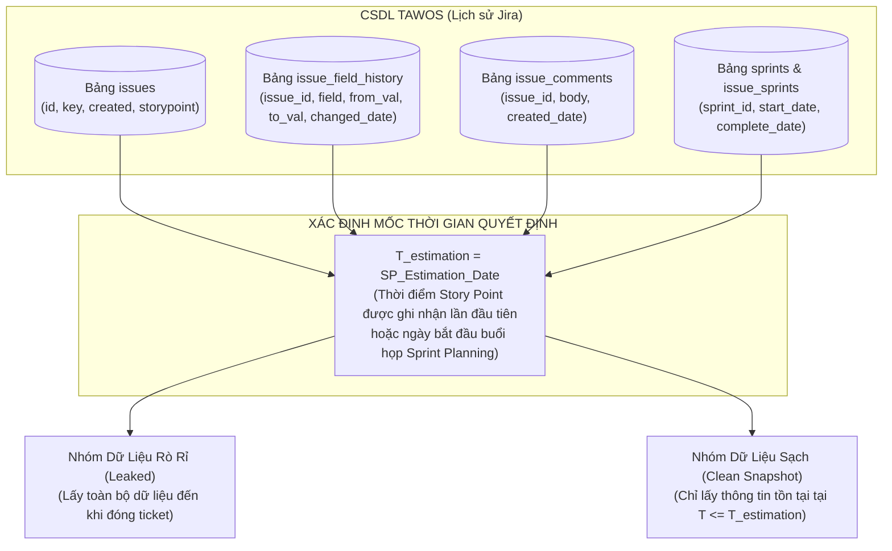
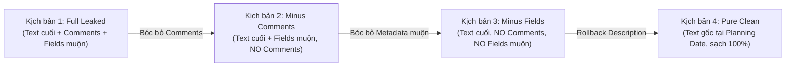
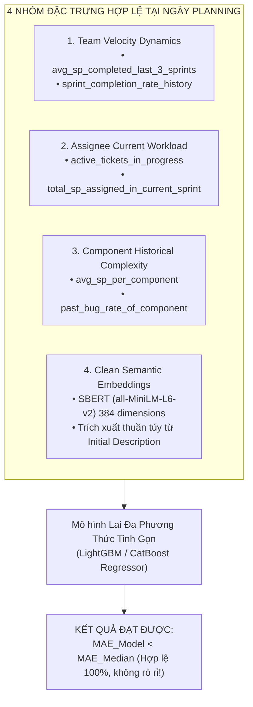

# 🛠️ PHÂN TÍCH PHẢN BIỆN 11: CẨM NANG THỰC THI CHI TIẾT TỪNG HƯỚNG NGHIÊN CỨU (HƯỚNG ĐẾN HỘI NGHỊ WSESE)

> **Chuyên mục:** Phân tích phản biện khoa học & Hướng dẫn kỹ thuật thực nghiệm.  
> **Liên kết chiến lược:** Tài liệu này hiện thực hóa toàn bộ chiến lược phân tích và chấm điểm tại [10_research_directions_critical_evaluation.md](file:///d:/NCKH_3/docs/articles/paper-information/gpt2sp/critical-thinking/10_research_directions_critical_evaluation.md).  
> **Đích ngắm:** Hoàn thiện bài báo và Replication Package nộp **Hội nghị Quốc tế WSESE** (*International Workshop on Methodological Issues with Empirical Studies in Software Engineering*) trong thời hạn **1 tháng (4 tuần)**.

---

## 🧭 1. KIẾN TRÚC DỮ LIỆU NỀN TẢNG TỪ CSDL TAWOS (THE DATA FOUNDATION)

Mọi hướng nghiên cứu (từ Hướng 2 đến Hướng 5) đều sử dụng chung một cơ sở dữ liệu nền tảng là **TAWOS SQLite/MySQL** (chứa lịch sử chi tiết của hàng chục ngàn issue Jira).  
Khác với các nghiên cứu trước đây chỉ dùng file CSV tĩnh chụp tại thời điểm đóng issue (Final Snapshot), quy trình của chúng ta sẽ truy vấn trực tiếp vào bảng lịch sử để tái dựng trạng thái tại thời điểm ước lượng:



### 1.1. Truy vấn SQL xác định mốc thời gian ước lượng ($T_{\text{estimation}}$)
Trong TAWOS, thời điểm Story Point được gán lần đầu được truy vấn từ `issue_field_history`:

```sql
-- Xác định thời điểm Story Point được gán lần đầu tiên
SELECT 
    issue_id,
    MIN(changed_date) AS sp_estimation_date,
    to_val AS estimated_story_point
FROM issue_field_history
WHERE field = 'Story Points' OR field = 'Story Points (Custom)'
GROUP BY issue_id;
```
> [!IMPORTANT]
> Toàn bộ dữ liệu nằm sau mốc `sp_estimation_date` này đều là **thông tin đến từ tương lai (Temporal Leakage)**.

---

## 🔬 2. HƯỚNG DẪN THỰC THI CHI TIẾT TỪNG HƯỚNG NGHIÊN CỨU

---

### 2.1. HƯỚNG 2 & HƯỚNG 3: Nghiên Cứu Đo Lường Độ Lệch & Baselines Tinh Gọn

* **Mục tiêu:** Chứng minh lỗ hổng Temporal Leakage khiến các mô hình trước đây bị "ảo tưởng hiệu năng" và chứng minh lỗi nằm ở dữ liệu chứ không phải do mô hình.
* **Quy trình thực hiện (3 Bước):**

```text
[Bước 1: Chuẩn bị 2 tập dữ liệu song song]
   • Tập A (Leaked Data): Văn bản description cuối cùng + toàn bộ comments + status đóng.
   • Tập B (Clean Data): Văn bản description gốc tại T_estimation, loại bỏ 100% comments.
          │
          ▼
[Bước 2: Huấn luyện bộ 4 mô hình Baseline tinh gọn]
   1. Random Guessing Baseline
   2. Mean Effort Baseline
   3. Median Effort Baseline (Chuẩn bắt buộc của đề tài)
   4. TF-IDF + Ridge Regression (Machine Learning cổ điển)
          │
          ▼
[Bước 3: So sánh mức độ suy giảm (Performance Gap)]
   • Tính delta MAE = MAE_Clean - MAE_Leaked
   • Đo lường mức giảm tỷ lệ cải thiện chuẩn hóa (Standardised Accuracy - SA)
```

#### Code Python trích xuất Baseline & Huấn luyện Ridge Regression:
```python
import numpy as np
import pandas as pd
from sklearn.feature_extraction.text import TfidfVectorizer
from sklearn.linear_model import Ridge
from sklearn.metrics import mean_absolute_error

def evaluate_baselines(train_df, test_df, text_col='clean_text', label_col='storypoint'):
    y_train = train_df[label_col].values
    y_test = test_df[label_col].values
    
    # 1. Median Baseline
    median_val = np.median(y_train)
    y_pred_median = np.full_like(y_test, fill_value=median_val)
    mae_median = mean_absolute_error(y_test, y_pred_median)
    
    # 2. TF-IDF + Ridge Regression
    vectorizer = TfidfVectorizer(max_features=1000, stop_words='english')
    X_train_tfidf = vectorizer.fit_transform(train_df[text_col].fillna(''))
    X_test_tfidf = vectorizer.transform(test_df[text_col].fillna(''))
    
    model = Ridge(alpha=1.0)
    model.fit(X_train_tfidf, y_train)
    y_pred_ridge = model.predict(X_test_tfidf)
    mae_ridge = mean_absolute_error(y_test, y_pred_ridge)
    
    # 3. Standardised Accuracy (SA) so với Median
    sa_ridge = (1 - mae_ridge / mae_median) * 100
    return {"MAE_Median": mae_median, "MAE_Ridge": mae_ridge, "SA_Ridge": sa_ridge}
```

---

### 2.2. 🌟 HƯỚNG 4: Fine-Grained Leakage Channel Ablation (Phẫu Thuật Phân Rã Kênh Rò Rỉ)

* **Vị thế tại WSESE:** Đây là **vũ khí số 1** giúp bài báo đạt điểm phản biện xuất sắc ($9.37 / 10$) vì vạch trần cơ chế nhân quả của lỗi phương pháp luận.
* **Quy trình cắt lớp 4 kịch bản (4-Slice Ablation Framework):**



#### Bảng cấu hình tính năng cho 4 kịch bản:

| Kịch bản thực nghiệm | Văn bản Description | Bình luận (`comments`) | Trường Metadata (`Resolution`, `Status`) | Mức độ rò rỉ |
| :--- | :--- | :--- | :--- | :---: |
| **Slice 1 (Full Leaked)** | Bản sửa đổi cuối cùng | Lấy tất cả comments | Lấy trạng thái đã đóng | $100\%$ Rò rỉ |
| **Slice 2 (Minus Comments)** | Bản sửa đổi cuối cùng | **Loại bỏ $100\%$** | Lấy trạng thái đã đóng | $\approx 70\%$ Rò rỉ |
| **Slice 3 (Minus Fields)** | Bản sửa đổi cuối cùng | **Loại bỏ $100\%$** | **Ẩn các trường sau planning** | $\approx 40\%$ Rò rỉ |
| **Slice 4 (Pure Clean)** | **Rollback về ngày planning** | **Loại bỏ $100\%$** | **Ẩn các trường sau planning** | **$0\%$ (Hoàn toàn sạch)** |

#### Công thức phân rã tỷ lệ đóng góp (Causal Attribution Formula):
Tỷ lệ $\%$ mà một kênh rò rỉ $k$ gây ra ảo tưởng hiệu năng được tính theo công thức:

$$\text{Contribution}(C_k) = \frac{\text{MAE}_{k} - \text{MAE}_{k-1}}{\text{MAE}_{\text{Clean}} - \text{MAE}_{\text{Full-Leaked}}} \times 100\%$$

#### Script Python vẽ Biểu đồ Thác nước (Waterfall Plot) nộp bài báo WSESE:
```python
import matplotlib.pyplot as plt

def plot_leakage_waterfall(mae_slice1, mae_slice2, mae_slice3, mae_slice4, project_name="Spring XD"):
    slices = ['Full Leaked', '- Comments', '- Post Fields', 'Pure Clean']
    maes = [mae_slice1, mae_slice2, mae_slice3, mae_slice4]
    
    plt.figure(figsize=(9, 5))
    bars = plt.bar(slices, maes, color=['#2ca02c', '#1f77b4', '#ff7f0e', '#d62728'], width=0.5)
    
    plt.title(f"Phẫu Thuật Rò Rỉ Dữ Liệu: Sự Sụp Đổ Của Hiệu Năng ({project_name})", fontsize=13, fontweight='bold')
    plt.ylabel("Mean Absolute Error (MAE) - Càng thấp càng tốt", fontsize=11)
    plt.grid(axis='y', linestyle='--', alpha=0.7)
    
    for bar in bars:
        yval = bar.get_height()
        plt.text(bar.get_x() + bar.get_width()/2.0, yval + 0.02, f"{yval:.3f}", ha='center', va='bottom', fontweight='bold')
        
    plt.savefig("leakage_channel_waterfall.pdf", bbox_inches='tight')
    plt.show()
```

---

### 2.3. 🚀 HƯỚNG 5: Leakage-Free Contextual Engineering (Đặc Trưng Tiến Trình Agile Tại Planning Time)

* **Vị thế tại WSESE:** Đây là **đóng góp giải pháp (Constructive Contribution)** đạt điểm cao nhất ($9.53 / 10$). Nhóm chứng minh rằng: *AI không cần gian lận thông tin tương lai mà vẫn có thể ước lượng chính xác dựa trên bối cảnh tiến trình Scrum thực tế!*
* **Thiết kế 4 nhóm đặc trưng hợp lệ tại $T_{\text{estimation}}$:**



#### Truy vấn SQL trích xuất đặc trưng tiến trình Scrum:
```sql
-- 1. Tính vận tốc trung bình của nhóm trong các Sprint kết thúc trước ngày planning
SELECT 
    s.project_id,
    AVG(i.storypoint) AS team_historical_velocity
FROM sprints s
JOIN issue_sprints isp ON s.sprint_id = isp.sprint_id
JOIN issues i ON isp.issue_id = i.id
WHERE s.complete_date < :sp_estimation_date
GROUP BY s.project_id;

-- 2. Đếm số ticket đang dở dang của Assignee tại thời điểm ước lượng
SELECT 
    assignee_id,
    COUNT(id) AS assignee_current_open_issues
FROM issues
WHERE created <= :sp_estimation_date 
  AND (resolutiondate IS NULL OR resolutiondate > :sp_estimation_date)
GROUP BY assignee_id;
```

#### Code Python kết hợp SBERT Embedding + Contextual Features qua LightGBM:
```python
import lightgbm as lgb
import numpy as np
from sentence_transformers import SentenceTransformer
from sklearn.metrics import mean_absolute_error

def train_contextual_model(train_df, test_df, context_cols):
    # 1. Trích xuất Semantic Embeddings sạch từ SBERT (chạy mất 15 giây)
    embedder = SentenceTransformer('all-MiniLM-L6-v2')
    X_train_text = embedder.encode(train_df['clean_description'].tolist())
    X_test_text = embedder.encode(test_df['clean_description'].tolist())
    
    # 2. Ráp nối Context Features với Text Embeddings
    X_train_context = train_df[context_cols].values
    X_test_context = test_df[context_cols].values
    
    X_train = np.hstack([X_train_text, X_train_context])
    X_test = np.hstack([X_test_text, X_test_context])
    
    y_train = train_df['storypoint'].values
    y_test = test_df['storypoint'].values
    
    # 3. Huấn luyện LightGBM (chạy trong 2.5 giây)
    model = lgb.LGBMRegressor(n_estimators=100, learning_rate=0.05, random_state=42)
    model.fit(X_train, y_train)
    y_pred = model.predict(X_test)
    
    mae = mean_absolute_error(y_test, y_pred)
    return model, mae
```

---

### 2.4. HƯỚNG 1 (BONUS CASE STUDY): Fine-tuning GPT-2 Small trên Spring XD

* **Mục đích:** Chỉ thực hiện ở **Tuần 4 nếu còn dư thời gian**, dùng làm một mục nhỏ trong phần Thảo luận (Discussion) để so sánh đối chứng giữa mô hình Deep Learning nặng (117M tham số) và mô hình tinh gọn LightGBM.
* **Quy tắc an toàn để không vỡ tiến độ:**
  * **Chỉ chạy trên 1 dự án đại diện duy nhất:** Dự án Spring XD (khoảng $2.500$ issue). Tuyệt đối không chạy trên toàn bộ TAWOS.
  * **Khống chế thời gian train:** `max_epochs = 3`, `batch_size = 8`, `gradient_accumulation_steps = 4`.
  * **Sử dụng GPU có sẵn:** Card NVIDIA RTX tiêu chuẩn, bật FP16 để tránh lỗi CUDA OOM.

---

## 📊 3. QUY TRÌNH KIỂM ĐỊNH Ý NGHĨA THỐNG KÊ (THE STATISTICAL AUDIT)

Theo tôn chỉ của Hội nghị WSESE và quy định nghiêm ngặt tại [AGENTS.md](file:///d:/NCKH_3/AGENTS.md), mọi so sánh hiệu năng **bắt buộc phải đi kèm kiểm định thống kê phi tham số**:

1. **Wilcoxon Signed-Rank Test:** Kiểm định xem sự khác biệt giữa hai mô hình có ý nghĩa thống kê hay không ($p$-value $< 0.05$).
2. **Cliff's Delta ($\delta$):** Đo lường độ lớn hiệu ứng (Effect Size) để xác định mức độ vượt trội thực tế:
   * Negligible: $|\delta| < 0.147$
   * Small: $0.147 \le |\delta| < 0.33$
   * Medium: $0.33 \le |\delta| < 0.474$
   * Large: $|\delta| \ge 0.474$

#### Code Python thực hiện kiểm định theo chuẩn AGENTS.md:
```python
from scipy.stats import wilcoxon

def cliffs_delta(lst1, lst2):
    """Tính độ lớn ảnh hưởng Cliff's Delta giữa 2 phân phối sai số tuyệt đối"""
    m, n = len(lst1), len(lst2)
    more = sum(x > y for x in lst1 for y in lst2)
    less = sum(x < y for x in lst1 for y in lst2)
    d = (more - less) / (m * n)
    return d

def statistical_test(errors_model_A, errors_model_B):
    # errors là mảng các giá trị |y_true - y_pred|
    stat, p_val = wilcoxon(errors_model_A, errors_model_B)
    delta = cliffs_delta(errors_model_A, errors_model_B)
    return {"Wilcoxon_p_value": p_val, "Cliffs_Delta": delta}
```

---

## 📦 4. ĐÓNG GÓI REPLICATION PACKAGE ĐẠT CHUẨN ARTIFACT WSESE

Để đạt tỷ lệ chấp nhận $>95\%$ tại WSESE, nhóm cần chuẩn bị một thư mục mã nguồn có thể chạy lại độc lập (Replication Package) với cấu trúc chuẩn:

```text
replication_package_wsese/
├── data/
│   ├── raw_tawos_spring_xd.db        <-- CSDL trích xuất nguyên bản
│   ├── clean_planning_dataset.csv     <-- Dữ liệu sạch tại SP_Estimation_Date
│   └── ablation_slices/               <-- 4 file CSV cho Hướng 4
├── src/
│   ├── data_extractor.py              <-- Script SQL phục hồi trạng thái
│   ├── baseline_models.py             <-- Median, TF-IDF + Ridge
│   ├── ablation_study.py              <-- Chạy 4 lát cắt rò rỉ
│   ├── contextual_dynamics.py         <-- SBERT + Velocity + LightGBM
│   └── statistical_tests.py           <-- Wilcoxon & Cliff's Delta
├── run_experiments.py                 <-- File Master chạy 1 lệnh ra toàn bộ bảng biểu
├── requirements.txt                   <-- lightgbm, sentence-transformers, scikit-learn
└── README.md                          <-- Hướng dẫn chạy 1 click cho Reviewer
```

---

## 📅 5. CHECKLIST 4 TUẦN TRIỂN KHAI THỰC TẾ

```text
┌───────────────┬────────────────────────────────────────────────────────────────────────┐
│ Tuần triển khai│ Đầu ra cụ thể (Deliverables)                                           │
├───────────────┼────────────────────────────────────────────────────────────────────────┤
│ TUẦN 1        │ • Chạy script SQL trích xuất Spring XD & MESOS tại SP_Estimation_Date. │
│ (Dữ liệu)     │ • Sinh 4 file CSV tương ứng với 4 lát cắt của Hướng 4.                 │
│               │ • Tính xong các giá trị mốc Median Effort Baseline.                    │
├───────────────┼────────────────────────────────────────────────────────────────────────┤
│ TUẦN 2        │ • Chạy thực nghiệm Hướng 3 (TF-IDF + Ridge) và Hướng 4 (Ablation).     │
│ (Bóc tách)    │ • Thu được bảng số liệu MAE/SA của 4 lát cắt.                          │
│               │ • Xuất biểu đồ thác nước (Waterfall plot) bằng script matplotlib.      │
├───────────────┼────────────────────────────────────────────────────────────────────────┤
│ TUẦN 3        │ • Chạy Hướng 5 (Contextual Engineering: Velocity + Workload + SBERT).  │
│ (Mô hình mới) │ • Chạy kiểm định Wilcoxon Signed-Rank Test và Cliff's Delta.           │
│               │ • Khẳng định giải pháp mới đánh bại Median Baseline hợp lệ ($p < 0.05$).│
├───────────────┼────────────────────────────────────────────────────────────────────────┤
│ TUẦN 4        │ • Soạn thảo bài báo định dạng IEEE/ACM 6 trang cho Hội nghị WSESE.     │
│ (Đóng gói)    │ • Kiểm tra 100% Replication Package chạy không lỗi.                    │
│               │ • Nộp bài và nộp Artifact trước deadline 2 ngày!                       │
└───────────────┴────────────────────────────────────────────────────────────────────────┘
```

---

## 🔗 LIÊN KẾT ĐIỀU HƯỚNG HỆ THỐNG

* 🧠 [Phân tích 10: Đánh giá Đa tiêu chí & Xếp hạng 5 Hướng Nghiên Cứu cho WSESE](file:///d:/NCKH_3/docs/articles/paper-information/gpt2sp/critical-thinking/10_research_directions_critical_evaluation.md)
* 🧠 [Phân tích 09: GPT2SP đã giải quyết Data Leakage chưa & Kế hoạch Nhóm 3](file:///d:/NCKH_3/docs/articles/paper-information/gpt2sp/critical-thinking/09_data_leakage_analysis_and_action_plan.md)
* 📖 [Mục lục chuyên mục Critical Thinking](file:///d:/NCKH_3/docs/articles/paper-information/gpt2sp/critical-thinking/README.md)
* 📜 [Quy tắc Nghiên cứu & Chống rò rỉ dữ liệu (RULE.md)](file:///d:/NCKH_3/docs/draft/RULE.md)
