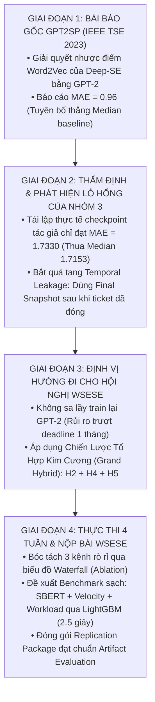
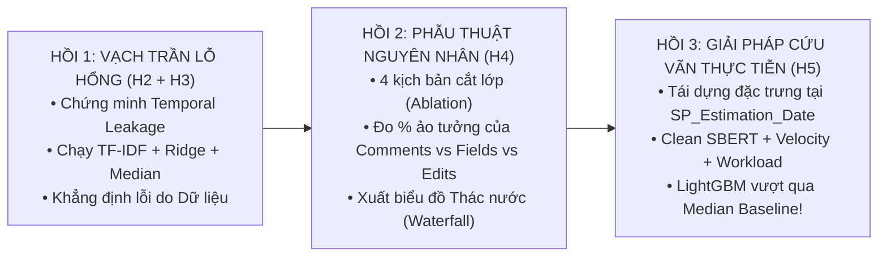

# 📋 BÁO CÁO TỔNG QUAN ĐIỀU HÀNH & KẾ HOẠCH HÀNH ĐỘNG ĐỀ TÀI NCKH
## TỪ GIẢI PHÃU BÀI BÁO GPT2SP ĐẾN CHIẾN LƯỢC CÔNG BỐ HỘI NGHỊ WSESE (DÀNH CHO ĐỒNG SỰ / PARTNER)

> **Tài liệu mục tiêu:** Báo cáo định hướng chiến lược và tổng hợp toàn diện dành cho Đồng sự (Partner) trong Nhóm 3.  
> **Đề tài NCKH:** *"Agile Story Point Estimation at Planning Time with Temporal & Data Leakage Control"*.  
> **Mục tiêu sống còn:** Giúp Partner nắm trọn vẹn **bản chất mô hình GPT2SP**, **lỗ hổng khoa học mà nhóm đã phát hiện**, và **kế hoạch thực nghiệm 4 tuần để nộp bài Hội nghị Quốc tế WSESE**.

---

## 🧭 LƯỢC ĐỒ ĐIỀU HÀNH (EXECUTIVE ROADMAP)

Để Partner có cái nhìn bao quát trước khi đi vào chi tiết, toàn bộ lộ trình nghiên cứu của nhóm được tóm tắt qua sơ đồ dòng chảy 4 giai đoạn:



---

## 📖 PHẦN 1: BÀI BÁO GPT2SP GIẢI QUYẾT BÀI TOÁN GÌ & KIẾN TRÚC RA SAO?

### 1. Vấn đề của các nghiên cứu trước (Deep-SE)
Trước GPT2SP, mô hình tiêu biểu nhất là **Deep-SE (2019)** sử dụng LSTM + Word2Vec. Tuy nhiên, Deep-SE dính 3 hạn chế lớn:
* **Từ điển đóng (Out-Of-Vocabulary - OOV):** Gặp từ mới trong phần mềm là "bó tay".
* **Không chuyển giao tri thức (Non-transferable):** Mô hình học ở dự án này không dùng được cho dự án khác (Cross-project cực kém).
* **Hiệu năng thực tế thấp:** Nhóm tác giả UCL (Tawosi et al.) đã chứng minh Deep-SE không vượt trội hơn Median Baseline.
👉 *Partner đọc chi tiết tại:* [01_introduction.md](01_introduction.md) và [02_background.md](02_background.md).

### 2. Ý tưởng cốt lõi của GPT2SP
Tác giả (Michael Fu & Chakkrit Tantithamthavorn - Monash University) đề xuất kế thừa **mô hình ngôn ngữ tiền huấn luyện GPT-2 Small (117M tham số)** để ước lượng Story Point cho Jira issue:
* **Tokenization:** Dùng Byte-Pair Encoding (BPE) với từ điển $50.257$ tokens giải quyết triệt để lỗi OOV.  
  👉 *Xem phân tích chuyên sâu:* [01_subword_vocabularies_50257.md](../critical-thinking/01_subword_vocabularies_50257.md).
* **Transformer Decoders:** Chuỗi token chạy qua 12 khối giải mã với cơ chế Multi-Head Masked Self-Attention ($768$ chiều ẩn, ma trận QKV $2304$, mở rộng FFN $3072$).  
  👉 *Xem phân tích phần cứng:* [02_why_hidden_dimension_768.md](../critical-thinking/02_why_hidden_dimension_768.md) và [03_why_qkv_2304_and_ffn_3072.md](../critical-thinking/03_why_qkv_2304_and_ffn_3072.md).
* **Head hồi quy (MLP Regressor):** Trích xuất vector của token cuối cùng (Last Token Pooling, kích thước $1 \times 768$) và chiếu qua mạng MLP để dự đoán ra một con số thực duy nhất đại diện cho Story Point.  
  👉 *Xem giải phẫu kiến trúc:* [03_the_gpt2sp_architecture.md](03_the_gpt2sp_architecture.md).

### 3. Nghiên cứu tình huống cụ thể trên Jira Issue XD-3751
Để hình dung dòng chảy tính toán thực tế (từ chữ cái thô $\rightarrow$ ma trận nơ-ron $\rightarrow$ con số Story Point), Partner hãy đọc chuỗi bài Case Study trên issue **Spring XD-3751**:
* 🔬 [Giải mã tổng thể Case Study XD-3751](../case-study/case_study_gpt2sp_architecture.md)
* 🔬 [Dòng chảy qua 12 khối Transformer Decoders](../case-study/01_case_study_12_transformer_decoders.md)
* 🔬 [Cơ chế trích xuất Last Token và dự đoán qua MLP Regressor](../case-study/02_case_study_mlp_regressor_head.md)
* 🔬 [Quy trình Training Phase (Lan truyền ngược & AdamW)](../case-study/04_case_study_training_phase.md)
* 🔬 [Quy trình Inference Phase khi người dùng nhập User Story mới](../case-study/05_case_study_inference_phase.md)

---

## 🔍 PHẦN 2: THẨM ĐỊNH THỰC TẾ & PHÁT HIỆN LỖ HỔNG KHOA HỌC CỦA NHÓM 3

Khi bắt tay vào nghiên cứu để tái lập (Replication), Nhóm 3 đã phát hiện **2 sự thật gây chấn động** mà bài báo IEEE TSE 2023 không công bố rõ:

```text
┌────────────────────────────────────────────────────────────────────────────────────────┐
│ SỰ THẬT 1: CẠM BẪY TÁI LẬP HIỆU NĂNG (THE REPRODUCTION GAP)                            │
├────────────────────────────────────────────────────────────────────────────────────────┤
│ • Bài báo công bố: MAE trung vị = 0.96 trên Spring XD (vượt trội Median Baseline 1.72) │
│ • Thực tế Nhóm 3 chạy lại Checkpoint tác giả công bố:                                 │
│   ==> MAE thực tế = 1.7330 (THUA CẢ MEDIAN BASELINE = 1.7153!)                        │
│ • Lý do: Bài báo nói dùng Title + Description, nhưng code công khai chỉ chạy riêng Title│
│   với max_length = 20 tokens!                                                          │
└────────────────────────────────────────────────────────────────────────────────────────┘
```

```text
┌────────────────────────────────────────────────────────────────────────────────────────┐
│ SỰ THẬT 2: RÒ RỈ DỮ LIỆU THỜI GIAN NGHIÊM TRỌNG (INTRA-ISSUE TEMPORAL LEAKAGE)         │
├────────────────────────────────────────────────────────────────────────────────────────┤
│ • Mặc dù tác giả chia train/test theo thời gian (Chronological Split), nhưng văn bản   │
│   lại được cào ở thời điểm FINAL SNAPSHOT (khi issue đã đóng xong xuôi)!               │
│ • Hậu quả: Dữ liệu huấn luyện chứa toàn bộ bình luận giải pháp kỹ thuật (Comments),     │
│   mô tả bị sửa để thêm stack trace / log lỗi, và các trường cập nhật muộn (Assignee,   │
│   Resolution).                                                                         │
│ • Mô hình đạt kết quả ảo tưởng vì "được học bài thi đã có sẵn lời giải của tương lai"! │
└────────────────────────────────────────────────────────────────────────────────────────┘
```

👉 *Partner đọc bản phân tích đối chứng đầy đủ tại:*  
🔗 [Phân tích 09: GPT2SP đã giải quyết Data Leakage chưa & Kế hoạch Nhóm 3](../critical-thinking/09_data_leakage_analysis_and_action_plan.md)

---

## 🎯 PHẦN 3: ĐỀ XUẤT CHIẾN LƯỢC HÀNH ĐỘNG NỘP HỘI NGHỊ QUỐC TẾ WSESE

### 1. Tại sao lại là Hội nghị WSESE?
* **WSESE** (*International Workshop on Methodological Issues with Empirical Studies in Software Engineering*): Là hội nghị chuyên sâu về **Lỗi phương pháp luận (Methodological Flaws)** và **Các mối đe dọa giá trị (Threats to Validity)** trong nghiên cứu thực nghiệm phần mềm bằng AI.
* Việc nhóm ta vạch trần lỗ hổng Temporal Leakage trong GPT2SP và đưa ra quy trình chuẩn mực không rò rỉ là **đề tài "trúng tủ" $100\%$ tôn chỉ của WSESE**.

### 2. Đặt 5 hướng nghiên cứu lên bàn cân (Thang điểm MCDA 9 tiêu chí)
Sau khi đánh giá đa tiêu chí (Khả thi trong 1 tháng, Độ khớp WSESE, Bằng chứng thép, Tính xây dựng, Độc lập GPU...):

| Hướng nghiên cứu | Điểm tổng kết | Đánh giá & Quyết định của nhóm |
| :--- | :---: | :--- |
| **H1: Full SOTA GPT-2 (117M params)** | $4.10 / 10$ | ❌ **LOẠI BỎ KHỎI TRỤC CHÍNH:** Huấn luyện quá nặng, nguy cơ CUDA OOM, nguy cơ trượt deadline 1 tháng. |
| **H2: Đo lường mức độ sai lệch** | $8.68 / 10$ | ✅ **DÙNG LÀM CÂU HỎI MỞ ĐẦU (Introduction):** Trả lời rò rỉ làm lệch kết quả bao nhiêu. |
| **H3: Mô hình tinh gọn (Baselines)** | $8.83 / 10$ | ✅ **DÙNG LÀM ĐỐI CHỨNG:** TF-IDF + Ridge + Median loại trừ 100% yếu tố gây nhiễu của LLM. |
| **H4: Phẫu thuật 3 kênh rò rỉ (Ablation)** | **$9.37 / 10$** | 🥈 **CON ÁT CHỦ BÀI SỐ 1:** Bóc tách định lượng Text edits, Fields muộn, và Comments qua biểu đồ Waterfall. |
| **H5: Đặc trưng tiến trình Agile sạch** | **$9.53 / 10$** | 🥇 **ĐÓNG GÓP XUẤT SẮC NHẤT:** Kết hợp Clean SBERT + Velocity + Workload qua LightGBM (chạy 2.5 giây) đánh bại Median Baseline hợp lệ! |

👉 *Partner xem toàn bộ ma trận chấm điểm và phân tích SWOT tại:*  
🔗 [Phân tích 10: Đánh giá Đa tiêu chí & Xếp hạng 5 Hướng Nghiên Cứu cho Hội nghị WSESE](../critical-thinking/10_research_directions_critical_evaluation.md)

---

## 🏆 PHẦN 4: CHIẾN LƯỢC TỔ HỢP KIM CƯƠNG (THE GRAND HYBRID BLUEPRINT)

Nhóm chúng ta sẽ trình bày bài báo nộp WSESE thành **một thiên phóng sự khoa học 3 hồi hoàn mỹ**:



### Điểm vượt trội giúp Partner yên tâm 100% về mặt kỹ thuật:
1. **Không phụ thuộc vào card GPU đắt tiền:** Toàn bộ pipeline chạy bằng **LightGBM / Ridge Regression / Sentence-Transformers (SBERT)**, chạy mượt mà trên laptop thông thường chỉ mất **vài phút**.
2. **Loại bỏ 100% rủi ro trễ hạn:** Không sợ tràn VRAM, không sợ lỗi hội tụ, kết quả thực nghiệm hoàn toàn tất định (Deterministic).
3. **Bài báo có tính xây dựng cao:** Không chỉ "chê bài báo cũ" mà còn mang lại **một Benchmark chuẩn tắc mới** cho các Agile Teams trong thực tế cuộc họp Sprint Planning.

👉 *Partner xem cẩm nang kỹ thuật, code Python mẫu và truy vấn SQL tại:*  
🔗 [Phân tích 11: Cẩm nang Thực thi Chi tiết Từng Hướng Nghiên cứu](../critical-thinking/11_implementation_guide_for_research_directions.md)

---

## 📅 PHẦN 5: KẾ HOẠCH PHÂN CHIA NHIỆM VỤ 4 TUẦN GIỮA 2 BẠN

Để đảm bảo nộp bài trước hạn 3 ngày, hai bạn có thể chia việc theo thế mạnh như sau:

```text
┌───────────────┬───────────────────────────────────┬───────────────────────────────────┐
│ Giai đoạn     │ Trách nhiệm Bạn (Bạn A)           │ Trách nhiệm Đồng sự (Partner - B) │
├───────────────┼───────────────────────────────────┼───────────────────────────────────┤
│ TUẦN 1        │ • Viết script SQL từ CSDL TAWOS   │ • Thiết lập môi trường Python     │
│ (Data & Base) │   để trích xuất ngày estimation.  │   (LightGBM, scikit-learn, SBERT).│
│               │ • Xuất 4 file CSV cho Hướng 4.    │ • Chạy Median Baseline làm chuẩn. │
├───────────────┼───────────────────────────────────┼───────────────────────────────────┤
│ TUẦN 2        │ • Chạy thực nghiệm bóc tách H4.   │ • Viết hàm tính MAE, SA và vẽ     │
│ (Ablation)    │ • Thu thập bảng số liệu 4 lát cắt.│   biểu đồ Thác nước (Waterfall).  │
│               │                                   │ • Bắt đầu nháp mục Đặt vấn đề.    │
├───────────────┼───────────────────────────────────┼───────────────────────────────────┤
│ TUẦN 3        │ • Xây dựng bộ đặc trưng Hướng 5   │ • Viết script kiểm định thống kê  │
│ (Contextual)  │   (Velocity, Workload, Component).│   (Wilcoxon Signed-Rank Test &    │
│               │ • Huấn luyện mô hình LightGBM.    │   Cliff's Delta theo chuẩn AGENTS)│
├───────────────┼───────────────────────────────────┼───────────────────────────────────┤
│ TUẦN 4        │ • Ráp nối bài báo (Template IEEE/ │ • Đóng gói Replication Package    │
│ (Đóng gói)    │   ACM 6 trang của WSESE).         │   (GitHub repo + 1-click script). │
│               │ • Rà soát ngôn từ học thuật TA.   │ • Kiểm tra nộp bài trước deadline!│
└───────────────┴───────────────────────────────────┴───────────────────────────────────┘
```

---

## 📑 BẢNG TRA CỨU TÀI LIỆU TOÀN HỆ THỐNG GPT2SP

Khi thảo luận kỹ thuật, Partner có thể click trực tiếp vào các liên kết bên dưới để xem tài liệu tương ứng:

| Phân hệ tri thức | Đường dẫn tập tin chi tiết | Giá trị tham khảo cho đề tài |
| :--- | :--- | :--- |
| **Phân tích từng chương** | [explanation/README.md](README.md) | Chi tiết 10 chương bài báo gốc GPT2SP. |
| **Kiến trúc mô hình** | [03_the_gpt2sp_architecture.md](03_the_gpt2sp_architecture.md) | Công thức ma trận $W_{qkv}$, GELU, Last Token Pooling. |
| **Case Study thực tế** | [case-study/case_study_gpt2sp_architecture.md](../case-study/case_study_gpt2sp_architecture.md) | Dòng chảy dữ liệu cụ thể trên Jira Issue XD-3751. |
| **Bản chất rò rỉ dữ liệu**| [critical-thinking/09_data_leakage_analysis_and_action_plan.md](../critical-thinking/09_data_leakage_analysis_and_action_plan.md) | Mổ xẻ vì sao Final Snapshot gây ra ảo tưởng hiệu năng. |
| **Đánh giá hướng nghiên cứu**|[critical-thinking/10_research_directions_critical_evaluation.md](../critical-thinking/10_research_directions_critical_evaluation.md) | Ma trận điểm số 9 tiêu chí và chiến lược chọn WSESE. |
| **Cẩm nang code thực thi**|[critical-thinking/11_implementation_guide_for_research_directions.md](../critical-thinking/11_implementation_guide_for_research_directions.md) | Mã nguồn Python, truy vấn SQL, Waterfall plot & LightGBM. |
| **Từ điển thuật ngữ** | [glossary/README.md](../glossary/README.md) | Tra cứu nhanh các khái niệm: BPE, Wilcoxon, Cliff's Delta... |
