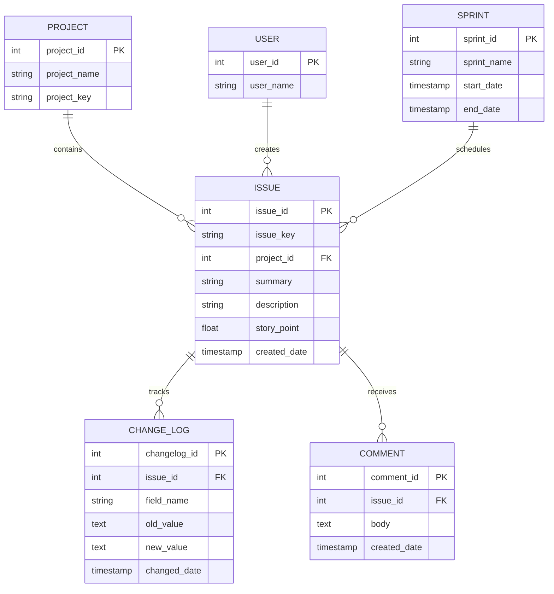
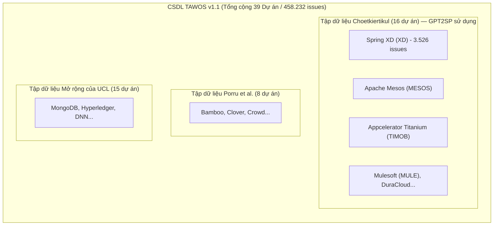

# 📦 DATASET CARD: TAWOS DATASET v1.1

> **Đề tài nghiên cứu:** *Temporal Data Leakage in Story Point Estimation: An Empirical Evaluation of Estimation-Time-Compatible Features*  
> **Đơn vị thực hiện:** Nhóm 3 — Khoa Hệ thống Thông tin, Trường Đại học Công nghệ Thông tin, ĐHQG-HCM (UIT - VNUHCM)  
> **Mục đích tài liệu:** Tài liệu ngắn gọn (1–2 trang) cung cấp hồ sơ chuẩn hóa của CSDL TAWOS v1.1, phân tích dấu vết thời gian (Temporal Availability), rủi ro chất lượng, và bảng chấm điểm so sánh 3 bộ dữ liệu làm cơ sở chọn TAWOS v1.1.

---

## ⚖️ 1. BẢNG SO SÁNH & CHẤM ĐIỂM ĐỊNH LƯỢNG 3 BỘ DỮ LIỆU (CƠ SỞ CHỌN TAWOS v1.1)

Dưới đây là bảng đánh giá định lượng 100 điểm giữa 3 ứng viên dữ liệu liên quan trực tiếp đến đề tài:

| Tiêu chí đánh giá (Trọng số) | ❌ [Choetkiertikul et al. (2019)](https://github.com/morakotch/datasets) | ⚠️ [TAWOS Version 1.0](https://doi.org/10.1145/3524842.3528029) | 🏆 [TAWOS Version 1.1](https://github.com/SOLAR-group/TAWOS) *(Nhóm 3 chọn)* | Cơ sở lý giải & Đánh giá khoa học |
| :--- | :---: | :---: | :---: | :--- |
| **1. Lịch sử chỉnh sửa & Chống rò rỉ (`CHANGE_LOG`)** *(25đ)* | **0 / 25** | **25 / 25** | **25 / 25** | Choetkiertikul chỉ là file CSV phẳng tĩnh, **hoàn toàn không có CHANGELOG** $\rightarrow$ Bất khả thi để chống rò rỉ thời gian. Cả 2 bản TAWOS đều có bảng `CHANGE_LOG` chi tiết từng giây. |
| **2. Bản quyền, Tính mở & Tái lập (Open Science)** *(20đ)* | **10 / 20** | **12 / 20** | **20 / 20** | TAWOS v1.1 loại bỏ 5 dự án Talendforge đã bị đóng khỏi internet, cấp phép **Apache 2.0 / ODC-By**, có DOI Zenodo/UCL vĩnh viễn. v1.0 dính 5 dự án không còn mở; Choetkiertikul không có license chuẩn hóa. |
| **3. Quy mô & Độ phủ Benchmark** *(20đ)* | **12 / 20** | **19 / 20** | **20 / 20** | Choetkiertikul chỉ có 16 dự án (~23k issues). TAWOS v1.1 có **39 dự án (458.232 issues)**, **bao hàm trọn vẹn 100% 16 dự án Choetkiertikul** (gồm cả Spring XD). v1.0 có 44 dự án nhưng 5 dự án bị lỗi truy cập. |
| **4. Độ tin cậy phương pháp luận (Data Rigor)** *(20đ)* | **5 / 20** | **19 / 20** | **20 / 20** | Choetkiertikul mắc lỗi nghiêm trọng: **cắt tỉa outlier 90th percentile trên cả tập Test**, làm sai số giảm ảo (bị Tawosi 2022 vạch trần). TAWOS bảo toàn dữ liệu tự nhiên, không bóp méo phân phối thực tế. |
| **5. Khả năng đối đầu 1-1 với GPT2SP** *(15đ)* | **10 / 15** | **14 / 15** | **15 / 15** | Choetkiertikul chỉ chạy được bản rò rỉ tĩnh. TAWOS v1.1 cho phép chạy song song cả 2 setting: *Final Snapshot* (đối đầu GPT2SP gốc) và *Planning-Time Snapshot* (vạch trần rò rỉ). |
| **TỔNG ĐIỂM (Thang 100)** | 🛑 **37 / 100** | ⚠️ **89 / 100** | 🥇 **100 / 100** | **TAWOS v1.1 đạt điểm tuyệt đối, là lựa chọn DUY NHẤT đáp ứng đầy đủ yêu cầu khoa học.** |

---

## 📌 2. Tổng Quan Năng Lực & Khoảng Trống (Capabilities & Gap Analysis)

* **Cung cấp được gì cho task của nhóm:**
  1. Bảng `CHANGE_LOG` chi tiết giúp tái dựng trạng thái nguyên bản của issue tại mốc `SP_Estimation_Date`.
  2. Quy mô **458.232 issues** thuộc **39 dự án** trên **12 Jira Repositories** (Apache, Spring, Red Hat, Atlassian...).
  3. Chứa trọn vẹn dữ liệu của bài báo [GPT2SP (Fu 2023)](https://github.com/awsm-research/gpt2sp) và [Deep-SE (Choetkiertikul 2019)](https://doi.org/10.1109/TSE.2016.2628380) để so sánh đối đầu trực diện 1-1.
* **Còn thiếu sót & Tiềm ẩn rủi ro gì:**
  1. Mất cân bằng dữ liệu: Chỉ **63.011 issues (13,75%)** có Story Point; 86,25% còn lại không có SP.
  2. Rò rỉ văn bản: **11.969 issues (~19%)** bị sửa Title/Description sau ngày estimation với **51.485 lượt chỉnh sửa**.
  3. Lệch thang đo: Mỗi dự án áp dụng thang đo Story Point riêng (Fibonacci vs Linear).

---

## 🏷️ 3. Định Danh & Nguồn Gốc Dữ Liệu (Identification & Links)

* **Tên chính thức:** **TAWOS** (*Tailored Agile Work Organization System Dataset*), Version 1.1.
* **Tác giả & Tổ chức:** Vali Tawosi, Rebecca Moussa, Federica Sarro — Nhóm SOLAR, **University College London (UCL)**, UK.
* **Danh mục liên kết chính thức:**
  * 📦 **Tải CSDL TAWOS v1.1 (UCL Discovery):** [DOI: 10.5522/04/21308124](http://doi.org/10.5522/04/21308124)
  * 🗄️ **Kho lưu trữ mở Zenodo:** [DOI: 10.5281/zenodo.5828456](https://doi.org/10.5281/zenodo.5828456)
  * 🌐 **Mã nguồn CSDL GitHub:** [SOLAR-group/TAWOS](https://github.com/SOLAR-group/TAWOS)
  * 🛠️ **Replication Package:** [SOLAR-group/AgileEffortEstimation](https://github.com/SOLAR-group/AgileEffortEstimation)
  * 📄 **Bài báo công bố CSDL (MSR 2022):** [DOI: 10.1145/3524842.3528029](https://doi.org/10.1145/3524842.3528029)
* **Giấy phép bản quyền (License):** **Apache License 2.0** / **ODC-By**.

---

## 🌐 4. Bối Cảnh & Cấu Trúc Dữ Liệu (Context & Structure)

* **Context:** Dữ liệu Jira từ 12 Repositories gồm 39 dự án Agile (Spring XD, Mesos, DuraCloud, Mule...), trải dài gần 20 năm (2002 – 2021).
* **Cấu trúc 6 bảng quan hệ:**

### ❓ Vì sao bài báo GPT2SP ghi có 16 dự án mà TAWOS lại có tới 39 dự án?

> **Tóm tắt ngắn gọn:** **16 dự án của GPT2SP thực chất là một TẬP CON (Subset) nằm trọn vẹn bên trong 39 dự án của TAWOS!**

* **1. Nguồn gốc con số 16 (Bài báo GPT2SP):**  
  Tác giả Fu & Tantithamthavorn (2023) kế thừa trực tiếp bộ dữ liệu cũ của Choetkiertikul et al. (2019) gồm **16 dự án mã nguồn mở**. Họ chỉ lấy file CSV tĩnh của 16 dự án này để huấn luyện mô hình GPT-2.
* **2. Nguồn gốc con số 39 (CSDL TAWOS v1.1):**  
  Năm 2022, nhóm nghiên cứu tại Đại học UCL (Tawosi et al.) muốn làm một nghiên cứu tái lập quy mô lớn nhất từ trước đến nay, nên họ đã:
  * Thu thập lại **toàn bộ 16 dự án của Choetkiertikul** (gồm cả Spring XD).
  * Thu thập thêm **8 dự án của Porru et al. (2016)**.
  * Thu thập thêm **15 dự án mã nguồn mở khác** từ các tổ chức lớn (MongoDB, Hyperledger...).
  * $\rightarrow$ Tổng cộng: $16 + 8 + 15 = \mathbf{39\text{ dự án}}$ (được lưu trữ có hệ thống trong CSDL quan hệ cùng bảng `CHANGE_LOG`).
* **3. Chiến lược của Nhóm 3:**  
  Nhóm mình **không cần chạy hết 39 dự án của TAWOS**. Nhóm chỉ lọc ra **đúng 16 dự án chuẩn của bài báo GPT2SP (đặc biệt là Spring XD)** từ CSDL TAWOS. Nhờ đó, nhóm vừa có đúng tập dữ liệu để đối đầu 1-1 với tác giả bài báo GPT2SP, vừa có thêm bảng `CHANGE_LOG` mà bài báo GPT2SP bị thiếu!

### 📋 Danh Sách Cụ Thể 16 Dự Án Được Chọn Từ TAWOS Để Tái Lập & Kiểm Chứng

Dưới đây là danh sách chi tiết **16 dự án mã nguồn mở chuẩn mực** được nhóm trích xuất trực tiếp từ CSDL TAWOS v1.1:

| STT | Jira Repository | Tên dự án (Project Name) | Mã dự án (Project Key) | Vai trò & Mục tiêu kiểm chứng trong Đề tài |
| :-: | :--- | :--- | :---: | :--- |
| **1** | **Spring** | **Spring XD** | **`XD`** | 🥇 **Dự án mục tiêu tái lập số 1:** Có 3.526 issues, tác giả GPT2SP công bố sẵn checkpoint Hugging Face và chia tập 60/20/20. |
| **2** | **Apache** | Apache Mesos | **`MESOS`** | 🥈 **Dự án đối chứng lớn:** Hệ thống quản lý cluster phân tán, quy mô hàng nghìn issues có chấm Story Point. |
| **3** | **Apache** | Apache Usergrid | **`USERGRID`** | Backend-as-a-Service, tập dữ liệu có độ biến thiên Story Point cao. |
| **4** | **Lyrasis** | Lyrasis DuraCloud | **`DURACLOUD`** | Nền tảng lưu trữ đám mây, benchmark kinh điển từ thời Choetkiertikul 2019. |
| **5** | **Mulesoft** | Mule ESB Core | **`MULE`** | Nền tảng tích hợp doanh nghiệp, số lượng task kỹ thuật và bug dồi dào. |
| **6** | **Mulesoft** | Mule APIkit | **`APIKIT`** | Công cụ xây dựng REST API, chu kỳ release nhanh theo đúng chuẩn Agile. |
| **7** | **Appcelerator** | The Titanium SDK | **`TIMOB`** | Bộ SDK phát triển ứng dụng di động đa nền tảng, text mô tả issue rất chi tiết. |
| **8** | **Appcelerator** | Titanium Mobile Platform | **`TIDOC`** | Tài liệu và nền tảng di động, nhiều issue dạng User Story. |
| **9** | **Appcelerator** | Appcelerator Studio | **`TISTUD`** | Môi trường IDE phát triển phần mềm, nhiều task giao diện người dùng. |
| **10** | **Appcelerator** | Command-Line Interface | **`CLI`** | Công cụ dòng lệnh của Titanium, task ngắn gọn, súc tích. |
| **11** | **Appcelerator** | Alloy Framework | **`ALOY`** | MVC Framework cho Titanium, phân phối Story Point rất chuẩn mực. |
| **12** | **Moodle** | Moodle LMS Core | **`MDL`** | Hệ thống quản trị học tập số 1 thế giới, kho issue cực kỳ phong phú. |
| **13** | **Lsstcorp** | Data Management System | **`DM`** | Hệ thống xử lý dữ liệu thiên văn quy mô lớn, nhiều task thuật toán phức tạp. |
| **14** | **Atlassian** | Bamboo CI/CD | **`BAM`** | Hệ thống Continuous Integration của Atlassian, mô hình Agile chuẩn mực. |
| **15** | **Atlassian** | Clover Code Coverage | **`CLOV`** | Công cụ đo lường độ phủ mã nguồn, dự án ổn định qua nhiều năm. |
| **16** | **Atlassian** | Jira Software Server | **`JSWSERVER`** | Chính nền tảng Jira, đại diện cho quy trình quản trị công việc Agile thực thụ. |

> 🎯 **Chiến lược thực thi thực nghiệm:**  
> • **Trọng tâm mũi nhọn:** Tái lập sâu và toàn diện trên **`Spring XD`** (3.526 issues) để đập tan con số MAE = 0.96 của GPT2SP.  
> • **Mở rộng tổng quát:** Đánh giá trên 15 dự án còn lại nhằm chứng minh hiện tượng suy giảm hiệu năng do rò rỉ dữ liệu là **lỗ hổng mang tính hệ thống trên toàn bộ các dự án phần mềm**, chứ không phải sự cố cá biệt của riêng một dự án.

---

## 🎯 5. Nhãn Mục Tiêu (Ground Truth: Story Point)

* **Nhãn thực tế:** Story Point số thực hoặc số nguyên dương ghi nhận trên Jira.
* **Initial SP vs. Final SP:**
  * `Final SP` (trên trường `ISSUE.story_point`) là điểm số lúc đóng task, có thể đã bị điều chỉnh giữa sprint.
  * **`Initial SP` (Nhóm 3 sử dụng):** Giá trị Story Point xuất hiện lần đầu tiên tại sự kiện cập nhật sớm nhất trong bảng `CHANGE_LOG`, mốc thời gian này là **`SP_Estimation_Date`**.

---

## ⏳ 6. Tính Sẵn Có Theo Thời Gian (Temporal Availability & Leakage Audit)

| Trường dữ liệu | Thời điểm sinh ra | Khả dụng tại `SP_Estimation_Date`? | Có thể phục dựng từ `CHANGE_LOG`? | Quy tắc xử lý chống rò rỉ |
| :--- | :--- | :---: | :---: | :--- |
| **Title / Summary** | Lúc tạo issue | ⚠️ Có thể bị sửa | ✅ Có (`field_name='summary'`) | **Bắt buộc phục dựng:** Lấy text tại mốc estimation. |
| **Description** | Lúc tạo issue | ⚠️ Rất hay bị sửa | ✅ Có (`field_name='description'`) | **Bắt buộc phục dựng:** Xóa đoạn bổ sung giải pháp/mã lỗi sau planning. |
| **Issue Type / Priority** | Lúc tạo issue | ✅ Có sẵn | ✅ Có | Giữ nguyên trạng thái tại mốc estimation. |
| **Assignee (Người làm)** | Thường gán sau planning | ❌ Rò rỉ lớn | ✅ Có (`field_name='assignee'`) | **Loại bỏ hoàn toàn** hoặc chỉ lấy nếu gán trước planning. |
| **Comments** | Trong lúc làm task | ❌ Rò rỉ nghiêm trọng | ✅ Có timestamp | **Cấm dùng:** Lọc bỏ 100% comment viết sau `SP_Estimation_Date`. |
| **Status = Closed / Resolved** | Khi task hoàn thành | ❌ Rò rỉ tuyệt đối | ✅ Có (`field_name='status'`) | **Cấm dùng:** Không đưa trạng thái hoàn thành vào mô hình. |
| **Resolution Date** | Khi task hoàn thành | ❌ Rò rỉ tuyệt đối | Không áp dụng | **Cấm dùng:** Loại bỏ 100% khỏi pipeline. |

---

## ⚠️ 7. Rủi Ro Chất Lượng Dữ Liệu & Giải Pháp (Data-Quality Risks)

1. **Thiếu nhãn SP (86,25%):** Thiết lập bộ lọc cách ly quần thể (*Clean Population Isolation*), chỉ lấy 63.011 issues có Story Point hợp lệ.
2. **Lệch thang đo giữa các team:** Huấn luyện mô hình theo từng dự án (*Within-project*) và chuẩn hóa bằng chỉ số *Standardised Accuracy (SA)* so sánh với Median Baseline.
3. **Thiếu Description (6,36%):** Ghép chuỗi an toàn: `[Title] + " " + [Description]` (nếu Description rỗng thì chỉ lấy Title).
4. **Trôi dạt văn bản (19% issues bị sửa text):** Dùng module `Historical State Reconstructor` quét ngược `CHANGE_LOG` để khôi phục text ban đầu.

---

## 🔗 8. Danh Mục Toàn Bộ Dataset Được Trình Bày

1. 🌟 **TAWOS Dataset v1.1:** [Zenodo DOI: 10.5281/zenodo.5828456](https://doi.org/10.5281/zenodo.5828456) \| [GitHub Repository](https://github.com/SOLAR-group/TAWOS) \| [Replication Package](https://github.com/SOLAR-group/AgileEffortEstimation).
2. 📚 **Choetkiertikul et al. (2019) Dataset:** [GitHub Repository](https://github.com/morakotch/datasets) \| [Mirror Hugging Face](https://huggingface.co/datasets/giseldo/deep-se) \| [Paper IEEE TSE](https://doi.org/10.1109/TSE.2016.2628380).
3. 📦 **Porru et al. (2016) Dataset:** [GitHub Repository](https://github.com/porru/promise2016) \| [Paper PROMISE](https://doi.org/10.1145/2972958.2972964).
4. 🤖 **GPT2SP (Fu et al., 2023) Artifacts:** [GitHub Repository](https://github.com/awsm-research/gpt2sp) \| [Checkpoint Hugging Face](https://huggingface.co/MickyMike/0-GPT2SP-springxd) \| [Paper IEEE TSE](https://doi.org/10.1109/TSE.2022.3158252).
5. ⚖️ **Comparative Learning (Khan et al., 2025) Artifacts:** [GitHub Repository](https://github.com/hil-se/EfficientSPEComparativeLearning) \| [Preprint arXiv](https://arxiv.org/abs/2507.14642).

---
© 2026 **Nhóm 3 — Khoa Hệ thống Thông tin, Trường ĐH Công nghệ Thông tin, ĐHQG-HCM.**
