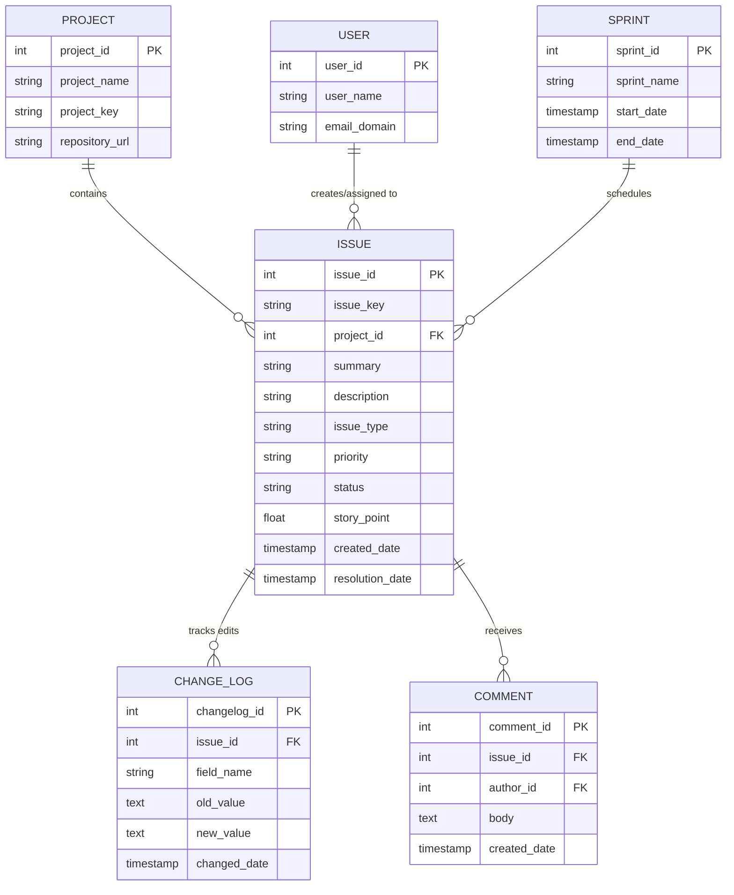

# 📦 DATASET CARD: TAWOS DATASET v1.1

> **Đề tài nghiên cứu:** *Temporal Data Leakage in Story Point Estimation: An Empirical Evaluation of Estimation-Time-Compatible Features*  
> **Đơn vị thực hiện:** Nhóm 3 — Khoa Hệ thống Thông tin, Trường Đại học Công nghệ Thông tin, ĐHQG-HCM (UIT - VNUHCM)  
> **Mục đích tài liệu:** Mô tả toàn diện nguồn gốc, cấu trúc quan hệ, nhãn mục tiêu, dấu vết thời gian (Temporal Availability), các rủi ro chất lượng dữ liệu, và luận chứng lý do lựa chọn bộ dữ liệu TAWOS thay vì tập dữ liệu Choetkiertikul cho bài toán kiểm soát rò rỉ dữ liệu thời gian.

---

## 📌 1. Tổng Quan & Đánh Giá Năng Lực (Capabilities & Gap Analysis)

### 🟢 1.1. Dataset này cung cấp được những gì cho task của nhóm?
1. **Dấu vết thời gian chi tiết (Full Historical Audit Trail):** Cung cấp bảng `CHANGE_LOG` ghi lại toàn bộ lịch sử chỉnh sửa từng trường (Field Name, Old Value, New Value, Changed Date) của từng issue. Đây là **điều kiện tiên quyết duy nhất** giúp nhóm hiện thực hóa thuật toán *Historical State Reconstruction* để đưa nội dung issue về đúng mốc `SP_Estimation_Date`.
2. **Quy mô lớn & Tính đại diện cao:** Bao phủ **458.232 issues** thuộc **39 dự án** phần mềm mã nguồn mở trên **12 Jira Repositories** khác nhau (Apache, Spring, Red Hat, Atlassian...).
3. **Bao hàm trọn vẹn các benchmark kinh điển:** TAWOS chứa toàn bộ 16 dự án từ bộ dữ liệu của Choetkiertikul et al. (2019) và 8 dự án của Porru et al. (2016), giúp nhóm dễ dàng tái lập mô hình **GPT2SP (Fu 2023)** và **Deep-SE (Choetkiertikul 2019)** trên cùng một cơ sở dữ liệu.
4. **Cấu trúc quan hệ chuẩn mực (Relational Schema):** Dữ liệu được chuẩn hóa thành các bảng quan hệ rõ ràng: `ISSUE`, `PROJECT`, `USER`, `CHANGE_LOG`, `SPRINT`, `COMMENT`.

### 🔴 1.2. Dataset còn thiếu sót và tiềm ẩn rủi ro gì?
1. **Mất cân bằng dữ liệu nghiêm trọng (Severe Imbalance & Missing SP):** Chỉ có **63.011 / 458.232 issues (13,75%)** được chấm Story Point. 86,25% còn lại là các tác vụ bảo trì, quản lý thường nhật không dùng Story Point.
2. **Hiện tượng sửa đổi văn bản sau Planning (Text Drift / Leakage):** Có tới **11.969 issues (~19% số issue có SP)** bị sửa đổi Title hoặc Description sau thời điểm ước lượng, với **51.485 lượt chỉnh sửa** sinh ra sau mốc estimation.
3. **Độ lệch thang đo giữa các nhóm (Heterogeneous Estimation Scales):** Mỗi dự án và mỗi đội ngũ áp dụng thang đo Story Point khác nhau (thang Fibonacci: 1, 2, 3, 5, 8, 13; thang tuyến tính: 1, 2, 3, 4, 5; thang lũy thừa 2...), gây khó khăn nếu huấn luyện mô hình đa dự án (Cross-project).
4. **Thiếu vắng dữ liệu âm thanh/họp thảo luận:** Dataset chỉ ghi nhận trạng thái dạng văn bản trên Jira, không có biên bản cuộc họp thảo luận Planning Poker thực tế.

---

## 🏷️ 2. Định Danh & Nguồn Gốc (Dataset Identification)

* **Tên chính thức:** **TAWOS** (*Tailored Agile Work Organization System Dataset*).
* **Phiên bản:** **Version 1.1** (Phát hành chính thức: Tháng 01/2022).
* **Nhóm tác giả & Tổ chức:** Vali Tawosi, Rebecca Moussa, Federica Sarro — Nhóm nghiên cứu **SOLAR** (*Software Systems Engineering Group*), Khoa Khoa học Máy tính, **University College London (UCL)**, Vương quốc Anh.
* **Nguồn công bố chính thức:**
  * **Tạp chí công bố:** *IEEE Transactions on Software Engineering (TSE)*, Vol. 49, No. 4, 2022.
  * **Kho lưu trữ mở (Zenodo):** [https://doi.org/10.5281/zenodo.5828456](https://doi.org/10.5281/zenodo.5828456)
  * **Mã nguồn GitHub:** [https://github.com/SOLAR-group/TAWOS](https://github.com/SOLAR-group/TAWOS)
  * **Replication Package:** [https://github.com/SOLAR-group/AgileEffortEstimation](https://github.com/SOLAR-group/AgileEffortEstimation)
* **Giấy phép bản quyền (License):** **MIT License** / **Open Data Commons Attribution License (ODC-By)**, cho phép khai thác, trích xuất và nghiên cứu học thuật phi thương mại.

---

## 🌐 3. Bối Cảnh Dữ Liệu (Operational Context)

* **Hệ thống theo dõi lỗi (Issue Tracking System):** Nền tảng **Jira Issue Tracker** của các tổ chức phát triển phần mềm Agile.
* **Kho lưu trữ Jira (12 Repositories):** Apache Software Foundation, Spring Framework, Red Hat JBoss, Atlassian Ecosystem, DuraSpace, Appcelerator, Moodle, SonarSource, v.v.
* **Số lượng dự án (Projects):** **39 dự án** mã nguồn mở với thời gian hoạt động kéo dài nhiều năm (Spring XD, Apache Mesos, DuraCloud, Mule, Titanium...).
* **Phân loại tác vụ (Issue Types):** User Story, Bug, New Feature, Improvement, Task, Sub-task.
* **Khoảng thời gian ghi nhận (Time Span):** Dữ liệu lịch sử trải dài từ **năm 2002 đến cuối năm 2021** (~20 năm lịch sử commit và thay đổi Jira).

---

## 🗄️ 4. Cấu Trúc Quan Hệ & Sơ Đồ Cơ Sở Dữ Liệu (Schema & Structure)

Bộ dữ liệu TAWOS được thiết kế dưới dạng CSDL quan hệ chuẩn (Relational Schema SQLite/MySQL) gồm 6 bảng trung tâm:

* **`ISSUE`:** Lưu thông tin thực thể task tại thời điểm crawl (Final Snapshot).
* **`CHANGE_LOG`:** Lưu toàn bộ vết thay đổi trường dữ liệu (`summary`, `description`, `story_point`, `status`, `assignee`...).
* **`PROJECT` & `USER`:** Quản lý bối cảnh dự án và tác nhân thao tác.
* **`SPRINT`:** Lưu chu kỳ Sprint Planning và thời hạn thực thi.
* **`COMMENT`:** Toàn bộ thảo luận phát sinh trong quá trình sửa lỗi / triển khai.

---

## 🎯 5. Nhãn Mục Tiêu (Ground Truth: Story Point)

* **Bản chất nhãn:** Giá trị Story Point (SP) số thực hoặc số nguyên dương (vd: 1, 2, 3, 5, 8, 13...).
* **Vấn đề Initial SP vs. Current/Final SP:**
  * Trong CSDL Jira tĩnh, trường `ISSUE.story_point` thể hiện **Current/Final Story Point** (trạng thái lúc issue đóng).
  * Trong thực tế Agile, Story Point đôi khi bị lập trình viên hoặc Scrum Master sửa đổi giữa Sprint khi phát hiện task phức tạp hơn dự kiến.
* **Giải pháp của Nhóm 3:**
  * Khôi phục **`Initial Story Point`**: Lấy giá trị Story Point xuất hiện lần đầu tiên tại sự kiện cập nhật Story Point sớm nhất trong bảng `CHANGE_LOG`.
  * Mốc thời gian này được đánh dấu là **`SP_Estimation_Date`** (Mốc thời gian quy chiếu chuẩn cho toàn bộ quy trình).

---

## ⏳ 6. Tính Sẵn Có Theo Thời Gian (Temporal Availability & Leakage Control)

| Trường dữ liệu (Field Name) | Thời điểm sinh ra (Emission Time) | Khả dụng tại `SP_Estimation_Date`? | Có thể phục dựng từ `CHANGE_LOG`? | Xử lý trong Pipeline chống rò rỉ |
| :--- | :--- | :---: | :---: | :--- |
| **Title / Summary** | Lúc tạo issue (`created_date`) | ⚠️ Có thể bị sửa | ✅ Có (`field_name='summary'`) | **Bắt buộc phục dựng:** Lấy giá trị text trước hoặc đúng ngày estimation. |
| **Description** | Lúc tạo issue (`created_date`) | ⚠️ Rất hay bị sửa | ✅ Có (`field_name='description'`) | **Bắt buộc phục dựng:** Xóa toàn bộ đoạn bổ sung mã lỗi, giải pháp sau planning. |
| **Issue Type / Priority** | Lúc tạo issue | ✅ Có sẵn | ✅ Có | Giữ nguyên trạng thái tại mốc estimation. |
| **Components / Labels** | Lúc tạo issue | ⚠️ Có thể thêm mới | ✅ Có | Lọc bỏ các component/label gán sau planning. |
| **Assignee (Người làm)** | Thường gán sau khi planning | ❌ Rò rỉ lớn | ✅ Có (`field_name='assignee'`) | **Loại bỏ hoàn toàn** hoặc chỉ lấy nếu được gán trước mốc planning. |
| **Comments** | Trong suốt quá trình làm | ❌ Rò rỉ nghiêm trọng | ✅ Có timestamp comment | **Cấm dùng:** Lọc bỏ 100% comment viết sau mốc `SP_Estimation_Date`. |
| **Status = Closed / Resolved** | Khi task hoàn thành | ❌ Rò rỉ tuyệt đối | ✅ Có (`field_name='status'`) | **Cấm dùng:** Không đưa trạng thái đóng vào vector đặc trưng. |
| **Resolution Date** | Khi task hoàn thành | ❌ Rò rỉ tuyệt đối | Không áp dụng | **Cấm dùng:** Không được đưa vào pipeline huấn luyện. |

---

## ⚠️ 7. Các Rủi Ro Chất Lượng Dữ Liệu (Data-Quality Risks Audit)

1. **Thiếu nhãn Story Point (Missing SP Rate):**
   * **Thực trạng:** 395.221 / 458.232 issues (`86,25%`) không có Story Point.
   * **Giải pháp:** Thiết lập bộ lọc cách ly quần thể (*Clean Population Isolation*), chỉ trích xuất các issue có Story Point hợp lệ.
2. **Khác biệt thang đo dự án (Project-specific Scales):**
   * **Thực trạng:** Dự án Apache Mesos dùng thang Fibonacci, trong khi dự án Spring XD dùng phân phối điểm tập trung ở mức 1, 2, 3 điểm.
   * **Giải pháp:** Huấn luyện mô hình theo từng dự án (Within-project) và chuẩn hóa độ đo qua chỉ số *Standardised Accuracy (SA)* so sánh với Median Baseline của chính dự án đó.
3. **Độ khuyết văn bản (Missing Text):**
   * **Thực trạng:** 29.128 issues (`6,36%`) bị thiếu trường Description.
   * **Giải pháp:** Kết hợp chuỗi văn bản theo công thức `[Title] + " " + [Description]` (nếu Description rỗng thì chỉ lấy Title).
4. **Trôi dạt văn bản (Changed Text / Temporal Leakage):**
   * **Thực trạng:** 11.969 issues bị đổi nội dung sau estimation; trung vị độ trễ sửa text là **2,30 ngày (55,30 giờ)**.
   * **Giải pháp:** Sử dụng module `Historical State Reconstructor` quét ngược `CHANGE_LOG` để hoàn trả văn bản về trạng thái nguyên bản.

---

## ⚖️ 8. Luận Chứng: Vì Sao Chọn TAWOS Thay Vì Bộ Dữ Liệu Choetkiertikul?

Đây là câu hỏi phương pháp luận cốt lõi mà mọi phản biện (Reviewer) của **EASE / ICSE** đều sẽ đặt ra: *"Tại sao không dùng trực tiếp bộ dữ liệu 16 dự án nổi tiếng của Choetkiertikul et al. (2019) đã được GPT2SP sử dụng?"*. 

Dưới đây là bảng đối chiếu trực diện chứng minh việc lựa chọn TAWOS là **bắt buộc và duy nhất đúng**:

| Tiêu chí so sánh | ❌ Bộ dữ liệu Choetkiertikul et al. (2019) | ✅ Bộ dữ liệu TAWOS v1.1 (Nhóm 3 lựa chọn) |
| :--- | :--- | :--- |
| **Bản chất định dạng** | Các file **CSV phẳng, tĩnh (Flat static CSVs)**. | **CSDL quan hệ hoàn chỉnh (Relational Database)** với đầy đủ khóa ngoại. |
| **Quy mô dữ liệu** | 16 dự án (~23.313 issues có SP). | **39 dự án** (458.232 issues, bao hàm toàn bộ 16 dự án Choetkiertikul). |
| **Bảng lịch sử chỉnh sửa (`CHANGE_LOG`)** | ❌ **HOÀN TOÀN KHÔNG CÓ.** Chỉ ghi nhận 1 dòng text cuối cùng tại thời điểm cào dữ liệu. | ✅ **CÓ ĐẦY ĐỦ VỚI HÀNG TRIỆU DÒNG CHANGELOG.** Ghi nhận từng giây thay đổi của từng trường. |
| **Khả năng kiểm soát Temporal Leakage** | ❌ **BẤT KHẢ THI.** Không thể biết câu nào được viết trước, câu nào được viết sau buổi họp planning. | ✅ **HOÀN HẢO.** Cho phép tái dựng chính xác trạng thái văn bản tại ngày `SP_Estimation_Date`. |
| **Lỗi phương pháp luận nghiêm trọng** | ⚠️ **Mắc bẫy Outlier Capping:** Tác giả Choetkiertikul đã cắt tỉa các điểm ngoại lai (90th percentile) **trên cả tập Test**, làm sai số MAE/MdAE giảm ảo nhân tạo (đã bị Tawosi 2022 vạch trần). | ✅ **Bảo toàn dữ liệu tự nhiên:** Giữ nguyên phân phối thực tế của Agile, không can thiệp bóp méo tập kiểm thử. |
| **Tính tương thích mô hình GPT2SP** | Chạy được mô hình tĩnh. | **Khớp 100%:** Chứa chính xác các dự án Choetkiertikul (Spring XD, Mule...) mà GPT2SP đã thử nghiệm. |

### 🎯 Kết luận luận chứng:
> **Bộ dữ liệu Choetkiertikul (2019) chỉ là một "bức ảnh chụp tĩnh" (Final Snapshot) bị rò rỉ dữ liệu và mắc lỗi phương pháp luận.**  
> Ngược lại, **TAWOS v1.1 là "cuốn băng ghi hình toàn bộ lịch sử"**. Nhóm 3 chọn TAWOS vì đây là bộ dữ liệu **DUY NHẤT** trong ngành Kỹ nghệ Phần mềm hiện nay có lưu bảng `CHANGE_LOG`, cho phép nhóm thực hiện thành công bài toán *Temporal Data Leakage Control*.

---
© 2026 **Nhóm 3 — Khoa Hệ thống Thông tin, Trường ĐH Công nghệ Thông tin, ĐHQG-HCM.**
