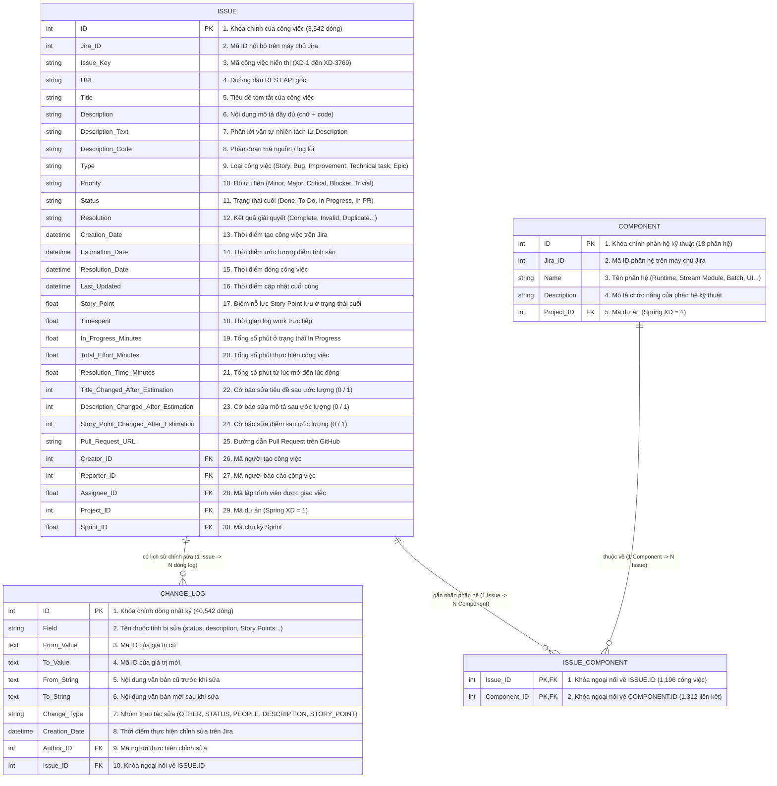

# 📋 PHẦN 2. SƠ ĐỒ QUAN HỆ THỰC THỂ (ERD) & BẢNG MÔ TẢ ĐẦY ĐỦ CÁC THUỘC TÍNH DỮ LIỆU GỐC (`N = 3,542` CÔNG VIỆC CÓ STORY POINT)

> **Lưu ý phạm vi:** Tài liệu này trình bày sơ đồ quan hệ thực thể (ERD) và bảng thống kê **100% dữ liệu nguyên bản (Raw Data)** của dự án **Spring XD** trên tập **`N = 3,542` công việc có nhãn `Story_Point > 0`** trong CSDL `C:/tawos/tawos_eda.db`. Ở mỗi thuộc tính đều liệt kê trực tiếp các loại giá trị (hoặc miền giá trị) kèm số lượng dòng tương ứng.

---

## 🗺️ 1. Sơ Đồ Quan Hệ Thực Thể (ERD) Của 4 Bảng Dữ Liệu Gốc (`Spring XD`)

Sơ đồ dưới đây biểu diễn toàn bộ các cột thuộc tính và mối liên kết giữa **4 bảng dữ liệu gốc** (`ISSUE`, `CHANGE_LOG`, `ISSUE_COMPONENT`, `COMPONENT`):

---

## 📑 2. Bảng Mô Tả Đầy Đủ Các Thuộc Tính & Các Loại Giá Trị Của 4 Bảng Gốc

### 2.1. Bảng 1 — Danh sách 30 thuộc tính của bảng `Issue` (`3,542` dòng công việc có Story Point)

| STT | Tên thuộc tính | Kiểu dữ liệu | Số dòng có dữ liệu | Số dòng trống (`NULL`) | Số giá trị khác nhau (`Unique`) | Giải thích ý nghĩa & Các loại giá trị (kèm số lượng dòng trên `N = 3,542`) |
| :-: | :--- | :---: | :---: | :---: | :---: | :--- |
| **1** | `ID` | `int64` | `3,542` | `0` | `3,542` | Khóa chính định danh công việc trong TAWOS. Miền giá trị: từ `65` đến `3773`. |
| **2** | `Jira_ID` | `int64` | `3,542` | `0` | `3,542` | Mã ID nội bộ của ticket trên máy chủ Jira. Miền giá trị: từ `14772` đến `87615`. |
| **3** | `Issue_Key` | `str` | `3,542` | `0` | `3,542` | Mã công việc hiển thị trên Jira. Các giá trị: từ `XD-1` đến `XD-3769`. |
| **4** | `URL` | `str` | `3,542` | `0` | `3,542` | Đường dẫn REST API gốc (`https://jira.spring.io/rest/api/2/issue/...`). |
| **5** | `Title` | `str` | `3,542` | `0` | `3,477` | Tiêu đề tóm tắt của công việc (độ dài từ `1` đến `32` từ, trung bình `8.16` từ). |
| **6** | `Description` | `str` | `3,373` | `169` | `3,341` | Nội dung mô tả đầy đủ gồm cả chữ và đoạn code (`3,373` dòng có mô tả, `169` dòng bỏ trống). |
| **7** | `Description_Text` | `str` | `3,370` | `172` | `3,337` | Phần lời văn tự nhiên tách ra từ `Description` (độ dài trung bình `53.25` từ, trung vị `34.0` từ). |
| **8** | `Description_Code` | `str` | `637` | `2,905` | `634` | Phần đoạn mã nguồn / stack trace tách ra từ `Description` (`637` dòng có chứa code, `2,905` dòng `NULL`). |
| **9** | **`Type`** | `str` | `3,542` | `0` | **`5`** | **Loại công việc (5 loại):** `Story` (`2,535`), `Bug` (`594`), `Improvement` (`294`), `Technical task` (`73`), `Epic` (`46`). |
| **10** | **`Priority`** | `str` | `3,542` | `0` | **`5`** | **Độ ưu tiên (5 mức):** `Minor` (`3,012`), `Major` (`401`), `Critical` (`72`), `Blocker` (`36`), `Trivial` (`21`). |
| **11** | **`Status`** | `str` | `3,542` | `0` | **`4`** | **Trạng thái công việc (4 loại):** `Done` (`2,940`), `To Do` (`578`), `In Progress` (`20`), `In PR` (`4`). |
| **12** | **`Resolution`** | `str` | `2,940` | `602` | **`9` *(+ NULL)*** | **Kết quả giải quyết khi đóng task:** `Complete` (`2,372`), `NULL / Chưa đóng` (`602`), `Invalid` (`119`), `Duplicate` (`118`), `Won't Fix` (`114`), `Deferred` (`110`), `Works as Designed` (`42`), `Fixed` (`36`), `Cannot Reproduce` (`20`), `Incomplete` (`9`). |
| **13** | `Creation_Date` | `datetime` | `3,542` | `0` | `3,537` | Ngày giờ mở ticket trên Jira. Miền giá trị: từ `2013-04-17 08:48:08` đến `2018-11-16 15:57:31`. |
| **14** | `Estimation_Date` | `datetime` | `3,542` | `0` | `3,537` | Ngày giờ ước lượng tính sẵn trong bảng `Issue`. Miền giá trị: từ `2013-04-17 07:48:08` đến `2018-11-16 15:57:31`. |
| **15** | `Resolution_Date` | `datetime` | `2,940` | `602` | `2,877` | Ngày giờ đóng công việc (`2,940` dòng đã đóng từ `2013-05-31` đến `2017-03-21`; `602` dòng chưa đóng là `NULL`). |
| **16** | `Last_Updated` | `datetime` | `3,542` | `0` | `2,520` | Ngày giờ cập nhật cuối cùng trên Jira (từ `2013-06-05` đến `2020-07-17`). |
| **17** | **`Story_Point`** | `float64` | `3,542` | `0` | **`25`** | **Nhãn điểm nỗ lực (25 mức):** `1.0` (`826`), `3.0` (`755`), `2.0` (`639`), `5.0` (`572`), `8.0` (`394`), `4.0` (`211`), `10.0` (`45`), `6.0` (`27`), `16.0` (`18`), `20.0` (`17`), `21.0` (`7`), `12.0` (`5`), `13.0` (`5`), `40.0` (`5`), `7.0` (`3`), `15.0` (`2`), `80.0` (`2`), `100.0` (`2`), và 7 mức có `1` dòng (`0.2`, `9.0`, `14.0`, `24.0`, `32.0`, `50.0`, `2567.0`). |
| **18** | `Timespent` | `float64` | `2` | `3,540` | `2` | Thời gian log work trực tiếp (`3,540` dòng `NULL`, chỉ có `2` dòng mang giá trị `1.0` và `28800.0`). |
| **19** | `In_Progress_Minutes` | `float64` | `3,542` | `0` | `1,462` | Tổng số phút ở trạng thái `In Progress` (`0.0` phút ở `1,996` dòng; các dòng còn lại từ `1` đến `441,514` phút). |
| **20** | `Total_Effort_Minutes` | `float64` | `3,542` | `0` | `1,640` | Tổng thời gian thực hiện tính bằng phút (`0.0` phút ở `1,813` dòng; các dòng còn lại từ `1` đến `441,514` phút). |
| **21** | `Resolution_Time_Minutes` | `float64` | `3,542` | `0` | `2,716` | Tổng số phút từ lúc mở đến lúc đóng (`0.0` phút ở `602` dòng chưa đóng; các dòng đã đóng từ `1` đến `1,303,053` phút). |
| **22** | **`Title_Changed_After_Estimation`** | `int64` | `3,542` | `0` | **`2`** | **Cờ báo sửa tiêu đề sau ước lượng (2 giá trị):** `0` — Không sửa (`2,921` dòng), `1` — Có sửa (`621` dòng). |
| **23** | **`Description_Changed_After_Estimation`** | `int64` | `3,542` | `0` | **`1`** | **Cờ báo sửa mô tả sau ước lượng (1 giá trị):** `0` (`3,542` dòng — bị lỗi chưa cập nhật trong bảng `Issue`). |
| **24** | **`Story_Point_Changed_After_Estimation`** | `int64` | `3,542` | `0` | **`2`** | **Cờ báo sửa điểm sau ước lượng (2 giá trị):** `0` — Không sửa (`3,071` dòng), `1` — Có sửa (`471` dòng). |
| **25** | `Pull_Request_URL` | `str` | `617` | `2,925` | `602` | Đường dẫn Pull Request trên GitHub (`617` dòng có link PR `https://github.com/spring-projects/spring-xd/pull/...`, `2,925` dòng `NULL`). |
| **26** | `Creator_ID` | `int64` | `3,542` | `0` | `146` | Mã người tạo ticket (gồm `146` người tạo; nhiều nhất là `ID=77` với `362` issues, `ID=84` với `338` issues, `ID=72` với `311` issues). |
| **27** | `Reporter_ID` | `int64` | `3,542` | `0` | `146` | Mã người báo cáo ticket (gồm `146` người báo cáo; trùng khớp phân phối với `Creator_ID`). |
| **28** | `Assignee_ID` | `float64` | `2,550` | `992` | `31` *(+ NULL)* | Mã lập trình viên nhận việc (`992` dòng `NULL`; `2,550` dòng chia cho `31` lập trình viên như `ID=77`: `308` issues, `ID=71`: `289` issues, `ID=84`: `253` issues...). |
| **29** | `Project_ID` | `int64` | `3,542` | `0` | **`1`** | Mã dự án trong TAWOS: **1 giá trị duy nhất** là `1` (tương ứng dự án `Spring XD`). |
| **30** | `Sprint_ID` | `float64` | `2,114` | `1,428` | `66` *(+ NULL)* | Mã chu kỳ Sprint (`1,428` dòng `NULL` không thuộc Sprint; `2,114` dòng thuộc `66` Sprint có mã từ `ID=12` đến `ID=77`). |

---

### 2.2. Bảng 2 — Danh sách 10 thuộc tính của bảng lịch sử `Change_Log` (`40,542` dòng lịch sử của `3,542` công việc)

| STT | Tên thuộc tính | Kiểu dữ liệu | Số dòng có dữ liệu | Số dòng trống (`NULL`) | Số giá trị khác nhau (`Unique`) | Giải thích ý nghĩa & Các loại giá trị (kèm số lượng dòng trên `40,542` dòng log) |
| :-: | :--- | :---: | :---: | :---: | :---: | :--- |
| **1** | `ID` | `int64` | `40,542` | `0` | `40,542` | Khóa chính của từng dòng nhật ký chỉnh sửa (từ `ID=6` đến `ID=42505`). |
| **2** | **`Field`** | `str` | `40,542` | `0` | **`40`** | **Tên thuộc tính của Issue bị chỉnh sửa (40 loại):** `Rank` (`7,846`), `status` (`6,210`), `Sprint` (`5,092`), `Fix Version` (`4,485`), `resolution` (`3,192`), `Workflow` (`2,416`), `assignee` (`2,075`), `Epic Link` (`1,979`), `Link` (`1,104`), `Epic Child` (`1,042`), `description` (`911`), `summary` (`845`), `Story Points` (`578`), `Pull Request URL` (`545`), `Actual Story Points` (`536`), `Component` (`374`), `issuetype` (`298`), `Time Spent` (`257`), `priority` (`151`), `Acceptance Criteria` (`138`), và 20 trường phụ khác (`606`). |
| **3** | `From_Value` | `str` | `21,508` | `19,034` | `2,894` | Mã ID nội bộ của giá trị cũ trước khi sửa (ví dụ: `10000` cho trạng thái `To Do`; `NULL` nếu sửa trường văn bản tự do hoặc thêm mới). |
| **4** | `To_Value` | `str` | `34,993` | `5,549` | `4,396` | Mã ID nội bộ của giá trị mới sau khi sửa (ví dụ: `10001` cho trạng thái `Done`; `NULL` nếu sửa trường văn bản tự do hoặc xóa giá trị). |
| **5** | `From_String` | `str` | `23,916` | `16,626` | `2,320` | **Nội dung văn bản / giá trị cũ trước khi sửa** (dùng trực tiếp để khôi phục `Title`, `Description`, `Type`, `Priority`, `Story_Point` lúc ước lượng). |
| **6** | `To_String` | `str` | `38,910` | `1,632` | `4,574` | **Nội dung văn bản / giá trị mới sau khi sửa** (ví dụ: điểm Story Point mới hoặc nội dung mô tả mới sau khi cập nhật). |
| **7** | **`Change_Type`** | `str` | `40,542` | `0` | **`5`** | **Nhóm phân loại thao tác chỉnh sửa (5 loại):** `OTHER` (`26,192`), `STATUS` (`9,402`), `PEOPLE` (`2,078`), `DESCRIPTION` (`1,756`), `STORY_POINT` (`1,114`). |
| **8** | `Creation_Date` | `datetime` | `40,542` | `0` | `23,844` | Thời điểm chính xác người dùng bấm nút lưu thay đổi trên Jira (từ `2013-05-03` đến `2020-07-17`). |
| **9** | `Author_ID` | `int64` | `40,542` | `0` | `75` | Mã người thực hiện thao tác chỉnh sửa (gồm `75` thành viên). |
| **10** | `Issue_ID` | `int64` | `40,542` | `0` | `3,456` | Khóa ngoại nối về `Issue.ID` (`3,456 / 3,542` công việc có lịch sử chỉnh sửa trong `Change_Log`; `86` công việc giữ nguyên từ lúc tạo nên không phát sinh dòng log nào). |

---

### 2.3. Bảng 3 & Bảng 4 — Danh sách thuộc tính của bảng `Issue_Component` (`1,312` dòng) và bảng `Component` (`18` dòng)

| Tên bảng | STT | Tên thuộc tính | Kiểu dữ liệu | Số dòng có dữ liệu | Số dòng trống (`NULL`) | Số giá trị khác nhau (`Unique`) | Giải thích ý nghĩa & Các loại giá trị (kèm số lượng công việc tương ứng) |
| :--- | :-: | :--- | :---: | :---: | :---: | :---: | :--- |
| **`Issue_Component`** *(Bảng cầu nối N-N)* | **1** | `Issue_ID` | `int64` | `1,312` | `0` | `1,196` | Khóa ngoại nối về `Issue.ID` (`1,196` công việc có gắn từ 1 đến 4 phân hệ; `2,346` công việc còn lại trong tập `3,542` không gắn phân hệ). |
| **`Issue_Component`** *(Bảng cầu nối N-N)* | **2** | `Component_ID` | `int64` | `1,312` | `0` | `18` | Khóa ngoại nối về `Component.ID` (nhận 18 mã phân hệ từ `74` đến `91`). |
| **`Component`** *(Bảng danh mục)* | **1** | `ID` | `int64` | `18` | `0` | `18` | Khóa chính định danh phân hệ kỹ thuật trong TAWOS (từ `74` đến `91`). |
| **`Component`** *(Bảng danh mục)* | **2** | `Jira_ID` | `int64` | `18` | `0` | `18` | Mã ID phân hệ trên máy chủ Jira (từ `12693` đến `13792`). |
| **`Component`** *(Bảng danh mục)* | **3** | **`Name`** | `str` | `18` | `0` | **`18`** | **Tên 18 phân hệ kỹ thuật (kèm số lượng Issue gắn nhãn trên `1,312` liên kết):** `Runtime` (`264`), `Stream Module` (`133`), `Documentation` (`113`), `Packaging` (`106`), `Batch` (`103`), `UI` (`94`), `Hadoop` (`92`), `CLI` (`69`), `Analytics` (`60`), `Configuration` (`57`), `Acceptance Testing` (`54`), `REST` (`39`), `Ingest` (`35`), `Testing` (`33`), `YARN Runtime` (`27`), `Performance Testing` (`18`), `DSL` (`12`), `Export` (`3`). |
| **`Component`** *(Bảng danh mục)* | **4** | `Description` | `str` | `17` | `1` | `17` | Mô tả chức năng của từng phân hệ (ví dụ: `"DIRT Runtime"`, `"Documentation on the wiki"`...; chỉ có phân hệ `REST` để trống mô tả `NULL`). |
| **`Component`** *(Bảng danh mục)* | **5** | `Project_ID` | `int64` | `18` | `0` | **`1`** | Mã dự án sở hữu phân hệ: **1 giá trị duy nhất** là `1` (`Spring XD`). |

---

## 🔗 Điều Hướng Tài Liệu Trong Chuỗi Báo Cáo (`docs/draft/`)

1. 📌 **[Phần 1: Giới thiệu quy mô dữ liệu & cấu trúc 4 bảng lưu trữ](01_data_scale_and_overview.md)**
2. 📋 **[Phần 2: Sơ đồ ERD & Bảng mô tả đầy đủ các thuộc tính kèm các loại giá trị (`N = 3,542`)](02_attribute_breakdown_and_counts.md)** *(Tài liệu hiện tại)*
3. 🛠️ **[Phần 3: Phát hiện các điểm bất thường & cách giải quyết tương ứng để tạo Clean Data](03_anomalies_and_cleaning_solutions.md)**
4. ✅ **[Phần 4: Thẩm định lại Clean Data để đảm bảo không còn Data Leakage](04_clean_data_verification_audit.md)**
5. 📏 **[RULE.md: Bộ quy tắc chuẩn hóa khi xử lý và viết báo cáo cho các dự án khác](RULE.md)**
