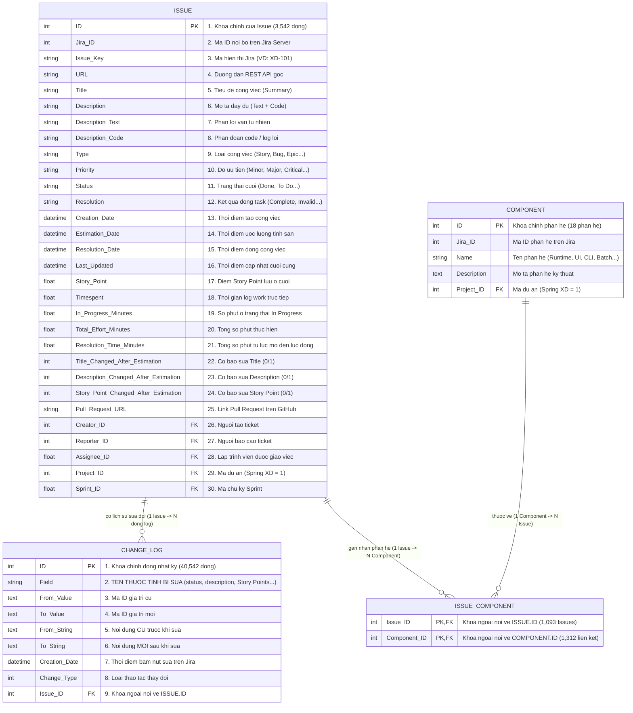

# 📋 PHẦN 2. SƠ ĐỒ QUAN HỆ THỰC THỂ (ERD) & THỐNG KÊ ĐẦY ĐỦ CÁC THUỘC TÍNH DỮ LIỆU GỐC (`N = 3,542` CÔNG VIỆC CÓ STORY POINT)

> **Lưu ý phạm vi:** Tài liệu này thống kê **100% dữ liệu nguyên bản (Raw Data)** của dự án **Spring XD** trên tập **`N = 3,542` công việc có nhãn `Story_Point > 0`** trong CSDL `C:/tawos/tawos_eda.db` (chưa pha trộn bất kỳ cột dữ liệu đã làm sạch nào vào đây để bạn nắm rõ bức tranh gốc của dữ liệu).

---

## 🗺️ 1. Sơ Đồ Quan Hệ Thực Thể (ERD) Của Dữ Liệu Gốc Phục Vụ Phân Tích (`Spring XD`)

Để hiểu rõ tại sao bảng **`ISSUE`** có 30 cột, tại sao **`COMPONENT`** lại tách ra bảng riêng (quan hệ Nhiều - Nhiều), và tại sao cột **`Field`** lại nằm trong bảng **`CHANGE_LOG`** để lưu tên các thuộc tính bị sửa, hãy quan sát sơ đồ ERD tổng thể dưới đây:

### 💡 Giải mã nhanh 3 điểm mấu chốt từ sơ đồ ERD trên:
1. **Bảng trung tâm `ISSUE` (`3,542 dòng x 30 cột`):** Lưu trữ thông tin của mỗi phiếu công việc tại thời điểm thu thập cuối cùng (1 dòng = 1 công việc).
2. **Tại sao bảng `CHANGE_LOG` có cột `Field` chứa tên nhiều thuộc tính khác (`1 - Nhiều`)?**
   - Một công việc trong bảng `ISSUE` sẽ bị sửa đổi nhiều lần qua thời gian $\rightarrow$ sinh ra nhiều dòng nhật ký trong `CHANGE_LOG` (`40,542` dòng nhật ký của `3,542` công việc, nối qua `ISSUE.ID = CHANGE_LOG.Issue_ID`).
   - Trên mỗi dòng nhật ký, cột **`Field`** đóng vai trò trả lời câu hỏi: *"Thao tác này vừa sửa thuộc tính nào của phiếu công việc?"* (ví dụ: `Field = 'description'` nghĩa là vừa sửa cột `Description`; `Field = 'Story Points'` nghĩa là vừa sửa cột `Story_Point`; `Field = 'status'` nghĩa là vừa đổi cột `Status`). Còn giá trị trước và sau khi sửa của thuộc tính đó được ghi ở 2 cột đi kèm là **`From_String`** (cũ) và **`To_String`** (mới).
3. **Tại sao `COMPONENT` không nằm trong 30 cột của bảng `ISSUE` mà phải tách ra bảng riêng (`Nhiều - Nhiều`)?**
   - Các thuộc tính như `Type` hay `Priority` là **đơn giá trị** (tại 1 thời điểm, 1 công việc chỉ có đúng 1 `Type` và 1 `Priority`), nên lưu thẳng thành 1 cột trong bảng `ISSUE`.
   - Ngược lại, **`COMPONENT` (Phân hệ kỹ thuật)** là **đa giá trị**: 1 công việc có thể tác động đồng thời lên nhiều phân hệ (ví dụ vừa sửa `CLI` vừa sửa `Documentation`). Vì vậy, CSDL SQL phải tách danh mục 18 phân hệ ra bảng `COMPONENT` và dùng bảng cầu nối `ISSUE_COMPONENT` (`1,312` dòng liên kết cho `1,093` công việc).

---

## 📑 2. Danh Sách 30 Cột Thuộc Tính Của Bảng `Issue` (Trên Tập `N = 3,542` Dòng)

Mỗi công việc trong bảng `Issue` của dự án Spring XD có đúng **30 cột thuộc tính**. Bảng dưới đây cho biết mỗi cột lưu kiểu dữ liệu gì, có bao nhiêu dòng có dữ liệu và bao nhiêu dòng bị trống (`NULL`):

| STT | Tên cột thuộc tính trong bảng `Issue` | Kiểu dữ liệu | Số dòng có dữ liệu (`Present`) | Số dòng bị trống (`Missing / NULL`) | Số giá trị khác nhau (`Unique`) | Giải thích thông tin lưu trong cột |
| :-: | :--- | :---: | :---: | :---: | :---: | :--- |
| **1** | `ID` | `int64` | `3,542` | `0` | `3,542` | Mã định danh khóa chính trong CSDL TAWOS (từ `65` đến `3773`). |
| **2** | `Jira_ID` | `int64` | `3,542` | `0` | `3,542` | Mã ID nội bộ của ticket trên máy chủ Jira (`14772` đến `87615`). |
| **3** | `Issue_Key` | `str` | `3,542` | `0` | `3,542` | Mã công việc hiển thị trên Jira (từ `XD-1` đến `XD-3769`). |
| **4** | `URL` | `str` | `3,542` | `0` | `3,542` | Đường dẫn REST API gốc của từng công việc. |
| **5** | `Title` | `str` | `3,542` | `0` | `3,477` | Tiêu đề tóm tắt của công việc. |
| **6** | `Description` | `str` | `3,373` | `169` | `3,341` | Nội dung mô tả đầy đủ (bao gồm cả chữ và đoạn code). |
| **7** | `Description_Text` | `str` | `3,370` | `172` | `3,337` | Phần lời văn tự nhiên được tách ra từ cột `Description`. |
| **8** | `Description_Code` | `str` | `637` | `2,905` | `634` | Phần đoạn mã nguồn / log lỗi được tách ra từ cột `Description`. |
| **9** | `Type` | `str` | `3,542` | `0` | `5` | Phân loại công việc (`Story`, `Bug`, `Improvement`, `Technical task`, `Epic`). |
| **10** | `Priority` | `str` | `3,542` | `0` | `5` | Mức độ ưu tiên (`Minor`, `Major`, `Critical`, `Blocker`, `Trivial`). |
| **11** | `Status` | `str` | `3,542` | `0` | `4` | Trạng thái của công việc (`Done`, `To Do`, `In Progress`, `In PR`). |
| **12** | `Resolution` | `str` | `2,940` | `602` | `9` *(+ NULL)* | Kết quả giải quyết khi đóng công việc (`Complete`, `Invalid`, `Duplicate`...). |
| **13** | `Creation_Date` | `datetime` | `3,542` | `0` | `3,537` | Ngày giờ công việc được tạo trên Jira (`2013-04-17` đến `2018-11-16`). |
| **14** | `Estimation_Date` | `datetime` | `3,542` | `0` | `3,537` | Ngày giờ ước lượng điểm được TAWOS tính sẵn trong bảng `Issue`. |
| **15** | `Resolution_Date` | `datetime` | `2,940` | `602` | `2,877` | Ngày giờ công việc được đóng lại (`602` công việc chưa đóng có giá trị `NULL`). |
| **16** | `Last_Updated` | `datetime` | `3,542` | `0` | `2,520` | Ngày giờ công việc có thao tác cập nhật cuối cùng. |
| **17** | `Story_Point` | `float64` | `3,542` | `0` | `25` | Điểm nỗ lực Story Point lưu ở trạng thái cuối của bảng `Issue`. |
| **18** | `Timespent` | `float64` | `2` | `3,540` | `2` | Thời gian log work trực tiếp trên Jira (chỉ có 2 dòng có dữ liệu, 3,540 dòng `NULL`). |
| **19** | `In_Progress_Minutes` | `float64` | `3,542` | `0` | `1,462` | Tổng số phút công việc nằm ở trạng thái `In Progress`. |
| **20** | `Total_Effort_Minutes` | `float64` | `3,542` | `0` | `1,640` | Tổng thời gian thực hiện công việc tính bằng phút. |
| **21** | `Resolution_Time_Minutes` | `float64` | `3,542` | `0` | `2,716` | Tổng số phút từ lúc mở đến lúc đóng công việc. |
| **22** | `Title_Changed_After_Estimation` | `int64` | `3,542` | `0` | `2` (`0`, `1`) | Cờ đánh dấu tiêu đề bị sửa sau ước lượng (`0`: không sửa; `1`: có sửa). |
| **23** | `Description_Changed_After_Estimation` | `int64` | `3,542` | `0` | `1` (`chỉ có 0`) | Cờ đánh dấu mô tả bị sửa sau ước lượng (toàn bộ 3,542 dòng đều ghi `0`). |
| **24** | `Story_Point_Changed_After_Estimation` | `int64` | `3,542` | `0` | `2` (`0`, `1`) | Cờ đánh dấu điểm Story Point bị sửa sau ước lượng (`0`: không sửa; `1`: có sửa). |
| **25** | `Pull_Request_URL` | `str` | `617` | `2,925` | `602` | Đường dẫn Pull Request trên GitHub (`617` dòng có link, `2,925` dòng bỏ trống). |
| **26** | `Creator_ID` | `int64` | `3,542` | `0` | `146` | Mã định danh người tạo công việc (có 146 người tạo khác nhau). |
| **27** | `Reporter_ID` | `int64` | `3,542` | `0` | `146` | Mã định danh người báo cáo công việc (có 146 người báo cáo khác nhau). |
| **28** | `Assignee_ID` | `float64` | `2,550` | `992` | `31` *(+ NULL)* | Mã định danh lập trình viên được giao việc (`2,550` dòng có người làm, `992` dòng `NULL`). |
| **29** | `Project_ID` | `int64` | `3,542` | `0` | `1` (`ID = 1`) | Mã dự án (toàn bộ đều mang giá trị `1` tương ứng với dự án Spring XD). |
| **30** | `Sprint_ID` | `float64` | `2,114` | `1,428` | `66` *(+ NULL)* | Mã chu kỳ Sprint (`2,114` dòng thuộc 66 Sprint; `1,428` dòng `NULL`). |

---

## 📊 3. Số Lượng Chi Tiết Đối Với Từng Loại Giá Trị Trong Mỗi Thuộc Tính Gốc (`N = 3,542`)

Dưới đây là bảng đếm số lượng dòng cụ thể cho từng loại giá trị (Category Value Counts) bên trong các thuộc tính phân loại của bảng `Issue`, bảng `Component` và bảng `Change_Log`:

### 3.1. Thuộc tính `Type` (Loại công việc trong bảng `Issue` — 5 loại)
| STT | Loại giá trị trong cột `Type` | Số lượng công việc (`N = 3,542`) | Tỷ lệ (%) | Ý nghĩa |
| :-: | :--- | :---: | :---: | :--- |
| **1** | **`Story`** | `2,535` | `71.57%` | Yêu cầu phát triển tính năng mới từ góc nhìn người dùng (chiếm đa số). |
| **2** | **`Bug`** | `594` | `16.77%` | Lỗi phần mềm cần khắc phục. |
| **3** | **`Improvement`** | `294` | `8.30%` | Cải tiến, tối ưu hóa tính năng hoặc kiến trúc hiện có. |
| **4** | **`Technical task`** | `73` | `2.06%` | Công việc kỹ thuật nội bộ của đội phát triển. |
| **5** | **`Epic`** | `46` | `1.30%` | Nhóm tính năng lớn bao hàm nhiều Story nhỏ. |
| — | **Tổng cộng** | **`3,542`** | **`100.00%`** | — |

---

### 3.2. Thuộc tính `Priority` (Mức độ ưu tiên trong bảng `Issue` — 5 loại)
| STT | Loại giá trị trong cột `Priority` | Số lượng công việc (`N = 3,542`) | Tỷ lệ (%) | Ý nghĩa |
| :-: | :--- | :---: | :---: | :--- |
| **1** | **`Minor`** | `3,012` | `85.04%` | Ưu tiên mức thường / mặc định khi tạo công việc trên Jira Spring XD. |
| **2** | **`Major`** | `401` | `11.32%` | Ưu tiên quan trọng. |
| **3** | **`Critical`** | `72` | `2.03%` | Ưu tiên nghiêm trọng, ảnh hưởng lớn đến hệ thống. |
| **4** | **`Blocker`** | `36` | `1.02%` | Ưu tiên khẩn cấp nhất (chặn tiến độ phát hành hoặc kiểm thử). |
| **5** | **`Trivial`** | `21` | `0.59%` | Ưu tiên rất nhỏ (thường là lỗi giao diện nhỏ hoặc chính tả tài liệu). |
| — | **Tổng cộng** | **`3,542`** | **`100.00%`** | — |

---

### 3.3. Thuộc tính `Status` (Trạng thái công việc trong bảng `Issue` — 4 loại)
| STT | Loại giá trị trong cột `Status` | Số lượng công việc (`N = 3,542`) | Tỷ lệ (%) | Ý nghĩa |
| :-: | :--- | :---: | :---: | :--- |
| **1** | **`Done`** | `2,940` | `83.00%` | Công việc đã kết thúc và đóng lại. |
| **2** | **`To Do`** | `578` | `16.32%` | Công việc đã được chấm điểm nhưng vẫn nằm ở hàng đợi chưa thực hiện. |
| **3** | **`In Progress`** | `20` | `0.56%` | Công việc đang được lập trình viên xử lý. |
| **4** | **`In PR`** | `4` | `0.11%` | Công việc đang ở bước gửi Pull Request chờ xét duyệt. |
| — | **Tổng cộng** | **`3,542`** | **`100.00%`** | — |

---

### 3.4. Thuộc tính `Resolution` (Kết quả giải quyết trong bảng `Issue` — 10 loại)
| STT | Loại giá trị trong cột `Resolution` | Số lượng công việc (`N = 3,542`) | Tỷ lệ (%) | Ý nghĩa |
| :-: | :--- | :---: | :---: | :--- |
| **1** | **`Complete`** | `2,372` | `66.97%` | Đã hoàn thành đầy đủ theo yêu cầu. |
| **2** | **`NULL` (Bỏ trống)** | `602` | `17.00%` | Công việc chưa đóng (`578` mẫu `To Do` + `20` mẫu `In Progress` + `4` mẫu `In PR`). |
| **3** | **`Invalid`** | `119` | `3.36%` | Báo cáo không hợp lệ hoặc không đúng thực tế. |
| **4** | **`Duplicate`** | `118` | `3.33%` | Trùng lặp với một công việc đã có trước đó. |
| **5** | **`Won't Fix`** | `114` | `3.22%` | Quyết định không sửa hoặc từ chối thực hiện. |
| **6** | **`Deferred`** | `110` | `3.11%` | Tạm hoãn sang phiên bản sau. |
| **7** | **`Works as Designed`** | `42` | `1.19%` | Phần mềm chạy đúng thiết kế ban đầu. |
| **8** | **`Fixed`** | `36` | `1.02%` | Đã sửa xong lỗi. |
| **9** | **`Cannot Reproduce`** | `20` | `0.56%` | Không thể tái hiện lại lỗi. |
| **10** | **`Incomplete`** | `9` | `0.25%` | Thiếu thông tin để xử lý. |
| — | **Tổng cộng** | **`3,542`** | **`100.00%`** | — |

---

### 3.5. Thuộc tính `Story_Point` (Nhãn điểm trong bảng `Issue` — 25 mức giá trị)
| STT | Giá trị điểm trong cột `Story_Point` | Số lượng công việc (`N = 3,542`) | Tỷ lệ (%) | STT | Giá trị điểm trong cột `Story_Point` | Số lượng công việc (`N = 3,542`) | Tỷ lệ (%) |
| :-: | :---: | :---: | :---: | :-: | :---: | :---: | :---: |
| **1** | **`0.2`** | `1` | `0.03%` | **14** | **`15.0`** | `2` | `0.06%` |
| **2** | **`1.0`** | `826` | `23.32%` | **15** | **`16.0`** | `18` | `0.51%` |
| **3** | **`2.0`** | `639` | `18.04%` | **16** | **`20.0`** | `17` | `0.48%` |
| **4** | **`3.0`** | `755` | `21.32%` | **17** | **`21.0`** | `7` | `0.20%` |
| **5** | **`4.0`** | `211` | `5.96%` | **18** | **`24.0`** | `1` | `0.03%` |
| **6** | **`5.0`** | `572` | `16.15%` | **19** | **`32.0`** | `1` | `0.03%` |
| **7** | **`6.0`** | `27` | `0.76%` | **20** | **`40.0`** | `5` | `0.14%` |
| **8** | **`7.0`** | `3` | `0.08%` | **21** | **`50.0`** | `1` | `0.03%` |
| **9** | **`8.0`** | `394` | `11.12%` | **22** | **`80.0`** | `2` | `0.06%` |
| **10** | **`9.0`** | `1` | `0.03%` | **23** | **`100.0`** | `2` | `0.06%` |
| **11** | **`10.0`** | `45` | `1.27%` | **24** | **`2567.0`** | `1` | `0.03%` |
| **12** | **`12.0`** | `5` | `0.14%` | **25** | — | — | — |
| **13** | **`13.0`** *(5 mẫu)* & **`14.0`** *(1 mẫu)* | `6` | `0.17%` | — | **Tổng cộng** | **`3,542`** | **`100.00%`** |

*(5 mức điểm Fibonacci `1.0`, `3.0`, `2.0`, `5.0`, `8.0` chiếm tới `3,186 / 3,542` công việc, tương đương `89.95%` toàn dự án).*

---

### 3.6. Ba cột Cờ nhị phân có sẵn trong bảng `Issue` (`0` vs `1`)
| Tên cột cờ trong bảng `Issue` | Số lượng mang giá trị `1` (Có thay đổi) | Số lượng mang giá trị `0` (Không thay đổi) | Tổng số dòng |
| :--- | :---: | :---: | :---: |
| **`Title_Changed_After_Estimation`** | `621` (`17.53%`) | `2,921` (`82.47%`) | `3,542` (`100%`) |
| **`Description_Changed_After_Estimation`** | `0` (`0.00%`) | `3,542` (`100.00%`) | `3,542` (`100%`) |
| **`Story_Point_Changed_After_Estimation`** | `471` (`13.30%`) | `3,071` (`86.70%`) | `3,542` (`100%`) |

---

### 3.7. Thuộc tính đa giá trị `Component` (18 phân hệ kỹ thuật nối qua bảng `ISSUE_COMPONENT` & `COMPONENT`)

> **Giải thích tại sao `Component` tách thành bảng riêng và tổng số lượt lớn hơn số Issue:**
> - Khác với `Type` hay `Priority` (mỗi Issue chỉ có 1 giá trị duy nhất), **1 Issue trên Jira có thể được gắn nhiều phân hệ kỹ thuật (`Component`) cùng lúc** (ví dụ: 1 công việc vừa sửa `CLI` vừa sửa `Documentation`).
> - Trong `3,542` công việc của Spring XD: có **`2,449` công việc (`69.14%`) không gắn Component**, và **`1,093` công việc (`30.86%`) được gắn từ 1 đến 4 Component** — tạo thành tổng cộng **`1,312` lượt gắn nhãn** trên 18 phân hệ kỹ thuật dưới đây:

| STT | Tên phân hệ (`Component.Name`) | Số lượng Issue mang phân hệ này | Tỷ lệ trên `3,542` Issue (%) | STT | Tên phân hệ (`Component.Name`) | Số lượng Issue mang phân hệ này | Tỷ lệ trên `3,542` Issue (%) |
| :-: | :--- | :---: | :---: | :-: | :--- | :---: | :---: |
| **1** | **`Runtime`** | `264` | `7.45%` | **10** | **`Configuration`** | `57` | `1.61%` |
| **2** | **`Stream Module`** | `133` | `3.75%` | **11** | **`Acceptance Testing`** | `54` | `1.52%` |
| **3** | **`Documentation`** | `113` | `3.19%` | **12** | **`REST`** | `39` | `1.10%` |
| **4** | **`Packaging`** | `106` | `2.99%` | **13** | **`Ingest`** | `35` | `0.99%` |
| **5** | **`Batch`** | `103` | `2.91%` | **14** | **`Testing`** | `33` | `0.93%` |
| **6** | **`UI`** | `94` | `2.65%` | **15** | **`YARN Runtime`** | `27` | `0.76%` |
| **7** | **`Hadoop`** | `92` | `2.60%` | **16** | **`Performance Testing`** | `18` | `0.51%` |
| **8** | **`CLI`** | `69` | `1.95%` | **17** | **`DSL`** | `12` | `0.34%` |
| **9** | **`Analytics`** | `60` | `1.69%` | **18** | **`Export`** | `3` | `0.08%` |

---

### 3.8. Cột `Field` trong bảng `Change_Log` (Thống kê các thuộc tính của Issue từng bị chỉnh sửa trên `40,542` dòng log)

> **Giải thích tại sao cột `Field` lại chứa tên của nhiều thuộc tính khác:**
> - Trong bảng lịch sử `Change_Log`, mỗi khi người dùng sửa bất kỳ thông tin gì trên phiếu công việc Jira, hệ thống sẽ sinh ra 1 dòng log gồm 3 cột đi cặp với nhau: **`Field`** *(Tên thuộc tính vừa bị sửa)*, **`From_String`** *(Giá trị cũ)*, và **`To_String`** *(Giá trị mới)*.
> - Do đó, các giá trị nằm bên trong cột `Field` chính là **tên của các thuộc tính trên phiếu công việc vừa bị con người thay đổi**. Thống kê cột `Field` dưới đây cho ta biết chính xác thuộc tính nào của bảng `Issue` bị chỉnh sửa nhiều nhất trong vòng đời của `3,542` công việc:

| STT | Giá trị trong cột `Change_Log.Field` *(Tên thuộc tính bị sửa)* | Tương ứng với cột nào của bảng `Issue`? | Tổng số lượt chỉnh sửa (`40,542` dòng log) | Số lượng Issue có chỉnh sửa (`N = 3,542`) | Tỷ lệ Issue có chỉnh sửa (%) |
| :-: | :--- | :--- | :---: | :---: | :---: |
| **1** | **`Rank`** | *(Thứ tự xếp hạng ưu tiên trên bảng Scrum)* | `7,846` | `2,516` | `71.03%` |
| **2** | **`status`** | Cột #11: **`Issue.Status`** | `6,210` | `2,978` | `84.08%` |
| **3** | **`Sprint`** | Cột #30: **`Issue.Sprint_ID`** | `5,092` | `2,283` | `64.46%` |
| **4** | **`Fix Version`** | *(Phiên bản phát hành dự kiến)* | `4,485` | `2,712` | `76.57%` |
| **5** | **`resolution`** | Cột #12: **`Issue.Resolution`** | `3,192` | `2,942` | `83.06%` |
| **6** | **`Workflow`** | *(Quy trình trạng thái trên Jira)* | `2,416` | `2,397` | `67.67%` |
| **7** | **`assignee`** | Cột #28: **`Issue.Assignee_ID`** | `2,075` | `1,814` | `51.21%` |
| **8** | **`Epic Link`** | *(Liên kết của Story vào Epic cha)* | `1,979` | `1,711` | `48.31%` |
| **9** | **`Link`** | *(Liên kết phụ thuộc giữa các Issue)* | `1,104` | `686` | `19.37%` |
| **10** | **`Epic Child`** | *(Danh sách các Issue con thuộc Epic)* | `1,042` | `44` | `1.24%` |
| **11** | **`description`** | Cột #6 & #7: **`Issue.Description`** | `911` | `581` | `16.40%` |
| **12** | **`summary`** | Cột #5: **`Issue.Title`** | `845` | `621` | `17.53%` |
| **13** | **`Story Points`** | Cột #17: **`Issue.Story_Point`** | `578` | `490` | `13.83%` |
| **14** | **`Pull Request URL`** | Cột #25: **`Issue.Pull_Request_URL`** | `545` | `530` | `14.96%` |
| **15** | **`Actual Story Points`** | *(Điểm thực tế ghi nhận sau Sprint)* | `536` | `526` | `14.85%` |
| **16** | **`Component`** | Bảng nối **`ISSUE_COMPONENT`** | `374` | `276` | `7.79%` |
| **17** | **`issuetype`** | Cột #9: **`Issue.Type`** | `298` | `276` | `7.79%` |
| **18** | **`Time Spent`** | Cột #18: **`Issue.Timespent`** | `257` | `253` | `7.14%` |
| **19** | **`priority`** | Cột #10: **`Issue.Priority`** | `151` | `143` | `4.04%` |
| **20** | *21 trường phụ khác (`Acceptance Criteria`, `Version`, `labels`...)* | *(Siêu dữ liệu phụ trên Jira)* | `606` | `312` | `8.81%` |

---

## 🔗 Điều Hướng Tài Liệu Trong Chuỗi Báo Cáo (`docs/draft/`)

1. 📌 **[Phần 1: Giới thiệu quy mô dữ liệu & cấu trúc thông tin lưu trữ](01_data_scale_and_overview.md)**
2. 📋 **[Phần 2: Sơ đồ ERD, 30 cột dữ liệu gốc & số lượng từng phân loại (`N = 3,542`)](02_attribute_breakdown_and_counts.md)** *(Tài liệu hiện tại)*
3. 🛠️ **[Phần 3: Phát hiện các điểm bất thường & cách giải quyết tương ứng để tạo Clean Data](03_anomalies_and_cleaning_solutions.md)**
4. ✅ **[Phần 4: Thẩm định lại Clean Data để đảm bảo không còn Data Leakage](04_clean_data_verification_audit.md)**
5. 📏 **[RULE.md: Bộ quy tắc chuẩn hóa khi xử lý và viết báo cáo cho các dự án khác](RULE.md)**
