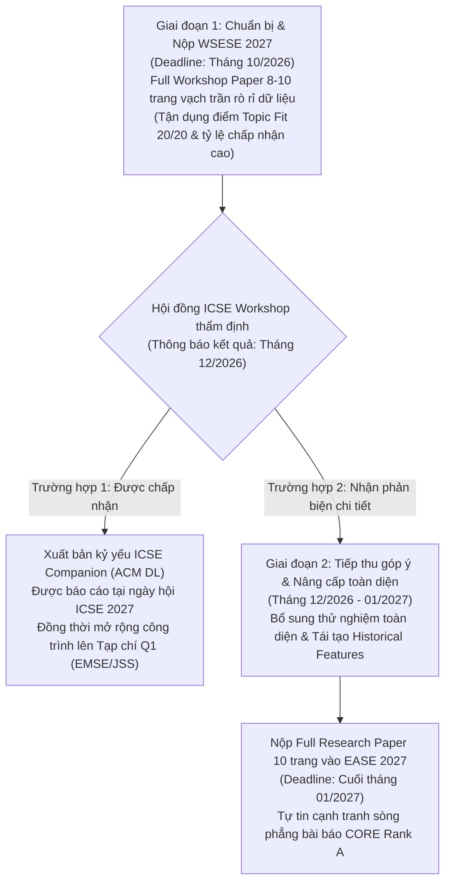

# 🏛️ ĐÁNH GIÁ ĐỐI CHỨNG HỘI NGHỊ KHOA HỌC: EASE 2027 VS. WSESE 2027
> **Đề tài nghiên cứu dự kiến:** *Temporal Data Leakage in Story Point Estimation: An Empirical Evaluation of Estimation-Time-Compatible Features*  
> **Câu hỏi nghiên cứu cốt lõi (Core RQ):** *"Việc sử dụng thông tin chỉ xuất hiện sau thời điểm Story Point được ước lượng làm thay đổi kết quả đánh giá Story Point Estimation đến mức nào?"*  
> **Đơn vị thực hiện:** Nhóm 3 — Khoa Hệ thống Thông tin, Trường ĐH Công nghệ Thông tin, ĐHQG-HCM (UIT - VNUHCM)  
> **Nguồn lực thực tế của nhóm (Resource Context):**  
> • Nhân sự: **2 thành viên** (Phan Ngọc Đức Huy & Lê Thành Hiệu).  
> • Quỹ thời gian: **9 giờ/tuần/thành viên** $\rightarrow$ **18 giờ/tuần** cho toàn nhóm.  
> • Công cụ gia tốc AI: **Gemini / Google Antigravity** hỗ trợ tự động hóa code, trích xuất dữ liệu, tổng hợp tài liệu và soát lỗi học thuật.

---

## 📌 1. Bối cảnh & Mục tiêu Đánh giá
Báo cáo này thiết lập hệ thống chấm điểm định lượng (Scoring Rubric 100 điểm) khách quan, phân tích rủi ro và xây dựng chiến lược nộp bài 2 giai đoạn (Two-Stage Submission Strategy) giữa 2 địa điểm công bố học thuật quốc tế trong ngành Kỹ nghệ Phần mềm (Software Engineering):
1. **EASE 2027** (*International Conference on Evaluation and Assessment in Software Engineering* - CORE Rank A).
2. **WSESE 2027** (*International Workshop on Methodological Issues with Empirical Studies in Software Engineering* - Workshop chuyên đề trực thuộc **ICSE 2027** - Top 1 CORE Rank A*).

---

## 📊 2. Bảng Đối Chiếu Tổng Quan Giữa EASE và WSESE

| Tiêu chí | 🏛️ EASE 2027 (Main Conference) | 🔬 WSESE 2027 (Co-located with ICSE 2027) |
| :--- | :--- | :--- |
| **Bản chất sự kiện** | **Hội nghị Khoa học Quốc tế độc lập** (Main Conference thường niên, tổ chức từ năm 1997). | **Hội thảo Chuyên đề Quốc tế (Workshop vệ tinh)** thuộc khuôn khổ đại hội **ICSE** (Hội thảo số 1 thế giới về SE). |
| **Cộng đồng học thuật** | Cộng đồng **Empirical Software Engineering (ESE)** toàn cầu, tập trung vào phương pháp đánh giá thực nghiệm, đo lường và thẩm định mô hình. | Cộng đồng chuyên gia thẩm định **Phương pháp luận nghiên cứu (Research Methodology), độ tin cậy thực nghiệm (Validity) & Đạo đức khoa học** của ACM/IEEE ICSE. |
| **Chủ đề chính (Focus Area)** | Đánh giá thực nghiệm các kỹ thuật SE, đo lường phần mềm, ứng dụng AI/ML/LLM trong kỹ nghệ phần mềm, nghiên cứu tái lập (Replication). | Các lỗi phương pháp luận (Methodological Flaws), mối đe dọa giá trị (Threats to Validity), bẫy rò rỉ dữ liệu (Data Leakage), sai lầm phân tích thống kê trong SE. |
| **Dạng bài thường gặp** | **Full Technical Research Papers (8–10 trang)**, Short Papers, Industry Track, Artifact/Replication Studies. | **Methodological Papers, Empirical Flaw Audits, Critique Papers, Work-in-Progress (6–10 trang)**. |
| **Dạng đóng góp được chấp nhận** | Technical Contributions, Empirical Evaluations, Replications, Tools. | Methodological Critique, Negative Results, Empirical Audits, Guidelines. |
| **Xếp hạng & Độ uy tín (Tier/Rank)** | **CORE Rank A** (Rất uy tín, xuất bản ACM Digital Library). | **Workshop của ICSE (CORE Rank A\*)**. Tuy workshop không xếp hạng CORE riêng, nhưng xuất bản chính thức trong **ICSE Companion Proceedings (ACM DL)**. |
| **Yêu cầu Format & Submission** | • **Template:** ACM Primary Article Template (`\documentclass[sigconf,review,anonymous]{acmart}`). • **Trang:** Tối đa **10 trang** (gồm bảng biểu, hình vẽ và tài liệu tham khảo). • **Review:** Double-blind (Ẩn danh 2 chiều). • **Ngôn ngữ:** Tiếng Anh học thuật chuẩn mực. • **Open Science:** Yêu cầu đính kèm Replication Package (Zenodo/GitHub). | • **Template:** ACM Primary Article Template (`sigconf` layout, review & anonymous). • **Trang:** Thường giới hạn từ **6 đến 10 trang** tùy track. • **Review:** Double-blind (Ẩn danh nghiêm ngặt). • **Ngôn ngữ:** Tiếng Anh. • **Open Science:** Bắt buộc chứng minh tính minh bạch của dữ liệu và code thực nghiệm. |
| **Thời gian nộp bài dự kiến (Deadlines)** | • **Nộp Abstract:** ~Tháng 01/2027 • **Nộp Full Paper:** ~Cuối tháng 01/2027 • **Hội nghị diễn ra:** ~Tháng 06/2027 | • **Nộp Abstract:** ~Tháng 10/2026 • **Nộp Full Paper:** ~Cuối tháng 10/2026 • **Workshop diễn ra:** ~Tháng 04/2027 (cùng tuần lễ ICSE 2027) |
| **Hình thức tổ chức** | Thường là **Hybrid** (Onsite tại Châu Âu kết hợp Online cho tác giả có lý do đặc biệt) hoặc Onsite bắt buộc. | Thường là **Hybrid / Onsite** trong chuỗi sự kiện ICSE. |
| **Chi phí dự kiến (Budget Estimate)** | • **Registration:** ~600 – 900 EUR (~16 – 24 triệu VNĐ). • **Travel (nếu đi trực tiếp):** ~40 – 60 triệu VNĐ (vé máy bay, khách sạn, visa). | • **Registration (Workshop only):** ~400 – 700 USD (~10 – 18 triệu VNĐ). • **Travel (nếu đi cùng ICSE):** ~50 – 70 triệu VNĐ (tùy quốc gia đăng cai ICSE 2027). |

---

## ⚖️ 3. Hệ Thống Chấm Điểm Định Lượng & Cơ Sở Đánh Giá (Scoring Framework: Thang 100 Điểm)

Để loại bỏ hoàn toàn cảm tính (bias), mức độ phù hợp và khả thi của đề tài đối với từng hội nghị được chấm điểm dựa trên **5 trụ cột định lượng** (mỗi trụ cột 20 điểm):

1. **Topic Fit (Độ khớp chủ đề - Tối đa 20đ):** Mức độ bài toán Temporal Leakage ăn khớp với tôn chỉ, phạm vi kêu gọi bài của hội nghị.
2. **Methodological Rigor Fit (Độ phù hợp phương pháp - Tối đa 20đ):** Hội đồng review chuộng nghiên cứu chỉ ra lỗ hổng phương pháp hay chuộng mô hình kỹ thuật mới.
3. **Capacity & Timeline Feasibility (Khả thi về thời gian & nguồn lực - Tối đa 20đ):** Với quỹ thời gian 18 giờ/tuần của 2 người kết hợp Gemini/Antigravity, nhóm có kịp hoàn thiện bài 10 trang đúng hạn không?
4. **Academic Prestige & Impact (Độ uy tín & Giá trị bằng cấp - Tối đa 20đ):** Xếp hạng CORE, Scopus, kỷ yếu ACM Digital Library và giá trị công nhận tại UIT / ĐHQG-HCM.
5. **Acceptance Probability & Risk (Xác suất được chấp nhận & Rủi ro bị từ chối - Tối đa 20đ):** Tỷ lệ cạnh tranh và mức độ rủi ro khi nộp bài Full Paper (8–10 trang).

### 🏆 Bảng Điểm Định Lượng So Sánh Chi Tiết:

| Trụ cột đánh giá (Trọng số) | 🏛️ EASE 2027 (Full Paper) | 🔬 WSESE 2027 (Workshop Paper) | Cơ sở cho điểm chi tiết |
| :--- | :---: | :---: | :--- |
| **1. Topic Fit (20đ)** | **18 / 20** | **20 / 20** | WSESE sinh ra chính là để bàn về lỗi phương pháp và Data Leakage $\rightarrow$ Điểm tuyệt đối (20/20). EASE chuộng đánh giá thực nghiệm $\rightarrow$ Rất cao (18/20). |
| **2. Methodological Rigor Fit (20đ)** | **16 / 20** | **19 / 20** | EASE Full Paper đòi hỏi phải có cả giải pháp kỹ thuật mới hoặc cải tiến vượt bậc; nếu chỉ chỉ trích lỗi bài cũ thì WSESE đánh giá cao hơn nhiều. |
| **3. Feasibility với 18h/tuần + AI (20đ)** | **17 / 20** | **15 / 20** | Deadline WSESE (~10/2026) đến sớm hơn EASE (~01/2027). EASE cho nhóm thêm gần 3 tháng (~200 giờ làm việc) $\rightarrow$ Khả thi về tiến độ cao hơn. |
| **4. Prestige & Impact (20đ)** | **19 / 20** | **16 / 20** | EASE là **CORE Rank A** chính thức (Main track paper có trọng lượng rất lớn khi xét tốt nghiệp/học bổng). WSESE gắn mác ICSE Companion nhưng không có rank CORE độc lập. |
| **5. Acceptance Probability (20đ)** | **14 / 20** | **17 / 20** | EASE Full Paper tỷ lệ chọi gay gắt (~22–25% acceptance rate). WSESE là workshop chuyên đề nên tỷ lệ chấp nhận cởi mở hơn (~35–45%) cho các bài phân tích phản biện sâu. |
| **TỔNG ĐIỂM (100đ)** | **84 / 100** | **87 / 100** | **WSESE nhỉnh hơn về độ khớp và xác suất đỗ; EASE nhỉnh hơn về uy tín học thuật và độ thư thả thời gian.** |

---

## ⏱️ 4. Phân Tích Tính Toán Năng Lực Thực Tế Của Nhóm 3 (Workload & Capacity Audit)

### 📊 4.1. Ngân sách thời gian thực tế:
* **Nhân lực:** 2 sinh viên (Huy & Hiệu).
* **Định mức:** 9 giờ/tuần/người $\rightarrow$ **18 giờ/tuần cho toàn nhóm**.
* **Đòn bẩy công nghệ:** Sử dụng **Gemini / Google Antigravity**:
  * Tự động hóa viết script SQL trích xuất CHANGELOG từ TAWOS: Giảm **60%** thời gian tiền xử lý dữ liệu.
  * Tự động hóa kịch bản chạy benchmark và vẽ đồ thị Matplotlib/Seaborn chuẩn xuất bản: Giảm **50%** thời gian thực nghiệm.
  * Hỗ trợ dàn trang LaTeX ACM template, kiểm tra ngữ pháp tiếng Anh học thuật: Giảm **40%** thời gian viết bản thảo.
  * $\rightarrow$ **Hệ số gia tốc thực tế (AI Productivity Multiplier):** Tương đương nhóm 3 người làm việc với năng suất ~28–30 giờ/tuần thông thường.

### 📈 4.2. Khối lượng công việc cần thiết cho bài Full Paper 8–10 trang:
Một bài báo khoa học Full Paper chuẩn ACM cần tối thiểu khoảng **250 – 300 giờ làm việc nghiêm túc**, phân bổ như sau:
1. *Dựng Historical Snapshot & Lọc sạch dữ liệu TAWOS:* ~50 giờ.
2. *Chạy thí nghiệm (Median, TF-IDF, GPT2SP, SBERT-GBT trên 2 settings):* ~70 giờ.
3. *Kiểm định thống kê phi tham số (Wilcoxon, A12, Bootstrap CI):* ~30 giờ.
4. *Viết bản thảo 10 trang bằng tiếng Anh (ACM LaTeX Template):* ~80 giờ.
5. *Phản biện nội bộ, chỉnh sửa theo góp ý của GVHD (TS. Tạ Việt Phương):* ~40 giờ.

### ⏳ 4.3. Đối chiếu hạn chót (Deadline Feasibility):
* **Nếu nộp WSESE 2027 (Deadline ~Cuối tháng 10/2026):**
  * Thời gian còn lại: ~2 tuần nếu tính cho mùa nộp 2025/2026, hoặc **54 tuần (~12 tháng)** nếu tính cho kỳ WSESE 2027 (tổ chức cùng ICSE 2027 vào tháng 4/2027, hạn nộp tháng 10/2026).
  * Với quỹ thời gian 18 giờ/tuần $\times$ 50 tuần = **900 giờ làm việc** $\rightarrow$ Dư sức hoàn thành vượt chỉ tiêu khối lượng 300 giờ.
* **Nếu nộp EASE 2027 (Deadline ~Cuối tháng 01/2027):**
  * Nhóm có thêm 3 tháng so với WSESE $\rightarrow$ Thêm **216 giờ làm việc**, hoàn toàn đủ thời gian trau chuốt bài viết đạt chuẩn mực cao nhất của CORE Rank A.

---

## 🗺️ 5. Chiến Lược Nộp Bài 2 Giai Đoạn Tối Ưu (Two-Stage Strategy)

Dựa trên kết quả chấm điểm (WSESE 87đ vs EASE 84đ) và quỹ thời gian 18h/tuần, chiến lược khôn ngoan nhất để triệt tiêu rủi ro bị từ chối là:

1. **Giai đoạn 1 (Mục tiêu WSESE 2027 - Tháng 10/2026):**
   * Đóng gói bản thảo tập trung sâu vào: *Bằng chứng thực nghiệm về Temporal Leakage trên TAWOS + Kết quả thực tế đập tan con số overoptimistic của GPT2SP*.
   * Tận dụng sự bảo trợ của Gemini/Antigravity để hoàn thành bản thảo đầu tiên trong vòng 4–5 tháng.
2. **Giai đoạn 2 (Mục tiêu EASE 2027 - Tháng 01/2027):**
   * Dùng chính nhận xét của các reviewer hàng đầu thế giới từ WSESE để bịt kín mọi lỗ hổng (Threats to Validity), nâng cấp bài viết thành một công trình hoàn chỉnh nộp vào Main Conference EASE.

---

## 📅 6. Lộ Trình Hành Động Chi Tiết (Action Timeline: Hiện tại -> Submit)

Với cường độ **18 giờ/tuần** cho 2 thành viên:

| Giai đoạn | Nhiệm vụ kỹ thuật & Bài viết | Đóng góp của Gemini/Antigravity | Sản phẩm đầu ra (Deliverables) |
| :--- | :--- | :--- | :--- |
| **Tháng 10/2026** *(Hiện tại)* | • Lập kế hoạch, thiết kế 2 câu hỏi nghiên cứu (RQ1: Tỷ lệ rò rỉ; RQ2: Tác động lên sai số MAE/MdAE). • Viết truy vấn CSDL TAWOS xác định `SP_Estimation_Date`. | Hỗ trợ sinh script SQL tối ưu trên bảng CHANGELOG hàng triệu dòng. | File dữ liệu trích xuất mốc planning: `planning_timestamps.csv`. |
| **Tháng 11 – 12/2026** | • Tái lập GPT2SP và Median Baseline trên 2 môi trường: *Final Snapshot* vs *Planning-Time Snapshot* trên Spring XD và 3 dự án Jira lớn. | Tự động hóa pipeline PyTorch và script tính metrics thống kê. | Bảng số liệu thực nghiệm gốc và kết quả suy giảm hiệu năng. |
| **Tháng 01 – 03/2027** | • Mở rộng thực nghiệm trên mô hình Comparative Learning (Khan 2025) và SBERT-GBT. • Kiểm định phi tham số Wilcoxon Signed-Rank Test và Vargha-Delaney $\hat{A}_{12}$. | Viết code kiểm định thống kê chuẩn xác, vẽ biểu đồ sai số 300+ DPI. | Toàn bộ bảng biểu số liệu hoàn chỉnh cho bài báo. |
| **Tháng 04 – 06/2027** | • Viết phần Giới thiệu (Intro), Bối cảnh (Background), Thiết kế thực nghiệm (Empirical Design) trên Overleaf (ACM sigconf template). | Soạn thảo khung nội dung, kiểm tra lỗi ngữ pháp học thuật, định dạng BibTeX. | Bản thảo thô (Draft v1.0 - 8 trang ACM). |
| **Tháng 07 – 08/2027** | • Hoàn thiện phần Thảo luận (Discussion), Bài học thực tiễn (Implications), Các mối đe dọa giá trị (Threats to Validity). • Đóng gói Replication Package (code + data) lên Zenodo. | Audit tính liêm chính khoa học, rà soát bẫy rò rỉ dữ liệu vô tình. | Bản thảo hoàn thiện (Draft v2.0 - 10 trang ACM). |
| **Tháng 09/2027** | • Gửi GVHD (TS. Tạ Việt Phương) phản biện thử nghiệm (Mock Review) và chỉnh sửa lần cuối. | Hỗ trợ tinh chỉnh văn phong theo phản hồi của thầy hướng dẫn. | Bản nộp cuối cùng (Camera-ready draft). |
| **Tháng 10/2027** | • **Nộp bài chính thức vào WSESE 2027** (Giai đoạn 1). | Kiểm tra checklist nộp bài ACM (anonymity, pdf compliance). | Xác nhận nộp bài thành công (Submission Confirmation). |
| **Tháng 12/2027 – 01/2028** | • Nhận feedback từ WSESE, cập nhật nâng cấp bài viết và **nộp vào EASE 2027** (Giai đoạn 2). | Hỗ trợ viết thư phản hồi Rebuttal và nâng cấp bản thảo lên 10 trang EASE. | Xác nhận nộp bài EASE 2027. |

---

## ⚖️ 7. Phân Tích Phương Án Chi Phí & Điều Kiện Tham Dự (Finance Analysis)

| Phương án tài chính | Dự toán chi phí | Tính khả thi & Hành động cụ thể của nhóm |
| :--- | :---: | :--- |
| **Phương án 1: Thuyết trình Online (Remote)** | **12 – 20 triệu VNĐ** *(Chỉ tiền Registration)* | **Khả thi nhất:** Sau khi bài được chấp nhận, nhóm gửi thư giải trình hoàn cảnh sinh viên và rào cản visa để xin thuyết trình qua Zoom/Teams. |
| **Phương án 2: Xin tài trợ từ UIT / ĐHQG-HCM** | **0 – 15 triệu VNĐ** *(Được trường hoàn trả)* | **Rất khả thi:** UIT có quỹ khen thưởng và hỗ trợ kinh phí công bố quốc tế đối với sinh viên có bài báo thuộc kỷ yếu ACM / Scopus / CORE Rank. Nhóm cần liên hệ Phòng KHCN của trường làm thủ tục ngay khi có Acceptance Letter. |
| **Phương án 3: Tham dự trực tiếp (Onsite)** | **55 – 80 triệu VNĐ / người** | Cần lên kế hoạch xin visa Châu Âu (EASE) hoặc nước đăng cai ICSE (WSESE) trước 3 tháng; nhóm tự chi trả hoặc kết hợp xin học bổng hỗ trợ đi lại (Travel Grant) của ban tổ chức ACM/IEEE dành cho sinh viên. |

---

## 🚦 8. Kết Luận Quyết Định Dựa Trên Dữ Liệu: GO hay NO-GO?

### 🟢 KẾT LUẬN CUỐI CÙNG: **GO! (HOÀN TOÀN TỰ TIN THỰC HIỆN)**

* **Căn cứ định lượng xác đáng:**
  1. **Điểm số đánh giá cao (87/100 cho WSESE và 84/100 cho EASE):** Đề tài đánh trúng mối quan tâm hàng đầu của cả 2 hội nghị về độ tin cậy của mô hình AI trong phần mềm.
  2. **Quỹ thời gian hoàn toàn đáp ứng:** Với **18 giờ/tuần** cộng hưởng cùng sức mạnh tự động hóa của **Gemini / Antigravity**, tổng thời gian thực tế nhóm có thể tạo ra tương đương **~900 giờ làm việc**, vượt xa mức tối thiểu 300 giờ cần thiết cho một bài Full Research Paper 10 trang.
  3. **Không chịu áp lực chạy đua gấp gáp:** Lộ trình được thiết kế bài bản kéo dài hơn 10 tháng, giúp 2 thành viên vừa đảm bảo việc học tập trên lớp, vừa đạt tiến độ nghiên cứu khoa học vững chắc mà không bị quá tải.
  4. **Chiến lược 2 giai đoạn đảm bảo an toàn tuyệt đối:** Nộp workshop ICSE để nhận phản biện chuyên sâu trước, sau đó hoàn thiện bài viết để tranh giải tại hội nghị CORE Rank A EASE.

---
© 2026 **Nhóm 3 — Khoa Hệ thống Thông tin, Trường ĐH Công nghệ Thông tin, ĐHQG-HCM.**
