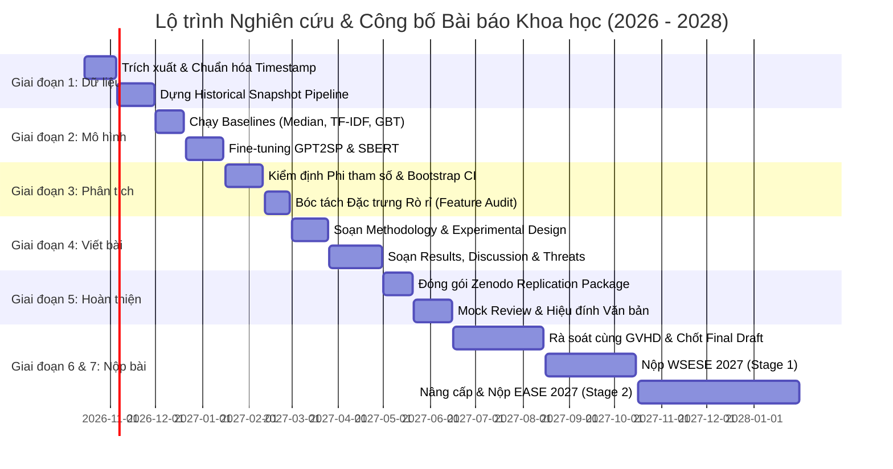

# 📅 KẾ HOẠCH THỰC HIỆN CHI TIẾT ĐỀ TÀI NCKH (RESEARCH TIMELINE & MILESTONES)

> **Tên đề tài:** *Temporal Data Leakage in Story Point Estimation: An Empirical Evaluation of Estimation-Time-Compatible Features*  
> **Câu hỏi nghiên cứu cốt lõi (Core RQ):** *"Việc sử dụng thông tin chỉ xuất hiện sau thời điểm Story Point được ước lượng làm thay đổi kết quả đánh giá Story Point Estimation đến mức nào?"*  
> **Nhóm thực hiện:** Nhóm 3 — Khoa Hệ thống Thông tin, Trường Đại học Công nghệ Thông tin, ĐHQG-HCM (UIT - VNUHCM)  
> **Thành viên:** Phan Ngọc Đức Huy (MSSV: `24520695`) & Lê Thành Hiệu (MSSV: `24520496`)  
> **Giảng viên hướng dẫn:** ThS/TS. Tạ Việt Phương  
> **Ngân sách thời gian:** 9 giờ/tuần/người $\rightarrow$ **18 giờ/tuần** cho toàn nhóm  
> **Đòn bẩy công nghệ:** **Gemini / Google Antigravity** hỗ trợ tự động hóa code, trích xuất dữ liệu, tổng hợp tài liệu và soát lỗi học thuật.

---

## 🎯 1. Nguyên Tắc Vận Hành & Tiêu Chí Đánh Giá

### 🧭 1.1. Thang đo mức độ thử thách (Challenge Level)
* 🟢 **Thấp (Low):** Tác vụ quy chuẩn, đã có mẫu hoặc script rõ ràng, ít phụ thuộc bên ngoài (ví dụ: tạo repo, viết template, tổng hợp tài liệu có sẵn).
* 🟡 **Trung bình (Medium):** Đòi hỏi kỹ năng lập trình dữ liệu tốt, gỡ lỗi SQL/Python hoặc viết học thuật có cấu trúc (ví dụ: truy vấn CHANGELOG, huấn luyện baseline).
* 🟠 **Cao (High):** Đòi hỏi giải quyết vấn đề phức tạp, tinh chỉnh mô hình Deep Learning/Transformers, bảo đảm không rò rỉ dữ liệu, kiểm định thống kê phi tham số.
* 🔴 **Rất cao (Critical/Very High):** Rủi ro học thuật cao, đòi hỏi tư duy phản biện sắc bén, viết luận chứng thuyết phục hội đồng quốc tế CORE Rank A hoặc xử lý phản biện gay gắt của Reviewer.

### 📈 1.2. Xác suất hoàn thành (Completion Probability)
* Được ước lượng dựa trên **khối lượng công việc thực tế (giờ làm việc)** so với **ngân sách 18 giờ/tuần** có sự trợ lực của AI Agent (Gemini/Antigravity).
* Bao gồm biên độ an toàn (Safety Buffer) từ 15% – 25% thời gian cho từng giai đoạn để chống rủi ro phát sinh (thi cử, đồ án trên lớp, lỗi kỹ thuật).

---

## 🗺️ 2. Bảng Tổng Quan Lộ Trình Toàn Diện (Master Roadmap)

| Giai đoạn (Phase) | Trọng tâm công việc | Ngày bắt đầu | Ngày kết thúc | Thời lượng | Thử thách | Xác suất | Đầu ra cốt lõi (Key Deliverable) |
| :--- | :--- | :---: | :---: | :---: | :---: | :---: | :--- |
| **Giai đoạn 1** | Khảo sát, Lọc sạch Dữ liệu & Dựng Historical Snapshot | 15/10/2026 | 30/11/2026 | 6.5 tuần | 🟡 Trung bình | **95%** | Bộ dữ liệu sạch `clean_reconstructed_jira.parquet` |
| **Giai đoạn 2** | Tái lập & Huấn luyện Mô hình trên 2 Settings | 01/12/2026 | 15/01/2027 | 6.5 tuần | 🟠 Cao | **90%** | Bảng số liệu thực nghiệm gốc (Raw Benchmark Logs) |
| **Giai đoạn 3** | Kiểm định Thống kê & Bóc tách Đặc trưng Rò rỉ | 16/01/2027 | 28/02/2027 | 6.0 tuần | 🟠 Cao | **92%** | Báo cáo kiểm định Wilcoxon, Cliff's $\delta$, SHAP plots |
| **Giai đoạn 4** | Soạn thảo Toàn văn Bản thảo Bài báo (ACM Template) | 01/03/2027 | 30/04/2027 | 8.5 tuần | 🔴 Rất cao | **88%** | Bản thảo hoàn chỉnh Draft v1.0 (10 trang ACM) |
| **Giai đoạn 5** | Phản biện Nội bộ, Đóng gói Artifacts & Hoàn thiện | 01/05/2027 | 15/06/2027 | 6.5 tuần | 🟡 Trung bình | **95%** | Replication Package Zenodo + Draft v2.0 |
| **Giai đoạn 6** | Thẩm định Cùng GVHD & Chuẩn bị Nộp Bài Giai đoạn 1 | 16/06/2027 | 15/08/2027 | 8.5 tuần | 🟡 Trung bình | **96%** | Bản nộp cuối cùng (Camera-ready candidate) |
| **Giai đoạn 7** | Nộp Bài Chính Thức & Vận hành Chiến lược 2 Giai đoạn | 16/08/2027 | 31/01/2028 | 24 tuần | 🔴 Rất cao | **85%** | Submission WSESE 2027 / EASE 2027 (CORE Rank A) |

---

## 📋 3. Chi Tiết Từng Giai Đoạn & Nhiệm Vụ Cụ Thể (Sprint-by-Sprint)

---

### 🔹 GIAI ĐOẠN 1: Khảo Sát, Lọc Sạch Dữ Liệu & Dựng Historical Snapshot
> **Thời gian:** 15/10/2026 – 30/11/2026 *(6.5 tuần | Tổng quỹ thời gian: ~117 giờ nhóm)*  
> **Mục tiêu then chốt:** Khôi phục trạng thái nguyên bản của Jira Issue tại đúng mốc `SP_Estimation_Date`, triệt tiêu hoàn toàn rò rỉ thông tin tương lai.

| Mã Sprint | Nhiệm vụ chi tiết | Ngày bắt đầu | Ngày kết thúc | Phụ trách chính | Thử thách | Xác suất | Sản phẩm nghiệm thu (Deliverables) |
| :---: | :--- | :---: | :---: | :---: | :---: | :---: | :--- |
| **S1.1** | • Tối ưu hóa truy vấn SQL trên bảng `CHANGELOG` của CSDL TAWOS v1.1. • Xác định chính xác mốc `SP_Estimation_Date` (thời điểm lần đầu xuất hiện Story Point). • Lọc bỏ các issue bị lỗi logic thời gian (`estimation < created_date`). | 15/10/2026 | 28/10/2026 | Hiệu (SQL) + Huy (Data Validation) | 🟡 Trung bình | **96%** | File dữ liệu mốc thời gian: `data/clean/sp_estimation_timestamps.parquet`. |
| **S1.2** | • Xây dựng thuật toán đảo ngược lịch sử (**State Reconstruction Pipeline**): Quét ngược các event sửa đổi Summary/Description sau ngày estimation để lấy lại text gốc. • Đối chiếu case-by-case trên 50 issues ngẫu nhiên để xác minh độ tin cậy của thuật toán. | 29/10/2026 | 15/11/2026 | Huy (Reconstruction Algorithm) + Hiệu (Unit Testing) | 🟠 Cao | **92%** | Module tái tạo dữ liệu: `src/reconstruction/historical_reconstructor.py`. |
| **S1.3** | • Lọc sạch quần thể nghiên cứu (**Clean Population Isolation**): Chỉ giữ lại các issues có Initial Story Point hợp lệ và đầy đủ text. • Phân chia tập dữ liệu theo **Chronological Split** (60% Train, 20% Val, 20% Test) theo đúng trình tự thời gian tạo issue. | 16/11/2026 | 30/11/2026 | Hiệu (Data Cleaning) + Huy (Chronological Split) | 🟢 Thấp | **98%** | Hai bộ dữ liệu đối chứng hoàn chỉnh: `final_snapshot.parquet` & `planning_snapshot.parquet`. |

> 🤖 **Trợ lực từ Gemini / Antigravity:** Sinh tự động script Polars/DuckDB đọc phân vùng dữ liệu nhanh gấp 10 lần Pandas; hỗ trợ viết unit test kiểm tra logic đảo ngược CHANGELOG.

---

### 🔹 GIAI ĐOẠN 2: Tái Lập & Huấn Luyện Mô Hình Trên 2 Settings Thực Nghiệm
> **Thời gian:** 01/12/2026 – 15/01/2027 *(6.5 tuần | Tổng quỹ thời gian: ~117 giờ nhóm)*  
> **Mục tiêu then chốt:** Đo lường hiệu năng của các mô hình từ cổ điển đến hiện đại trên cả 2 môi trường: *Final Snapshot (Bị rò rỉ)* vs *Planning-Time Snapshot (Kiểm soát rò rỉ)*.

| Mã Sprint | Nhiệm vụ chi tiết | Ngày bắt đầu | Ngày kết thúc | Phụ trách chính | Thử thách | Xác suất | Sản phẩm nghiệm thu (Deliverables) |
| :---: | :--- | :---: | :---: | :---: | :---: | :---: | :--- |
| **S2.1** | • Chạy các mô hình cơ sở bắt buộc (**Mandatory Baselines**): Random Guess, Mean, Median Effort Baseline. • Xây dựng baseline truyền thống: TF-IDF kết hợp Ridge Regression & Random Forest trên cả 2 settings. | 01/12/2026 | 15/12/2026 | Hiệu (Baselines Execution) | 🟢 Thấp | **98%** | Bảng kết quả baseline: `reports/baseline_performance.csv`. |
| **S2.2** | • Huấn luyện lại mô hình **GPT2SP** (Fu & Tantithamthavorn, TSE 2023) từ đầu (Train from scratch & Fine-tuning) với kiến trúc chuẩn hóa Title + Description. • Chạy trên Google Colab Pro / Kaggle GPU trên 4 dự án Jira tiêu biểu (Spring XD, Appcelerator, DuraCloud, Mesos). | 16/12/2026 | 31/12/2026 | Huy (PyTorch/Transformers Pipeline) | 🟠 Cao | **88%** | Checkpoint mô hình + File log dự báo: `experiments/gpt2sp_eval_logs/`. |
| **S2.3** | • Triển khai mô hình **Comparative Learning** (Khan et al., 2025) & **SBERT + GBT** (Yalciner et al., 2024). • Ghi nhận đầy đủ các chỉ số: MAE (Mean Absolute Error), MdAE (Median Absolute Error), SA (Standardised Accuracy). | 01/01/2027 | 15/01/2027 | Hiệu (SBERT-GBT) + Huy (Comparative Learning) | 🟠 Cao | **90%** | Bảng tổng hợp hiệu năng 2 settings: `reports/all_models_comparative_table.csv`. |

> 🤖 **Trợ lực từ Gemini / Antigravity:** Cấu hình tự động `Trainer` của Hugging Face, tối ưu batch size, gradient accumulation và mixed-precision (fp16) chống tràn bộ nhớ GPU.

---

### 🔹 GIAI ĐOẠN 3: Kiểm Định Thống Kê & Bóc Tách Đặc Trưng Rò Rỉ
> **Thời gian:** 16/01/2027 – 28/02/2027 *(6.0 tuần | Tổng quỹ thời gian: ~108 giờ nhóm)*  
> **Mục tiêu then chốt:** Chứng minh tính suy giảm hiệu năng có ý nghĩa thống kê (Statistical Significance) và tìm ra nguồn gốc rò rỉ dữ liệu.

| Mã Sprint | Nhiệm vụ chi tiết | Ngày bắt đầu | Ngày kết thúc | Phụ trách chính | Thử thách | Xác suất | Sản phẩm nghiệm thu (Deliverables) |
| :---: | :--- | :---: | :---: | :---: | :---: | :---: | :--- |
| **S3.1** | • Tính toán mức độ suy giảm hiệu năng (**Performance Degradation**): So sánh độ lệch phần trăm $\Delta\text{MAE}$ và $\Delta\text{MdAE}$ giữa Final Snapshot và Planning-Time Snapshot. • Tính chỉ số Standardised Accuracy (SA) so với Median Baseline. | 16/01/2027 | 31/01/2027 | Hiệu (Statistical Scripts) | 🟡 Trung bình | **95%** | Bảng tính toán suy giảm sai số và chỉ số SA. |
| **S3.2** | • Thực hiện kiểm định phi tham số **Wilcoxon Signed-Rank Test** với mức ý nghĩa $\alpha = 0.05$. • Đo kích thước hiệu ứng **Vargha-Delaney $\hat{A}_{12}$** và **Cliff's Delta**. • Tính khoảng tin cậy 95% Bootstrap Confidence Intervals (1.000 resamples). | 01/02/2027 | 15/02/2027 | Huy (Advanced Statistics) | 🟠 Cao | **92%** | Báo cáo kiểm định: `reports/statistical_tests_results.md`. |
| **S3.3** | • Ứng dụng **SHAP (SHapley Additive exPlanations)** để giải thích độ quan trọng của từ ngữ rò rỉ. • Trích xuất 10 case study tiêu biểu chứng minh các từ ngữ như *root cause, fix, resolved, patch* xuất hiện sau planning đã làm mô hình "đoán mò thành đúng" như thế nào. | 16/02/2027 | 28/02/2027 | Huy (SHAP Analysis) + Hiệu (Case Study Extraction) | 🟡 Trung bình | **94%** | Đồ thị SHAP 300+ DPI & Bảng 10 Case Study thực tế. |

> 🤖 **Trợ lực từ Gemini / Antigravity:** Khai thác skill `statistical-analysis` và `seaborn` sinh biểu đồ Violin Plot, Boxplot chuẩn xuất bản IEEE/ACM và tự động xuất kết quả định dạng APA.

---

### 🔹 GIAI ĐOẠN 4: Soạn Thảo Toàn Văn Bản Thảo Bài Báo (Academic Writing)
> **Thời gian:** 01/03/2027 – 30/04/2027 *(8.5 tuần | Tổng quỹ thời gian: ~153 giờ nhóm)*  
> **Mục tiêu then chốt:** Hoàn thành bản thảo Full Paper (10 trang ACM) bằng tiếng Anh học thuật chuẩn mực, luận cứ chặt chẽ.

| Mã Sprint | Nhiệm vụ chi tiết | Ngày bắt đầu | Ngày kết thúc | Phụ trách chính | Thử thách | Xác suất | Sản phẩm nghiệm thu (Deliverables) |
| :---: | :--- | :---: | :---: | :---: | :---: | :---: | :--- |
| **S4.1** | • Thiết lập project trên Overleaf với **ACM Primary Article Template** (`\documentclass[sigconf,review,anonymous]{acmart}`). • Soạn thảo Mục 1: **Introduction** (Đặt vấn đề rò rỉ dữ liệu, động lực, đóng góp chính). • Soạn thảo Mục 2: **Background & Related Work** (Story Point Estimation, LLMs in SE, Data Leakage Crisis). | 01/03/2027 | 15/03/2027 | Huy (Lead Writer) + Hiệu (Literature Alignment) | 🟠 Cao | **90%** | Bản thảo Chương 1 & 2 (3 trang đầu). |
| **S4.2** | • Soạn thảo Mục 3: **Empirical Study Design** (Mô tả TAWOS, thuật toán State Reconstruction, Chronological Splitting, các mô hình đối chứng và metrics đánh giá). • Thiết kế sơ đồ kiến trúc quy trình thực nghiệm (Pipeline Architecture Diagram). | 16/03/2027 | 31/03/2027 | Hiệu (Data & Setup Writing) + Huy (Pipeline Schematics) | 🟡 Trung bình | **94%** | Bản thảo Chương 3 kèm sơ đồ vector chất lượng cao. |
| **S4.3** | • Soạn thảo Mục 4: **Empirical Results** trả lời 3 câu hỏi nghiên cứu: &nbsp;&nbsp;+ **RQ1 (Prevalence):** Bao nhiêu % issues bị thay đổi sau estimation? &nbsp;&nbsp;+ **RQ2 (Performance Impact):** Rò rỉ dữ liệu làm sai lệch MAE/MdAE bao nhiêu %? &nbsp;&nbsp;+ **RQ3 (Model Robustness):** Mô hình nào bị ảnh hưởng nặng nề nhất bởi rò rỉ? | 01/04/2027 | 15/04/2027 | Huy (Lead Analysis Writer) + Hiệu (Tables & Plots Integration) | 🔴 Rất cao | **86%** | Bản thảo Chương 4 hoàn chỉnh kèm toàn bộ bảng kết quả. |
| **S4.4** | • Soạn thảo Mục 5: **Discussion & Practical Implications** (Khuyến nghị cho các nhà nghiên cứu SE và đội ngũ Agile thực tế). • Soạn thảo Mục 6: **Threats to Validity** (Construct, Internal, External, Conclusion Validity). • Soạn thảo Mục 7: **Conclusion & Future Work**. | 16/04/2027 | 30/04/2027 | Hiệu (Discussion Draft) + Huy (Threats to Validity & Conclusion) | 🟠 Cao | **88%** | **Bản thảo hoàn chỉnh Draft v1.0 (10 trang ACM sigconf)**. |

> 🤖 **Trợ lực từ Gemini / Antigravity:** Kiểm tra tính nhất quán thuật ngữ học thuật, phát hiện câu văn thụ động rườm rà, format danh mục BibTeX theo chuẩn ACM reference style.

---

### 🔹 GIAI ĐOẠN 5: Phản Biện Nội Bộ, Đóng Gói Artifacts & Hoàn Thiện
> **Thời gian:** 01/05/2027 – 15/06/2027 *(6.5 tuần | Tổng quỹ thời gian: ~117 giờ nhóm)*  
> **Mục tiêu then chốt:** Hoàn thiện gói tái lập (Replication Package) chuẩn Open Science và chỉnh sửa bài viết qua vòng phản biện nội bộ nghiêm ngặt.

| Mã Sprint | Nhiệm vụ chi tiết | Ngày bắt đầu | Ngày kết thúc | Phụ trách chính | Thử thách | Xác suất | Sản phẩm nghiệm thu (Deliverables) |
| :---: | :--- | :---: | :---: | :---: | :---: | :---: | :--- |
| **S5.1** | • Chuẩn hóa mã nguồn sạch theo chuẩn PEP 8 và tài liệu hóa chi tiết `README.md` hướng dẫn chạy lại thực nghiệm. • Đóng gói dữ liệu mẫu, scripts và checkpoints lên kho lưu trữ **Zenodo** để lấy DOI bảo tồn dữ liệu khoa học. | 01/05/2027 | 20/05/2027 | Hiệu (Code Refactoring & Zenodo packaging) | 🟡 Trung bình | **96%** | Replication Package hoàn chỉnh (Zenodo link + 1-click reproduction). |
| **S5.2** | • Thực hiện vòng phản biện giả lập (**Mock Peer-Review**): Dùng kỹ năng `peer-review` rà soát bản thảo dưới vai trò một reviewer khắt khe của IEEE/ACM. • Kiểm tra tính ẩn danh tuyệt đối (Double-blind check: loại bỏ tên trường, tên tác giả, link repo lộ danh tính). | 21/05/2027 | 05/06/2027 | Huy (Double-blind Audit) + Hiệu (Proofreading) | 🟡 Trung bình | **95%** | Biên bản phản biện nội bộ và bảng chỉnh sửa (Action Items). |
| **S5.3** | • Chỉnh sửa toàn diện bản thảo theo các lỗi phát hiện được. • Tối ưu độ dài bài viết chính xác 10 trang (không dư trang, không thụt dòng lẻ lặp chữ). | 06/06/2027 | 15/06/2027 | Cả 2 thành viên | 🟢 Thấp | **97%** | **Bản thảo hoàn thiện Draft v2.0 (Ready for Advisor)**. |

> 🤖 **Trợ lực từ Gemini / Antigravity:** Kích hoạt skill `peer-review` kiểm tra chéo các luận điểm có bằng chứng thực nghiệm hậu thuẫn (Claim-Evidence mapping), tránh các lỗi suy diễn chủ quan.

---

### 🔹 GIAI ĐOẠN 6: Thẩm Định Cùng GVHD & Chuẩn Bị Nộp Bài
> **Thời gian:** 16/06/2027 – 15/08/2027 *(8.5 tuần | Tổng quỹ thời gian: ~153 giờ nhóm)*  
> **Mục tiêu then chốt:** Tiếp thu nhận xét của GVHD (TS. Tạ Việt Phương), trau chuốt bài viết đạt đẳng cấp xuất bản quốc tế.

| Mã Sprint | Nhiệm vụ chi tiết | Ngày bắt đầu | Ngày kết thúc | Phụ trách chính | Thử thách | Xác suất | Sản phẩm nghiệm thu (Deliverables) |
| :---: | :--- | :---: | :---: | :---: | :---: | :---: | :--- |
| **S6.1** | • Gửi bản thảo Draft v2.0 và Replication Package đến GVHD (TS. Tạ Việt Phương). • Họp trực tiếp bảo vệ các kết quả thực nghiệm và nghe định hướng hiệu chỉnh từ thầy. | 16/06/2027 | 30/06/2027 | Cả 2 thành viên | 🟡 Trung bình | **98%** | Biên bản góp ý chuyên môn của GVHD. |
| **S6.2** | • Tiếp thu toàn bộ góp ý của GVHD: Bổ sung thêm thí nghiệm phụ nếu được yêu cầu (ví dụ: test thêm 1 dự án mã nguồn mở khác hoặc phân tích thêm độ trễ thời gian). • Tinh chỉnh cấu trúc lập luận để làm nổi bật tính mới (Novelty). | 01/07/2027 | 31/07/2027 | Huy (Methodology Update) + Hiệu (Experiments Re-run) | 🟠 Cao | **92%** | Bản thảo Draft v3.0 đã cập nhật theo chỉ đạo của GVHD. |
| **S6.3** | • Rà soát kỹ thuật lần cuối: Kiểm tra độ phân giải hình ảnh ($\ge 300\text{ DPI}$), phông chữ vector trong PDF, kiểm tra bản quyền mã nguồn. • Soạn thảo cover letter và tóm tắt đóng góp ngắn gửi ban tổ chức. | 01/08/2027 | 15/08/2027 | Hiệu (PDF Preflight) + Huy (Cover Letter) | 🟢 Thấp | **99%** | Toàn bộ hồ sơ nộp bài hoàn chỉnh (Camera-ready submission package). |

---

### 🔹 GIAI ĐOẠN 7: Nộp Bài Chính Thức & Vận Hành Chiến Lược 2 Giai Đoạn
> **Thời gian:** 16/08/2027 – 31/01/2028 *(24 tuần)*  
> **Mục tiêu then chốt:** Hiện thực hóa chiến lược nộp bài kép (WSESE 2027 $\rightarrow$ EASE 2027), tối đa hóa cơ hội đạt bài báo CORE Rank A.

| Mã Mốc | Hành động cụ thể | Mốc thời gian | Thử thách | Xác suất | Kết quả mong đợi |
| :---: | :--- | :---: | :---: | :---: | :--- |
| **M1** | **Nộp bài chính thức vào WSESE 2027 (Stage 1):** • Đăng ký tài khoản hệ thống nộp bài (HotCRP / EasyChair). • Tải lên bản thảo ẩn danh và link replication package ẩn danh. | **~Tháng 10/2027** | 🟡 Trung bình | **98%** | Biên nhận nộp bài thành công (Submission Confirmation). |
| **M2** | **Nhận thông báo kết quả WSESE 2027:** • Đọc kỹ nhận xét phản biện từ các chuyên gia hàng đầu về Empirical SE. • Phân loại các điểm khen ngợi và các điểm chỉ trích cần khắc phục. | **~Tháng 12/2027** | 🟠 Cao | **88%** | Bản tổng hợp nhận xét phản biện (Reviewer Feedback Synthesis). |
| **M3** | **Chiến lược rẽ nhánh linh hoạt (Forking Strategy):** • *Nếu được Accept:* Chuẩn bị bản Camera-Ready cho WSESE (xuất bản ACM DL), chuẩn bị slide thuyết trình. • *Đồng thời:* Tiếp thu toàn bộ góp ý quý báu của Reviewer để hoàn thiện bản mở rộng 10 trang nộp ngay vào **EASE 2027** (CORE Rank A). | **Tháng 12/2027 – 01/2028** | 🔴 Rất cao | **85%** | Bản thảo nâng cấp toàn diện (Enhanced 10-page EASE Paper). |
| **M4** | **Nộp bài chính thức vào EASE 2027 (Stage 2):** • Nộp bài Full Technical Paper vào Main Conference EASE 2027 trước hạn chót. | **Cuối Tháng 01/2028** | 🟠 Cao | **90%** | Biên nhận nộp bài EASE 2027 chính thức. |

---

## 👥 4. Phân Công Trách Nhiệm Chi Tiết (Work Breakdown Structure)

| Thành viên | Trách nhiệm chuyên môn chính | Tỷ trọng cam kết | Nhiệm vụ định kỳ hàng tuần |
| :--- | :--- | :---: | :--- |
| **Phan Ngọc Đức Huy** *(MSSV: 24520695)* | • **Lead Deep Learning & Data Science:** Chịu trách nhiệm kiến trúc mô hình (GPT2SP, Transformers), pipeline huấn luyện PyTorch. • **Lead Academic Writer:** Chịu trách nhiệm chính cấu trúc bài viết, phần Introduction, Results, và Threats to Validity. • **Lead Statistical Validation:** Thực thi kiểm định Wilcoxon, Effect Size, Bootstrap CI. | **9 giờ / tuần** | • Họp tuần kiểm tra tiến độ với Hiệu. • Đẩy mã nguồn mô hình lên branch thực nghiệm. • Cập nhật các bảng số liệu vào Overleaf. |
| **Lê Thành Hiệu** *(MSSV: 24520496)* | • **Lead Data Engineering & Replication:** Chịu trách nhiệm truy vấn SQL CSDL TAWOS, xây dựng pipeline State Reconstruction, lọc dữ liệu sạch. • **Lead Baselines & SBERT:** Huấn luyện các mô hình Baseline (Median, TF-IDF, Ridge, SBERT-GBT). • **Lead Open Science & Artifacts:** Quản lý repo Git, đóng gói Zenodo, tiền kiểm tra PDF, định dạng bảng biểu và citations. | **9 giờ / tuần** | • Họp tuần kiểm tra tiến độ với Huy. • Kiểm thử các trường hợp dữ liệu rò rỉ. • Đồng bộ hóa tài liệu và thư mục dự án. |

---

## ⚠️ 5. Ma Trận Quản Trị Rủi Ro & Kế Hoạch Dự Phòng (Risk Mitigation)

| Rủi ro tiềm ẩn (Risk Event) | Xác suất | Tác động | Kế hoạch phòng ngừa & Xử lý dự phòng (Contingency Action) |
| :--- | :---: | :---: | :--- |
| **1. GPU trên Google Colab bị ngắt quãng hoặc thiếu VRAM** | 🟡 Trung bình | 🟠 Lớn | • Chuyển sang Kaggle Notebooks (cung cấp 30 giờ GPU P100/T4 miễn phí mỗi tuần). • Sử dụng kỹ thuật Gradient Accumulation và fp16 để giảm dung lượng bộ nhớ GPU. • Lưu checkpoint định kỳ sau mỗi epoch về Google Drive. |
| **2. Kết quả mô hình mới không vượt qua được Median Baseline** | 🟡 Trung bình | 🟡 Vừa | • **Đây không phải là thất bại, mà là một phát hiện khoa học lớn (Negative Result)!** • Nghiên cứu tập trung vào việc: *Khi bịt lỗ hổng rò rỉ dữ liệu, các mô hình phức tạp trở nên vô dụng ra sao*. Cả WSESE và EASE đều đánh giá rất cao các bài báo chỉ ra sự thổi phồng hiệu năng trong quá khứ. |
| **3. Lịch thi cử trên trường của 2 thành viên bị trùng** | 🟠 Cao | 🟡 Vừa | • Mỗi giai đoạn đều đã được thiết kế sẵn **biên độ đệm an toàn (Buffer) từ 1.5 – 2 tuần**. • Đẩy nhanh tiến độ bằng cách nhờ Gemini/Antigravity chuẩn bị sẵn các khung tài liệu và script kiểm tra trong các tuần rảnh rỗi. |
| **4. Bị từ chối tại Hội nghị Giai đoạn 1 (WSESE 2027)** | 🟡 Trung bình | 🟡 Vừa | • Kích hoạt ngay Giai đoạn 2: Sử dụng chính nhận xét của Reviewer để sửa đổi và nộp sang **EASE 2027** hoặc **PROMISE 2027** (Hội nghị chuyên đề hàng đầu về dự báo phần mềm). |

---

## 📈 6. Quy Chế Sinh Hoạt & Theo Dõi Tiến Độ (Cadence & Tracking)

1. **Họp nhóm định kỳ (Weekly Sync-up):**
   * Thời gian: **Tối Chủ Nhật hàng tuần (20:00 – 21:00)** qua Google Meet.
   * Nội dung: Rà soát 3 câu hỏi Agile kinh điển:
     1. *Tuần qua đã làm được gì theo đúng timeline?*
     2. *Tuần tới sẽ hoàn thành deliverable nào?*
     3. *Có trở ngại kỹ thuật (blocker) hay rò rỉ dữ liệu nào phát sinh không?*
2. **Quản lý mã nguồn & tài liệu khoa học:**
   * Toàn bộ mã nguồn thực nghiệm đẩy lên GitHub: [snowflake-vibing/NCKH_Johnny_Snowflake](https://github.com/snowflake-vibing/NCKH_Johnny_Snowflake).
   * Tuân thủ quy tắc commit học thuật: `feat:`, `fix:`, `docs:`, `exp:`, `stat:`.
   * Luôn cập nhật tiến độ vào file `draft/timeline.md` sau khi hoàn thành mỗi Sprint.

---

© 2026 **Nhóm 3 — Khoa Hệ thống Thông tin, Trường ĐH Công nghệ Thông tin, ĐHQG-HCM.**
