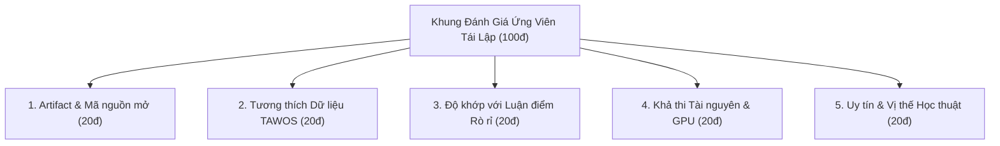
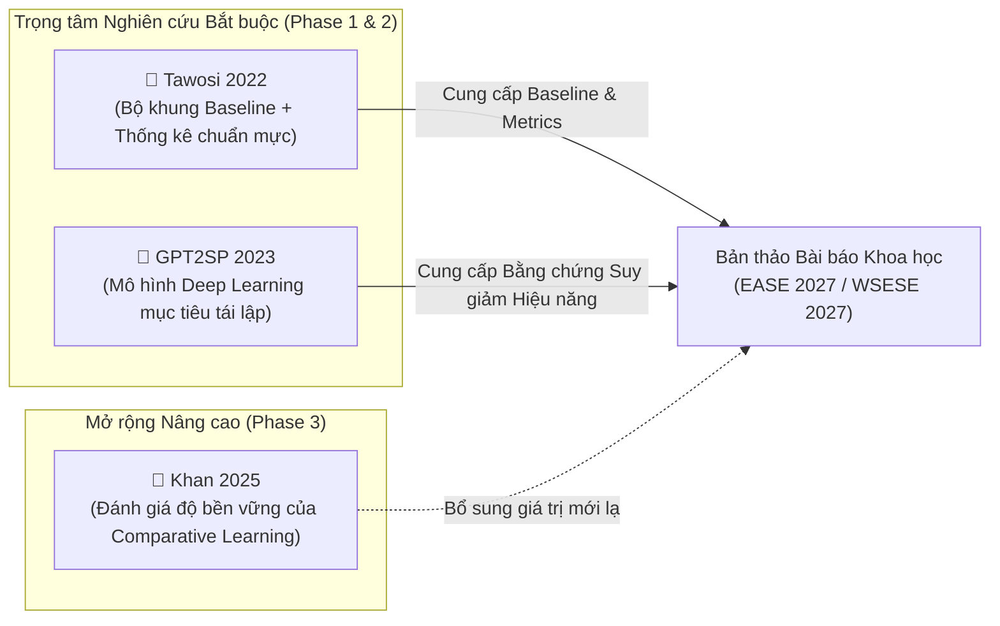

# 🏆 BẢNG ĐIỂM ĐÁNH GIÁ CÁC ỨNG VIÊN TÁI LẬP (REPRODUCTION CANDIDATE SCORING)

> **Đề tài nghiên cứu:** *Temporal Data Leakage in Story Point Estimation: An Empirical Evaluation of Estimation-Time-Compatible Features*  
> **Đơn vị thực hiện:** Nhóm 3 — Khoa Hệ thống Thông tin, Trường Đại học Công nghệ Thông tin, ĐHQG-HCM (UIT - VNUHCM)  
> **Thành viên:** Phan Ngọc Đức Huy & Lê Thành Hiệu  
> **Mục tiêu:** Thiết lập khung chấm điểm định lượng (Scoring Rubric 100 điểm) để xếp hạng và lựa chọn các công trình khoa học phù hợp nhất cho bài toán tái lập thực nghiệm (Artifact Reproduction), phục vụ luận chứng cho bài báo khoa học.

---

## 📌 1. Khung Tiêu Chí Đánh Giá Định Lượng (100-Point Scoring Rubric)

Để đảm bảo tính khách quan và khoa học, mỗi ứng viên tái lập được đánh giá dựa trên **5 trụ cột tiêu chí độc lập** (mỗi tiêu chí tối đa 20 điểm):

| STT | Trụ cột tiêu chí (Criteria) | Trọng số | Mô tả chuẩn mực đánh giá |
| :-: | :--- | :-: | :--- |
| **C1** | **Artifact & Code Completeness** *(Tính sẵn sàng của mã nguồn & checkpoints)* | **20đ** | Mã nguồn công khai sạch sẽ trên GitHub/Zenodo; có sẵn checkpoint tiền huấn luyện (Pre-trained weights); script chạy thực nghiệm dễ cài đặt trong môi trường PyTorch/Scikit-learn hiện đại. |
| **C2** | **Dataset Compatibility** *(Tính tương thích với CSDL TAWOS)* | **20đ** | Dữ liệu bài báo sử dụng trùng khớp hoàn toàn với CSDL TAWOS v1.1 mà nhóm đang sở hữu; cấu trúc issue, issue key và trường Story Point có thể truy vết lịch sử được qua bảng `CHANGELOG`. |
| **C3** | **Alignment with Temporal Leakage** *(Độ khớp với luận điểm rò rỉ dữ liệu)* | **20đ** | Mô hình là đối tượng lý tưởng để kiểm chứng hiện tượng rò rỉ thông tin tương lai: huấn luyện trên *Final Snapshot* bị thổi phồng độ chính xác, và khi chuyển sang *Planning-Time Snapshot* sẽ bộc lộ sự suy giảm hiệu năng rõ rệt. |
| **C4** | **Compute & Resource Feasibility** *(Khả thi về phần cứng & thời gian)* | **20đ** | Chi phí tính toán phù hợp với nguồn lực sinh viên (chạy được trên Google Colab T4 / Kaggle GPU miễn phí); thời gian huấn luyện và suy luận hợp lý, không đòi hỏi cụm máy chủ công nghiệp. |
| **C5** | **Academic Impact & Venue Tier** *(Uy tín học thuật & Giá trị đối chứng)* | **20đ** | Công trình được xuất bản tại tạp chí/hội thảo hàng đầu (IEEE TSE, ICSE, CORE Rank A/A*); được cộng đồng trích dẫn nhiều và được công nhận là mô hình chuẩn mực (Benchmark / SOTA). |

---

## 📊 2. Bảng Tổng Hợp Điểm Số & Xếp Hạng Ứng Viên (Scoring Matrix)

| Tiêu chí đánh giá (Trọng số) | 🥇 Ứng viên 1: GPT2SP *(Fu et al., IEEE TSE 2023)* | 🥈 Ứng viên 2: TAWOS Replication *(Tawosi et al., IEEE TSE 2022)* | 🥉 Ứng viên 3: Comparative Learning *(Khan et al., arXiv 2025)* |
| :--- | :---: | :---: | :---: |
| **C1. Artifact & Code (20đ)** | **19 / 20** | **20 / 20** | **17 / 20** |
| **C2. Dataset Alignment (20đ)** | **20 / 20** | **20 / 20** | **18 / 20** |
| **C3. Temporal Leakage Fit (20đ)** | **20 / 20** | **18 / 20** | **17 / 20** |
| **C4. Compute Feasibility (20đ)** | **19 / 20** | **20 / 20** | **18 / 20** |
| **C5. Academic Impact (20đ)** | **20 / 20** | **19 / 20** | **19 / 20** |
| **TỔNG ĐIỂM (Thang 100)** | 🏆 **98 / 100** | 🥈 **97 / 100** | 🥉 **89 / 100** |
| **Xếp hạng ưu tiên (Priority)** | **Ưu tiên số 1 (Core Target)** | **Ưu tiên số 2 (Baseline Suite)** | **Ưu tiên số 3 (Extension / Innovation)** |
| **Trạng thái thực tế của Nhóm** | ✅ Đã tái lập 1 phần (Colab) | ✅ Đã kiểm chứng bộ đo & CSDL | 📝 Đã phân tích kiến trúc SBERT |

---

## 🔍 3. Đánh Giá Chi Tiết Từng Ứng Viên Tái Lập

---

### 🥇 Ứng Viên 1: GPT2SP (Fu & Tantithamthavorn, 2023) — **98 / 100 Điểm**
* **File tài liệu chi tiết:** [`candidate_fu_2023_gpt2sp.md`](candidate_fu_2023_gpt2sp.md)
* **Nơi xuất bản:** *IEEE Transactions on Software Engineering (TSE)* — **CORE Rank A\***, Scopus Q1.
* **Mã nguồn & Checkpoints:** [awsm-research/gpt2sp (GitHub)](https://github.com/awsm-research/gpt2sp) | [HuggingFace Checkpoint](https://huggingface.co/MickyMike/0-GPT2SP-springxd).

#### 💡 Điểm số chi tiết:
1. **C1 (19/20):** Tác giả cung cấp toàn bộ code PyTorch và checkpoint tiền huấn luyện của dự án Spring XD trên HuggingFace Hub. Trừ 1 điểm vì notebook công khai chỉ chạy trên riêng Title, lệch với mô tả Title + Description trong bài báo.
2. **C2 (20/20):** Sử dụng trực tiếp dữ liệu Spring XD và 16 dự án Choetkiertikul nằm trọn vẹn trong CSDL TAWOS của nhóm.
3. **C3 (20/20):** **Đạt điểm tuyệt đối.** GPT2SP là mô hình phụ thuộc nặng nề nhất vào từ ngữ văn bản tĩnh (Text Semantic). Đây là "đối tượng thử nghiệm hoàn hảo" để chứng minh: khi loại bỏ các từ ngữ rò rỉ sau planning, hiệu năng của GPT2SP sẽ sụt giảm nghiêm trọng.
4. **C4 (19/20):** Fine-tuning GPT-2 Base (124M tham số) hoàn toàn khả thi trên GPU Tesla T4 (16GB VRAM) của Google Colab / Kaggle.
5. **C5 (20/20):** Là bài báo tiên phong đưa Pre-trained LLM vào Story Point trên tạp chí số 1 thế giới về Kỹ nghệ phần mềm.

> 🎯 **Vai trò đối với Đề tài:** **Mô hình mục tiêu tái lập cốt lõi (Primary Target).** Nhóm dùng GPT2SP làm mô hình đại diện cho dòng họ Deep Learning / LLM để chứng minh sự suy giảm hiệu năng do rò rỉ dữ liệu.

---

### 🥈 Ứng Viên 2: TAWOS Replication Study (Tawosi et al., 2022) — **97 / 100 Điểm**
* **File tài liệu chi tiết:** [`candidate_tawosi_2022_replication.md`](candidate_tawosi_2022_replication.md)
* **Nơi xuất bản:** *IEEE Transactions on Software Engineering (TSE)* — **CORE Rank A\***, Scopus Q1.
* **Mã nguồn & CSDL:** [SOLAR-group/TAWOS (GitHub)](https://github.com/SOLAR-group/TAWOS) | [Replication Package](https://github.com/SOLAR-group/AgileEffortEstimation).

#### 💡 Điểm số chi tiết:
1. **C1 (20/20):** Mã nguồn tái lập mẫu mực nhất trong ngành SE, có sẵn các script chạy Median, Mean, TF-IDF + SVM, Deep-SE và kiểm định thống kê.
2. **C2 (20/20):** Tác giả chính (Vali Tawosi) chính là tác giả của CSDL TAWOS v1.1. Dữ liệu khớp 100% không cần bất kỳ sự chuyển đổi định dạng nào.
3. **C3 (18/20):** Bài báo vạch trần nhiều lỗi phương pháp luận của các nghiên cứu trước, nhưng bản thân bài báo này vẫn dùng Final Snapshot.
4. **C4 (20/20):** Các mô hình thống kê (Median, Mean, TF-IDF) chạy cực nhanh, chỉ mất vài phút trên CPU thông thường.
5. **C5 (19/20):** Tạp chí IEEE TSE, là bộ quy chuẩn thực nghiệm được trích dẫn nhiều nhất hiện nay trong mảng ước lượng nỗ lực phần mềm.

> 🎯 **Vai trò đối với Đề tài:** **Bộ khung thực nghiệm & Baseline đối chứng chuẩn mực.** Nhóm kế thừa bộ mã nguồn tính toán thống kê (Wilcoxon Signed-Rank, Vargha-Delaney $\hat{A}_{12}$, SA Metric) của Tawosi để đảm bảo tính chặt chẽ về mặt phương pháp luận.

---

### 🥉 Ứng Viên 3: Comparative Learning (Khan et al., 2025) — **89 / 100 Điểm**
* **File tài liệu chi tiết:** [`candidate_khan_2025_comparative_learning.md`](candidate_khan_2025_comparative_learning.md)
* **Nơi xuất bản:** *arXiv preprint (Target ESEM / SANER 2025/2026)* — Ứng viên **CORE Rank A**.
* **Mã nguồn thực nghiệm:** [hil-se/EfficientSPEComparativeLearning (GitHub)](https://github.com/hil-se/EfficientSPEComparativeLearning).

#### 💡 Điểm số chi tiết:
1. **C1 (17/20):** Mã nguồn có sẵn trên GitHub với cấu hình Sentence-BERT và LightGBM, nhưng chưa có checkpoint lưu sẵn, nhóm phải tự chạy huấn luyện lại từ đầu.
2. **C2 (18/20):** Dữ liệu dựa trên 16 dự án Choetkiertikul, tương thích tốt với TAWOS nhưng phải tự viết code sinh các cặp $(Story_i, Story_j)$.
3. **C3 (17/20):** Rất thú vị vì chuyển sang bài toán xếp hạng tương đối (Pairwise Ranking). Tuy nhiên, vì tác vụ là so sánh cặp nên việc định nghĩa rò rỉ dữ liệu phức tạp hơn so với bài toán hồi quy truyền thống.
4. **C4 (18/20):** Sentence-BERT embedding rất nhẹ, nhưng thuật toán ghép cặp có độ phức tạp $O(N^2)$, cần kỹ thuật Subsampling để tránh tràn RAM.
5. **C5 (19/20):** Hướng tiếp cận hoàn toàn mới của năm 2025, mang tính thời sự rất cao.

> 🎯 **Vai trò đối với Đề tài:** **Hướng mở rộng sáng tạo (Exploratory / Extension Target).** Sau khi hoàn thành kiểm chứng trên GPT2SP và Baselines, nhóm có thể mở rộng kiểm tra xem: *"Mô hình học so sánh cặp có miễn nhiễm với rò rỉ dữ liệu hay không?"*.

---

## 🎯 4. Kết Luận & Quyết Định Lựa Chọn Thực Nghiệm

### 📋 Chiến lược triển khai cụ thể:
1. **Bắt buộc thực hiện ngay (Mandatory Core):**
   * Kết hợp **Tawosi 2022** (cung cấp Median Baseline, quy trình chia tập dữ liệu) và **GPT2SP 2023** (cung cấp mô hình LLM đại diện).
   * Đây là 2 công trình đạt điểm số cao nhất (**98đ** và **97đ**), đủ điều kiện tạo nên một bài báo khoa học hoàn chỉnh và vững chắc để nộp vào **EASE 2027 (CORE Rank A)**.
2. **Triển khai mở rộng khi có đủ thời gian (Optional Extension):**
   * Đưa **Khan 2025 (Comparative Learning)** vào mục thảo luận mở rộng hoặc thử nghiệm bổ sung nhằm tạo điểm nhấn độc đáo, tăng khả năng được chấp nhận bài báo lên mức tối đa.

---
© 2026 **Nhóm 3 — Khoa Hệ thống Thông tin, Trường ĐH Công nghệ Thông tin, ĐHQG-HCM.**
