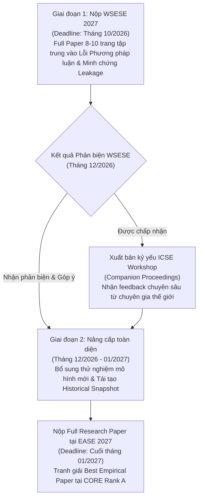

# 🏛️ ĐÁNH GIÁ ĐỐI CHÍNH HỘI NGHỊ KHOA HỌC: EASE 2027 VS. WSESE 2027
> **Đề tài nghiên cứu dự kiến:** *Temporal Data Leakage in Story Point Estimation: An Empirical Evaluation of Estimation-Time-Compatible Features*  
> **Câu hỏi nghiên cứu cốt lõi (Core RQ):** *"Việc sử dụng thông tin chỉ xuất hiện sau thời điểm Story Point được ước lượng làm thay đổi kết quả đánh giá Story Point Estimation đến mức nào?"*  
> **Đơn vị thực hiện:** Nhóm 3 — Khoa Hệ thống Thông tin, Trường ĐH Công nghệ Thông tin, ĐHQG-HCM (UIT - VNUHCM)

---

## 📌 1. Bối cảnh & Mục tiêu Đánh giá
Báo cáo này phân tích, so sánh chi tiết và thiết lập chiến lược nộp bài 2 giai đoạn (Two-Stage Submission Strategy) giữa 2 địa điểm công bố học thuật quốc tế uy tín trong ngành Kỹ nghệ Phần mềm (Software Engineering):
1. **EASE 2027** (*International Conference on Evaluation and Assessment in Software Engineering* - CORE Rank A).
2. **WSESE 2027** (*International Workshop on Methodological Issues with Empirical Studies in Software Engineering* - Workshop vệ tinh trực thuộc **ICSE 2027** - Top 1 CORE Rank A*).

---

## 📊 2. Bảng Đối Chiếu Chi Tiết Giữa EASE và WSESE

| Tiêu chí | 🏛️ EASE 2027 (Main Conference) | 🔬 WSESE 2027 (Co-located with ICSE 2027) |
| :--- | :--- | :--- |
| **Bản chất sự kiện** | **Hội nghị Khoa học Quốc tế độc lập** (Main Conference thường niên, tổ chức từ năm 1997). | **Hội thảo Chuyên đề Quốc tế (Workshop vệ tinh)** thuộc khuôn khổ đại hội **ICSE** (Hội thảo số 1 thế giới về SE). |
| **Cộng đồng học thuật** | Cộng đồng **Empirical Software Engineering (ESE)** toàn cầu, tập trung vào phương pháp đánh giá thực nghiệm, đo lường và thẩm định mô hình. | Cộng đồng chuyên gia thẩm định **Phương pháp luận nghiên cứu (Research Methodology), độ tin cậy thực nghiệm (Validity) & Đạo đức khoa học** của ACM/IEEE ICSE. |
| **Chủ đề chính (Focus Area)** | Đánh giá thực nghiệm các kỹ thuật SE, đo lường phần mềm, ứng dụng AI/ML/LLM trong kỹ nghệ phần mềm, nghiên cứu tái lập (Replication). | Các lỗi phương pháp luận (Methodological Flaws), mối đe dọa giá trị (Threats to Validity), bẫy rò rỉ dữ liệu (Data Leakage), sai lầm phân tích thống kê trong SE. |
| **Dạng bài thường gặp** | **Full Technical Research Papers (8–10 trang)**, Short Papers, Industry Track, Artifact/Replication Studies. | **Methodological Papers, Empirical Flaw Audits, Critique Papers, Work-in-Progress (5–10 trang)**. |
| **Mức độ tương thích đề tài (Fit)** | ⭐⭐⭐⭐ (Rất cao: EASE cực kỳ chuộng các bài đánh giá đo lường tác động thực tế của AI trên tập dữ liệu lớn). | ⭐⭐⭐⭐⭐ (Hoàn hảo tuyệt đối: Đề tài của nhóm trực tiếp "vạch trần" lỗi rò rỉ dữ liệu phương pháp luận mà các bài báo SOTA mắc phải). |
| **Dạng đóng góp được chấp nhận** | Technical Contributions, Empirical Evaluations, Replications, Tools. | Methodological Critique, Negative Results, Empirical Audits, Guidelines. |
| **Xếp hạng & Độ uy tín (Tier/Rank)** | **CORE Rank A** (Rất uy tín, xuất bản ACM Digital Library). | **Workshop của ICSE (CORE Rank A\*)**. Tuy workshop không xếp hạng CORE riêng, nhưng xuất bản chính thức trong **ICSE Companion Proceedings (ACM DL)**. |
| **Yêu cầu Format & Submission** | • **Template:** ACM Primary Article Template (`\documentclass[sigconf,review,anonymous]{acmart}`). • **Trang:** Tối đa **10 trang** (gồm bảng biểu, hình vẽ và tài liệu tham khảo). • **Review:** Double-blind (Ẩn danh 2 chiều). • **Ngôn ngữ:** Tiếng Anh học thuật chuẩn mực. • **Open Science:** Yêu cầu đính kèm Replication Package (Zenodo/GitHub). | • **Template:** ACM Primary Article Template (`sigconf` layout, review & anonymous). • **Trang:** Thường giới hạn từ **6 đến 10 trang** tùy track. • **Review:** Double-blind (Ẩn danh nghiêm ngặt). • **Ngôn ngữ:** Tiếng Anh. • **Open Science:** Bắt buộc chứng minh tính minh bạch của dữ liệu và code thực nghiệm. |
| **Thời gian nộp bài dự kiến (Deadlines)** | • **Nộp Abstract:** ~Tháng 01/2027 • **Nộp Full Paper:** ~Cuối tháng 01/2027 • **Hội nghị diễn ra:** ~Tháng 06/2027 | • **Nộp Abstract:** ~Tháng 10/2026 • **Nộp Full Paper:** ~Cuối tháng 10/2026 • **Workshop diễn ra:** ~Tháng 04/2027 (cùng tuần lễ ICSE 2027) |
| **Hình thức tổ chức** | Thường là **Hybrid** (Onsite tại Châu Âu kết hợp Online cho tác giả có lý do đặc biệt) hoặc Onsite bắt buộc. | Thường là **Hybrid / Onsite** trong chuỗi sự kiện ICSE. |
| **Chi phí dự kiến (Budget Estimate)** | • **Registration:** ~600 – 900 EUR (~16 – 24 triệu VNĐ). • **Travel (nếu đi trực tiếp):** ~40 – 60 triệu VNĐ (vé máy bay, khách sạn, visa). | • **Registration (Workshop only):** ~400 – 700 USD (~10 – 18 triệu VNĐ). • **Travel (nếu đi cùng ICSE):** ~50 – 70 triệu VNĐ (tùy quốc gia đăng cai ICSE 2027). |

---

## 🎯 3. Phân Tích Mức Độ Tương Thích Của Đề Tài (Topic Fit Analysis)

Đề tài: *"Temporal Data Leakage in Story Point Estimation: An Empirical Evaluation of Estimation-Time-Compatible Features"*  
Câu hỏi nghiên cứu: *"Việc sử dụng thông tin chỉ xuất hiện sau thời điểm Story Point được ước lượng làm thay đổi kết quả đánh giá Story Point Estimation đến mức nào?"*

### 🔬 3.1. Đối với WSESE (ICSE Workshop) — Điểm tương thích 10/10:
* **Tại sao khớp hoàn hảo?** WSESE sinh ra chính là để mổ xẻ những bài báo có kết quả "quá đẹp" nhờ vào các lỗi phương pháp luận tiềm ẩn (như Data Leakage, chọn sai baseline, hay rò rỉ thời gian).
* Bài nghiên cứu của Nhóm 3 cung cấp minh chứng định lượng trên CSDL TAWOS (hàng chục nghìn lượt sửa text sau khi planning), chứng minh rằng kết quả cao ngất ngưởng của các mô hình LLM (như GPT2SP, Deep-SE) thực chất là do nhìn thấy thông tin tương lai. Đây chính là "món ăn ưa thích" của hội đồng thẩm định WSESE.

### 🏛️ 3.2. Đối với EASE (Main Conference) — Điểm tương thích 9/10:
* **Tại sao khớp tốt?** EASE là hội nghị hàng đầu về thẩm định thực nghiệm (Evaluation & Assessment). Bài báo của nhóm không chỉ nêu lý thuyết mà còn xây dựng một cuộc thực nghiệm quy mô lớn: Tái dựng lại trạng thái lịch sử (*Historical State Reconstruction*) trên 39 dự án TAWOS và so sánh trực tiếp hiệu năng giữa 2 settings:
  1. *Final Snapshot* (Setting truyền thống có rò rỉ).
  2. *Planning-Time Snapshot* (Setting thực tế kiểm soát rò rỉ).
* Đây là một bài báo thực nghiệm mẫu mực (Empirical Study), hoàn toàn đủ tầm vóc để cạnh tranh sòng phẳng ở track Full Research Paper của EASE.

---

## 🗺️ 4. Chiến Lược Nộp Bài 2 Giai Đoạn (Two-Stage Strategy)

Vì người dùng đã chọn chiến lược nộp bài 2 giai đoạn và mục tiêu là **Full Research Paper (8–10 trang)**:

1. **Giai đoạn 1 (Tháng 10/2026 — Nộp WSESE 2027):**
   * Đóng gói bản thảo 8–10 trang tập trung vào: *Thống kê hiện tượng rò rỉ trên TAWOS v1.1 + Kết quả thực nghiệm đối chứng trên GPT2SP và Median Baseline*.
   * Lợi ích: Nhận được phản biện cực kỳ khắt khe từ các nhà nghiên cứu hàng đầu về phương pháp luận của ICSE để hoàn thiện bài viết.
2. **Giai đoạn 2 (Tháng 01/2027 — Nộp EASE 2027):**
   * Tận dụng các góp ý từ vòng 1, bổ sung thêm giải pháp tái dựng đặc trưng tương thích thời điểm lập kế hoạch (*Estimation-Time-Compatible Features*) và mở rộng trên toàn bộ các dự án trong TAWOS.
   * Nộp bài Full Paper hoàn chỉnh nhất vào Main Conference EASE 2027 (CORE Rank A).

---

## 📅 5. Lập Kế Hoạch & Lộ Trình Thực Hiện (Action Timeline: Hiện tại -> Submit)

| Mốc thời gian | Tác vụ chi tiết cần hoàn thành | Sản phẩm đầu ra (Deliverables) |
| :--- | :--- | :--- |
| **10/2026** *(Hiện tại)* | • Chốt khung nghiên cứu, câu hỏi nghiên cứu (RQ1, RQ2). • Hoàn thành pipeline trích xuất CHANGELOG từ CSDL TAWOS cục bộ để xác định `SP_Estimation_Date`. | Script SQL/Python trích xuất bảng lịch sử thay đổi `clean_issues.csv`. |
| **11/2026** | • Tái lập toàn bộ các baseline (Median, TF-IDF + Ridge) và mô hình GPT2SP trên 2 settings (Final vs Planning-time). • Đo lường mức độ suy giảm hiệu năng (Performance Degradation Drop). | Bảng số liệu thực nghiệm đầy đủ (MAE, MdAE, SA, Wilcoxon test). |
| **12/2026** | • Viết bản thảo thô (Drafting): Giới thiệu (Intro), Bối cảnh rò rỉ dữ liệu (Background), Thiết kế thực nghiệm (Methodology). • Lập bảng biểu và biểu đồ phân phối sai số chuẩn xuất bản (300+ DPI). | Bản thảo sơ bộ (Draft v1.0 - 8 trang Overleaf ACM template). |
| **01/2027 – 03/2027** | • Mở rộng thử nghiệm trên mô hình Comparative Learning (Khan 2025) và SBERT-GBT. • Viết mục Thảo luận (Discussion) và Các mối đe dọa giá trị (Threats to Validity). | Bản thảo hoàn thiện đầy đủ thực nghiệm (Draft v2.0 - 10 trang). |
| **04/2027 – 08/2027** | • Gửi giảng viên hướng dẫn (ThS/TS. Tạ Việt Phương) rà soát và góp ý phản biện. • Tối ưu văn phong học thuật tiếng Anh, đóng gói Replication Package lên Zenodo/GitHub. | Bản thảo hoàn chỉnh sẵn sàng nộp (Ready for Submission). |
| **09/2027 – 10/2027** | • Nộp bản thảo vào **WSESE 2027** (Giai đoạn 1). | Submission Confirmation WSESE. |
| **11/2027 – 01/2028** | • Nhận phản biện, cập nhật dữ liệu và nộp bản Full Paper mở rộng vào **EASE 2027** (Giai đoạn 2). | Submission Confirmation EASE. |

---

## ⚖️ 6. Phân Tích Phương Án Chi Phí & Điều Kiện Tham Dự (Finance & Attendance Analysis)

Nhóm xem xét toàn bộ các kịch bản tài chính để chuẩn bị phương án ứng phó:

1. **Phương án 1: Thuyết trình Online / Từ xa (Remote Presentation - Tiết kiệm nhất):**
   * *Khả năng:* Nhiều hội nghị SE sau đại dịch vẫn duy trì chính sách cho phép tác giả sinh viên hoặc tác giả gặp khó khăn visa thuyết trình online (cần gửi thư xin phép Ban tổ chức sau khi bài được chấp nhận).
   * *Chi phí:* Chỉ tốn phí đăng ký bài báo (Registration fee: ~10 – 20 triệu VNĐ).
2. **Phương án 2: Xin tài trợ từ Trường / Quỹ NCKH Sinh viên (Recommended):**
   * Trường ĐH Công nghệ Thông tin (UIT - VNUHCM) và ĐHQG-HCM có các chính sách khen thưởng và hỗ trợ kinh phí công bố bài báo quốc tế uy tín (đặc biệt các bài thuộc danh mục Scopus Q1 / CORE Rank A).
   * Nhóm có thể làm hồ sơ xin tài trợ phí đăng ký và một phần vé máy bay.
3. **Phương án 3: Tham dự trực tiếp (Onsite - Toàn diện):**
   * Chi phí ước tính: **50 – 80 triệu VNĐ / người** (Bao gồm Registration, Vé máy bay khứ hồi quốc tế, Khách sạn 4-5 ngày, Chi phí xin Visa, Bảo hiểm du lịch).
   * Đòi hỏi lập kế hoạch tài chính và xin visa trước ít nhất 2–3 tháng.

---

## 🚦 7. Kết Luận Quyết Định: GO hay NO-GO?

### 🟢 KẾT LUẬN: **GO! (HOÀN TOÀN KHẢ THI VÀ NÊN THỰC HIỆN)**

* **Lý do quyết định GO:**
  1. **Tính mới và độ cấp thiết rất cao:** Đề tài đánh trúng "tử huyệt" của các nghiên cứu AI trong công nghệ phần mềm hiện nay (Data/Temporal Leakage), chủ đề đang được cộng đồng quốc tế cực kỳ quan tâm sau bài báo cảnh báo khủng hoảng tái lập của Kapoor & Narayanan (Patterns 2023).
  2. **Dữ liệu và mã nguồn đã sẵn sàng:** Nhóm đã làm chủ CSDL TAWOS v1.1 cục bộ, đã có kết quả EDA chỉ ra 19% số issue bị rò rỉ và đã chạy thành công tái lập GPT2SP trên Spring XD.
  3. **Thời gian chuẩn bị cực kỳ dư dả:** Với timeline hướng tới mùa hội nghị 2027 (các deadline nộp bài diễn ra vào cuối năm 2026 đến đầu năm 2027), nhóm có đủ thời gian từ 6 đến 9 tháng để hoàn thành một bài báo Full Paper 10 trang chỉn chu, hoàn hảo và kiểm định thống kê đa chiều.
  4. **Chiến lược 2 giai đoạn giảm thiểu rủi ro:** Nộp workshop trước giúp nhóm cầm chắc bài học phản biện từ các chuyên gia hàng đầu để gia cố chất lượng bài viết trước khi tranh tài ở hội nghị CORE Rank A.

---
© 2026 **Nhóm 3 — Khoa Hệ thống Thông tin, Trường ĐH Công nghệ Thông tin, ĐHQG-HCM.**
