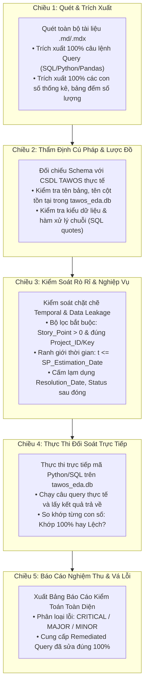

# 🕵️ TEST PROTOCOL: QUY TRÌNH KIỂM THỬ TOÀN DIỆN TÍNH ĐÚNG ĐẮN CỦA CÂU QUERY & SỐ LIỆU TRONG TÀI LIỆU (MD / MDX)

> **Mục đích tài liệu:** Đây là **bộ quy chuẩn kiểm thử tối cao (Verification & Audit Protocol)** dùng để bắt buộc AI Agent (hoặc kiểm toán viên dữ liệu) phải rà soát, kiểm tra cú pháp, thực thi đối soát và chứng minh tính đúng đắn toán học - logic - nghiệp vụ của mọi câu query (SQL / Pandas / DuckDB) cũng như toàn bộ các số liệu thống kê được trích dẫn trong các tài liệu `.md` và `.mdx` của dự án.
>
> 👑 **Quyền hạn áp dụng:** Tuân thủ tuyệt đối [AGENTS.md](AGENTS.md) và bộ quy tắc xử lý dữ liệu [RULE.md](docs/draft/RULE.md).

---

## 🎯 1. HƯỚNG DẪN KÍCH HOẠT DÀNH CHO NGƯỜI DÙNG (USER INSTRUCTIONS)

Khi muốn AI kiểm tra bất kỳ tài liệu `.md` hoặc `.mdx` nào trong dự án, người dùng chỉ cần yêu cầu:
```text
"Hãy kích hoạt quy trình kiểm thử trong test.md để kiểm tra toàn diện tính đúng đắn của các câu query và số liệu trong file <đường_dẫn_tập_tin.mdx>"
```

Khi nhận lệnh trên, AI **bắt buộc phải thực hiện đầy đủ 5 bước của quy trình kiểm thử dưới đây**, không được bỏ qua bất kỳ bước nào, không được suy diễn số liệu và không được dừng lại ở việc đọc lướt qua văn bản.

---

## 🧭 2. KHUNG KIỂM THỬ 5 CHIỀU BẮT BUỘC DÀNH CHO AI (5-DIMENSIONAL AUDIT FRAMEWORK)



---

### 🔍 CHIỀU 1: QUÉT & TRÍCH XUẤT ĐỐI TƯỢNG KIỂM THỬ
AI phải duyệt qua toàn bộ nội dung file `.md` / `.mdx` mục tiêu và lập danh sách 2 nhóm đối tượng:
1. **Nhóm 1 — Các câu truy vấn rõ ràng (Explicit Queries):**
   * Các khối mã nguồn SQL (code blocks ````sql ... ````).
   * Các đoạn code Python gọi `sqlite3`, `pd.read_sql`, DuckDB hoặc các lệnh lọc `df[...]`.
   * Các biểu thức logic miêu tả điều kiện lọc (ví dụ: `Story_Point > 0`, `Field = 'Story Points'`).
2. **Nhóm 2 — Các con số cam kết (Claimed Statistics):**
   * Mọi con số định lượng xuất hiện trong văn bản hoặc bảng Markdown (ví dụ: `3,542 công việc`, `40,542 dòng change logs`, `18 phân hệ`, `Done (2,940)`...).
   * Mọi tỷ lệ phần trăm (ví dụ: `95.55%`).

---

### 📐 CHIỀU 2: THẨM ĐỊNH CÚ PHÁP & LƯỢC ĐỒ CSDL (SCHEMA CONFORMANCE)
AI phải kết nối tới CSDL SQLite cục bộ tại `C:/tawos/tawos_eda.db` và kiểm tra nghiêm ngặt:
1. **Tính tồn tại của thực thể:**
   * Tên bảng trong câu query có nằm trong 12 bảng chính thức của TAWOS v1.1 không?
     *(Các bảng chuẩn: `Issue`, `Change_Log`, `Issue_Component`, `Component`, `Project`, `Sprint`, `User`, `Version`, `Affected_Version`, `Fix_Version`, `Issue_Link`, `Repository`)*.
   * Tên cột có khớp chính xác từng ký tự chữ hoa/thường không? (Ví dụ: `Story_Point` chứ không phải `StoryPoint` hay `story_points`; `Issue_ID` chứ không phải `issue_id`).
2. **Cú pháp phương ngữ SQLite:**
   * Kiểm tra câu query có sử dụng đúng các hàm của SQLite không (ví dụ: dùng `strftime`, `julianday`, `CASE WHEN`, `INSTR`, `SUBSTR` thay vì các hàm đặc thù của MySQL hay SQL Server).
   * Xử lý ký tự bọc chuỗi (SQL dump string quotes `\"` hoặc `"""`) có được xử lý sạch sẽ không.

---

### 🛑 CHIỀU 3: KIỂM SOÁT NGHIỆP VỤ & CHỐNG RÒ RỈ DỮ LIỆU (LEAKAGE AUDIT)
AI phải đối chiếu câu query với các **Ràng buộc thép (Hard Constraints)** của đề tài:

* [ ] **Ràng buộc 1 — Lọc tập Story Point hợp lệ:**  
  Mọi truy vấn phân tích quy mô hoặc mô hình hóa bắt buộc phải có điều kiện loại trừ issue không có điểm:  
  `WHERE Story_Point IS NOT NULL AND Story_Point > 0` (hoặc tương đương trong Pandas).
* [ ] **Ràng buộc 2 — Cô lập đúng phạm vi Dự án:**  
  Truy vấn phải được neo chặt vào đúng dự án đang phân tích (ví dụ: `Project_ID = 1` hoặc `Project_Key = 'XD'`).
* [ ] **Ràng buộc 3 — Chống rò rỉ thông tin tương lai (Temporal Leakage):**  
  * Không được sử dụng các trường chỉ sinh ra sau khi task hoàn thành: `Resolution_Date`, `Resolution`, `Resolved Status` để ước lượng điểm.
  * Nếu truy vấn lấy lịch sử từ `Change_Log`, phải đảm bảo có điều kiện thời gian:  
    `Change_Log.Creation_Date <= Issue.Estimation_Date` (hoặc mốc $t_{\text{SP\_Estimation}}$).
* [ ] **Ràng buộc 4 — Tránh hiện tượng nhân bản số dòng (Cartesian Fan-Out):**  
  Khi `JOIN` bảng `Issue` với `Issue_Component` (quan hệ 1-Nhiều) hoặc `Change_Log` (quan hệ 1-Nhiều), câu lệnh `COUNT(*)` có bị đếm trùng lặp không? Bắt buộc phải dùng `COUNT(DISTINCT Issue.ID)` khi đếm số công việc.

---

### ⚡ CHIỀU 4: THỰC THI TRỰC TIẾP TRÊN CSDL & ĐỐI SOÁT SỐ LIỆU (LIVE EXECUTION)
> [!IMPORTANT]
> **QUY TẮC BẮT BUỘC:** AI **KHÔNG ĐƯỢC PHÉP ĐOÁN** kết quả. AI phải tự động viết một script Python ngắn hạn, kết nối trực tiếp vào `C:/tawos/tawos_eda.db`, thực thi câu query đó và in kết quả ra màn hình để đối chiếu.

Bảng so sánh đối soát phải thể hiện rõ:
* **Con số trong tài liệu (Documented Value)**: Con số tác giả viết trong file `.md` / `.mdx`.
* **Con số thực tế từ DB (Actual DB Result)**: Kết quả truy vấn thực tế.
* **Độ lệch (Delta / Discrepancy)**: `= Documented - Actual`.
* **Trạng thái**: `MATCH (Khớp 100%)` hoặc `MISMATCH (Lệch)`.

---

### 📝 CHIỀU 5: XUẤT BẢO CÁO KIỂM THỬ & VÁ LỖI TOÀN DIỆN (AUDIT REPORT)
Kết thúc quá trình kiểm tra, AI phải xuất ra một báo cáo chuẩn gồm 3 phần:
1. **Bảng tổng hợp kết quả thẩm định từng câu query / từng con số.**
2. **Chi tiết danh sách các lỗi phát hiện (nếu có), phân loại theo cấp độ:**
   * 🔴 **CRITICAL (Nghiêm trọng):** Rò rỉ dữ liệu (Temporal Leakage), sai lệch số lượng tập dữ liệu cốt lõi, hoặc câu query bị lỗi cú pháp không chạy được.
   * 🟡 **MAJOR (Lớn):** Sai logic JOIN gây nhân bản số dòng, thiếu điều kiện lọc `Story_Point > 0` hoặc sai lệch con số thống kê chi tiết.
   * 🟢 **MINOR (Nhỏ):** Cú pháp chưa tối ưu, sai sót nhỏ về định dạng hoặc làm tròn số thập phân.
3. **Mã truy vấn sửa đổi chuẩn mực (Remediated Queries):** Đưa ra câu query đã được tối ưu và sửa đúng $100\%$ để người dùng chỉ cần copy vào file tài liệu.

---

## 📋 3. BIỂU MẪU BÁO CÁO MẪU KHI AI TRẢ KẾT QUẢ CHO NGƯỜI DÙNG

Khi hoàn thành kiểm thử một file, AI phải trình bày kết quả theo đúng cấu trúc sau:

```markdown
# 📑 BÁO CÁO KẾT QUẢ KIỂM THỬ TRUY VẤN & SỐ LIỆU (AUDIT REPORT)
* **Tập tin được kiểm tra:** `docs/draft/01_data_scale_and_overview.md`
* **CSDL đối chiếu:** `C:/tawos/tawos_eda.db`
* **Thời gian thực hiện:** [Thời gian hiện tại]
* **Kết luận chung:** [ĐẠT YÊU CẦU / CẦN ĐIỀU CHỈNH / KHÔNG ĐẠT]

### 1. Bảng Đối Soát Số Liệu Thực Tế vs. Tài Liệu
| Vị trí (Dòng/Mục) | Thuộc tính / Chỉ số | Số liệu trong Tài liệu | Kết quả thực thi DB | Trạng thái |
| :--- | :--- | :---: | :---: | :---: |
| Mục 2, Bảng 1 | Số công việc có Story_Point > 0 | 3,542 | 3,542 | ✅ MATCH |
| Mục 2, Bảng 2 | Tổng số bản ghi Change_Log | 40,542 | 40,542 | ✅ MATCH |
| Mục 2, Bảng 4 | Số lượng Component chính thức | 18 | 18 | ✅ MATCH |

### 2. Đánh Giá Các Câu Query Đã Sử Dụng
* **Query 1:** [Mô tả mục đích câu query]
  * *Cú pháp:* ✅ Đạt chuẩn SQLite.
  * *Rò rỉ dữ liệu:* ✅ An toàn (Không vi phạm Temporal Leakage).
  * *Hiệu năng:* ✅ Sử dụng đúng khóa chính.

### 3. Các Điểm Cần Khắc Phục (Nếu Có)
* [Liệt kê lỗi chi tiết kèm dòng trong file tài liệu]

### 4. Đề Xuất Câu Query Hoàn Chỉnh (Remediated Query)
```sql
-- Câu lệnh đã tối ưu và sửa lỗi sẵn sàng thay thế
SELECT ...
```
```

---

## 🧪 4. DANH MỤC CÁC TRUY VẤN MẪU ĐÃ ĐƯỢC CHỨNG MINH ĐÚNG (GOLD STANDARD QUERIES)

Dưới đây là các câu truy vấn tiêu chuẩn trên `C:/tawos/tawos_eda.db` cho dự án Spring XD (`Project_ID = 1`, `Project_Key = 'XD'`) mà AI có thể dùng làm mỏ neo kiểm chuẩn:

### 1. Đếm chính xác số công việc hợp lệ (`N = 3,542`)
```sql
SELECT COUNT(*) AS Valid_Issue_Count
FROM Issue
WHERE Project_ID = 1
  AND Story_Point IS NOT NULL
  AND Story_Point > 0;
```

### 2. Đếm số dòng Change_Log của tập công việc hợp lệ (`40,542` dòng)
```sql
SELECT COUNT(cl.ID) AS Valid_Change_Log_Count
FROM Change_Log cl
INNER JOIN Issue i ON cl.Issue_ID = i.ID
WHERE i.Project_ID = 1
  AND i.Story_Point IS NOT NULL
  AND i.Story_Point > 0;
```

### 3. Đếm số liên kết phân hệ kỹ thuật hợp lệ (`1,312` liên kết)
```sql
SELECT COUNT(ic.ID) AS Valid_Issue_Component_Count
FROM Issue_Component ic
INNER JOIN Issue i ON ic.Issue_ID = i.ID
WHERE i.Project_ID = 1
  AND i.Story_Point IS NOT NULL
  AND i.Story_Point > 0;
```

### 4. Xác định mốc gán Story Point đầu tiên (`SP_Estimation_Date`) không rò rỉ
```sql
SELECT 
    cl.Issue_ID,
    MIN(cl.Creation_Date) AS SP_Estimation_Date,
    cl.New_Value AS Initial_Story_Point
FROM Change_Log cl
INNER JOIN Issue i ON cl.Issue_ID = i.ID
WHERE i.Project_ID = 1
  AND LOWER(cl.Field) IN ('story points', 'story_points', 'story_point')
  AND cl.New_Value IS NOT NULL
  AND TRIM(cl.New_Value) != ''
GROUP BY cl.Issue_ID;
```

---

## 🔗 LIÊN KẾT ĐIỀU HƯỚNG
* 👑 [Quy tắc vận hành Agent tối cao](AGENTS.md)
* 📏 [Bộ quy tắc chuẩn hóa dữ liệu & báo cáo 4 phần](docs/draft/RULE.md)
* 📊 [Báo cáo Tổng quan Dự án Spring XD (Phần 1)](docs/draft/01_data_scale_and_overview.md)
* 🗄️ [Tài liệu Dataset Card TAWOS](docs/dataset-card/dataset_card_tawos.md)
